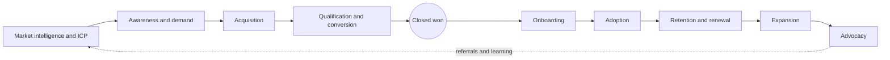
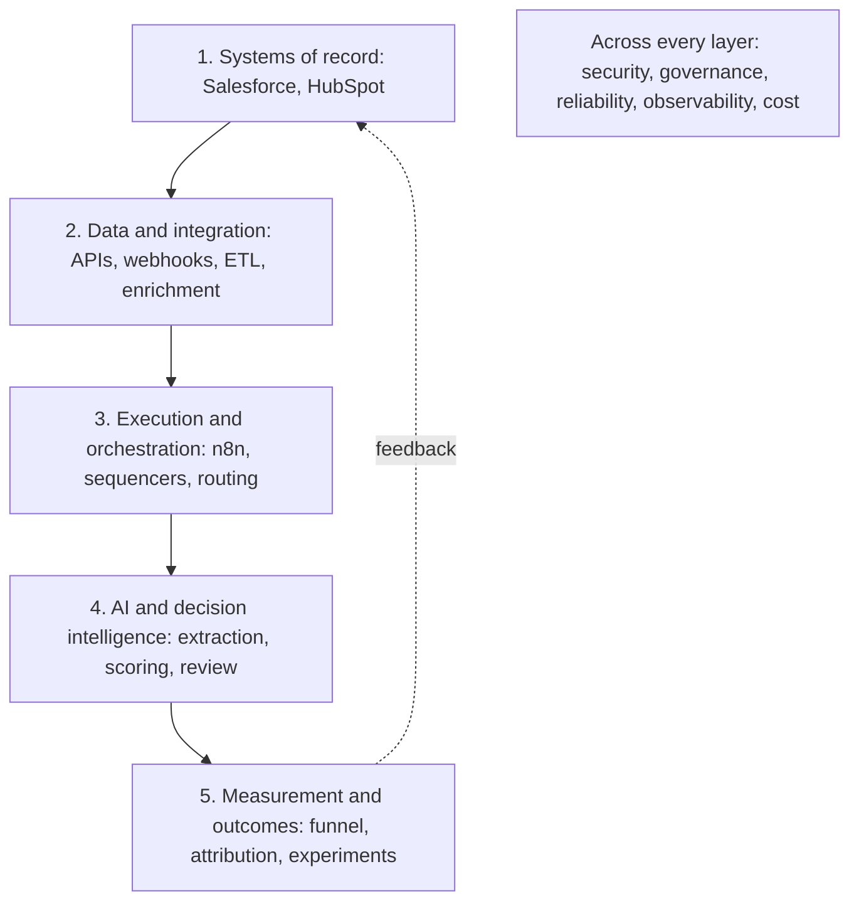

# GTM Systems Engineering

**Engineering measurable revenue growth across the full customer lifecycle.**

I design, build, and improve GTM systems across the entire revenue lifecycle. My approach combines commercial experience, data engineering, automation, experimentation, and applied AI to extend existing infrastructure and deliver measurable business outcomes.

I started in analytical roles (Constellation Energy, AECOM), moved into sales (SDR Team Lead at FiscalNote, Account Executive at Quorum), and built GTM systems for B2B teams and for my own businesses. This repository shows how I reason, what I build, and how I measure it, with every result labeled by how strong its evidence is.

**HOW I THINK → WHAT I BUILD → HOW I MEASURE → WHAT I DELIVER**

## Impact scorecard

| Result | Evidence |
|---|---|
| RouteHero location data: 24,348 commercial-kitchen candidates against 9,464 from the common open alternative in the same area, with 86% phone coverage against about 55% | Measured (engineering) |
| Built AI call analysis in production on Gong and Salesloft call recordings: keyword detection plus AI evaluation of each call, with buyer signals (competitors, objections, next steps) pushed to the CRM | Production work ([rebuild you can run](projects/conversation-intelligence/README.md)) |
| 69 meetings, 27 opportunities and about $436,834 in pipeline in three months as an SDR at FiscalNote, with among the lowest activity on the team: I built Salesforce reports to find true-ICP contacts nobody had contacted | [Self-reported](case-studies/revenue-impact/historical-outbound.md) |
| Built RouteHero's outbound to grease hood cleaning operators, a market nobody was prospecting: about 8,000 contacts, about 4% reply rate, about 40% of replies positive, about 30% of positive replies to sourced pipeline | [Self-reported](case-studies/revenue-impact/historical-outbound.md#outbound-to-grease-hood-cleaning-operators) |
| Started and ran an Amazon FBA wholesale business that grossed about $3M a year | [Zero-to-one case study](case-studies/zero-to-one/amazon-wholesale.md) |

Full scorecard, metric definitions and attribution rules: **[IMPACT.md](IMPACT.md)**. What each historical figure still needs: [evidence checklist](EVIDENCE_CHECKLIST.md).

| Label | Meaning |
|---|---|
| Measured / Verified | Source record, definition and attribution method attached |
| Self-reported | A real result I can describe and defend; source records not attached |
| Historical / Pending Verification | Reported figure still missing definitions or sources |
| Synthetic Demonstration | Measured on invented data; proves a method, not a business result |
| Proposed Experiment | Designed with a fixed decision rule; not yet run |
| Exploratory Research | Investigation with known validity problems |

## Three pillars

**How I think.** An eight-step method from business objective to enablement, with the real decisions that show each step. [THINKING.md](THINKING.md) · [decision records](decision-examples/README.md) · [scenarios](decision-examples/scenarios.md) · [failure analysis](decision-examples/failure-analysis.md)

**What I build.** A live territory intelligence product, a set of GTM automations rebuilt to inspect and run, and four runnable demos with tests. [Featured projects](#featured-projects) · [architecture](docs/03-data-architecture/architecture-layers.md)

**What I deliver.** Results with definitions, sources and attribution, separated from simulations. [IMPACT.md](IMPACT.md) · [case studies](case-studies/README.md) · [experiments](case-studies/experimentation/message-rotation.md)

## Featured projects

| Project | Status | Business problem | Evidence |
|---|---|---|---|
| [RouteHero](projects/routehero/README.md) | Live application, 8 customers ([app](https://routepro-mu.vercel.app/), [site](https://routehero.io/)) | Field-service operators cannot see which nearby sites are worth the most to call first | Data-source measurements, four decision records, scoring logic from the code |
| [GTM Learning Engine](projects/gtm-learning-engine/README.md) | Public repo, synthetic data | Signal-based outbound that learns which message wins per segment | Runnable rebuild of nine workflows |
| [Conversation intelligence](projects/conversation-intelligence/README.md) | Runnable demo | Buyer signals stay trapped in call recordings | Validated, grounded extraction with review routing and idempotent CRM operations |
| [AI evaluation](projects/ai-evaluation/README.md) | Runnable demo | AI demos that nobody measures | Precision, recall, failure classes, review load, latency, cost, regression gates |
| [Lookalike and propensity model](projects/lookalike-model/README.md) | Runnable demo | Static ICPs are written from memory, not from who bought | Learned model beats the written ICP (AUC 0.66 vs 0.58), leakage trap, tiered outreach queue with suppression and a holdout |
| [Account data model](projects/gtm-ontology/README.md) | Runnable demo | Duplicate and mis-modeled accounts break routing, territory and AI answers | Identity resolution with lineage, semantic metrics, graph view |

Secondary: [SPX range study](research/spx-forecasting/README.md), exploratory research kept as a worked example of data leakage.

## Revenue bowtie

GTM engineering covers the whole lifecycle, not only outbound. The bowtie connects every project and document here.



[Bowtie overview](docs/02-revenue-bowtie/README.md) · [all nine stages in detail](docs/02-revenue-bowtie/stages.md)

## GTM systems architecture

Extend existing systems when practical. Build custom where it creates real differentiation or fills a genuine capability gap.



[Architecture layers](docs/03-data-architecture/architecture-layers.md) · [build vs buy vs extend](docs/03-data-architecture/build-buy-extend.md)

## Engineering methodology

1. Understand the business objective: start from the revenue target and work backward across retention, expansion and new logos
2. Investigate existing infrastructure and data
3. Identify the root cause or constraint
4. Evaluate build vs buy vs extend
5. Form a measurable hypothesis
6. Prototype and validate
7. Measure operational and business outcomes
8. Iterate, document and enable others

Each step, with questions, criteria, risks and real examples: [THINKING.md](THINKING.md)

## Technical knowledge base

| Section | Covers |
|---|---|
| [01 GTM foundations](docs/01-gtm-foundations/README.md) | TAM/SAM/SOM, ICP, personas, segmentation, pricing, CAC, LTV, payback, velocity, coverage, territory, conversion economics. Also [GTM motions](docs/01-gtm-foundations/gtm-motions.md) |
| [02 Revenue bowtie](docs/02-revenue-bowtie/README.md) | The nine lifecycle stages with metrics, systems, bottlenecks and engineering opportunities |
| [03 Data architecture](docs/03-data-architecture/README.md) | CRM data models, identity resolution, APIs, webhooks, ETL/ELT, sync, idempotency, retries, validation |
| [04 GTM engineering](docs/04-gtm-engineering/README.md) | Enrichment, signals, scoring, territory, routing, health, expansion, observability |
| [05 AI and agents](docs/05-ai-and-agents/README.md) | Structured outputs, tools, RAG, agents versus workflows, human review, prompt injection, evals, cost |
| [06 Analytics and prediction](docs/06-analytics-and-prediction/README.md) | Funnels, cohorts, attribution, experiment design, forecasting, calibration, leakage |
| [07 Governance and operations](docs/07-governance-and-operations/README.md) | Privacy, compliance, data licensing, access control, audit, reliability, vendor evaluation |
| [08 Product marketing and growth](docs/08-product-marketing-and-growth/README.md) | ICP, positioning, messaging, competitive intelligence, win/loss, messaging experiments. Also [SEO and GEO](docs/08-product-marketing-and-growth/seo-and-geo.md) |

## Technology stack

Grouped by function, with depth of use stated per tool in [technology ecosystem](docs/03-data-architecture/technology-ecosystem.md).

| Function | Tools |
|---|---|
| CRM and systems of record | Salesforce, HubSpot |
| Engagement and conversation intelligence | Gong, Salesloft, Outreach, Instantly, HeyReach |
| GTM intelligence and enrichment | Clay, Apollo, Prospeo, ZoomInfo, Serper, Exa, Apify, Overture Maps |
| AI | Claude, OpenAI |
| Orchestration | n8n, Zapier |
| Custom engineering | Python, TypeScript, Next.js, SQL, PostgreSQL, PostGIS, REST APIs, webhooks, MCP |

## Run the demos

Python 3.10 or newer, standard library only, no credentials.

```bash
python tests/run_all.py     # every project's tests plus link and style checks
```

Each project README has its own commands.

## Privacy and accuracy

No employer code, client data, customer records, call transcripts or credentials are in this repository. All demo data is synthetic. Results are published only with their evidence label. See [CONTRIBUTING.md](CONTRIBUTING.md) for the rules every addition follows.

[LinkedIn](https://www.linkedin.com/in/tamnguyen789)
