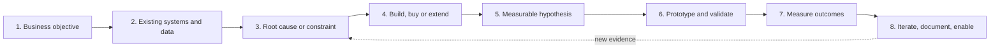
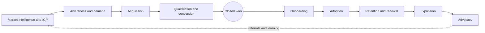
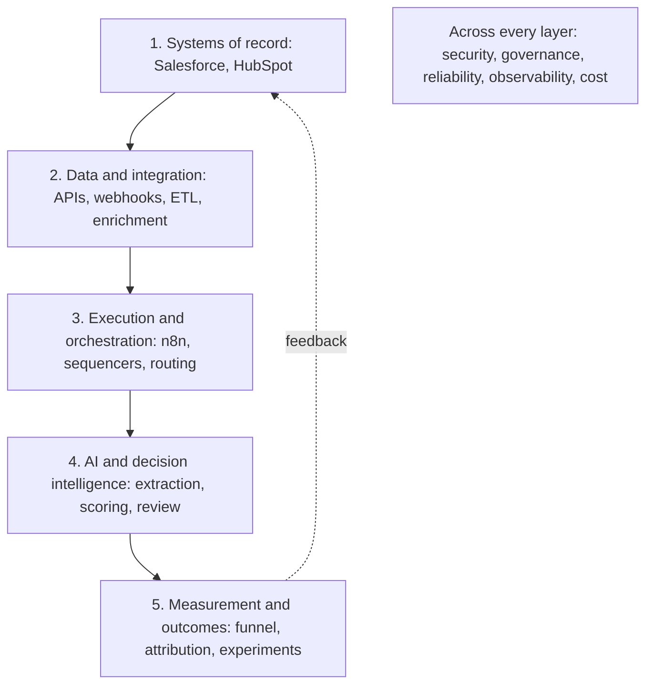

# GTM Systems Engineering

**GTM systems I have built across the full customer lifecycle.**

GTM means go-to-market: how a company finds, wins and keeps customers. I started in analytical roles (Constellation Energy, AECOM), moved into sales (SDR Team Lead at FiscalNote, Account Executive at Quorum), and have built GTM systems the whole way: for the teams I worked on, for clients, and for my own businesses. This repository shows what I built, how it works, and how I think about building it.

## How I think

Most requests arrive as a solution: "we need an AI SDR", "build us a lead score", "clean up the CRM". My job is to find the business problem under the request, check what already exists, and pick the cheapest change that moves a number someone cares about. Here is the method, step by step, with a real decision from this repository for each step.



### 1. Understand the business objective

Start from the company's North Star: the revenue target for the year or quarter. Work backward from it. Cover both sides of the bowtie: winning new customers on the left, keeping and growing them on the right.

1. **Split the target.** New-customer revenue needed = target - (starting annual recurring revenue, or ARR, x net revenue retention). Net revenue retention (NRR) is how much of last year's customer revenue you keep, after losses and upsells. Current customers cover part of the target before any new pipeline is built.
2. **Run the funnel math for each part.** For new customers: how many deals, opportunities, meetings and contacts you need. For current customers: which renewals are at risk and where upsells are.
3. **Check it against what the team can actually do.** Count the ideal customer profile (ICP) accounts available, how much each rep can handle, and the conversion rates you really see. The gap between what the target needs and what the team can deliver is the problem to solve.
4. **Find the cheapest fix per dollar of gap.** Options are keeping more customers, growing them, converting better, or adding volume. Fund one or two, not all of them.

Keeping five more points of customer revenue (NRR) can remove dozens of opportunities from the new-business plan. Worked example: [start from the company's revenue target](docs/01-gtm-foundations/README.md#start-from-the-companys-revenue-target).

| | |
|---|---|
| Questions | What is the revenue target? How much must come from new customers and how much from current ones? Which number should move: pipeline, meetings, conversion, retention, cost per meeting, hours? By how much, by when? Who owns that number? What happens if nothing is built? |
| Evidence sought | The number today and how it is calculated |
| Alternatives | Writing the request as a number often shows a non-technical fix, like a process change or a training gap |
| Tradeoffs | A sharper goal versus starting sooner |
| Decision criteria | A goal is ready when it names a number, its current value and an owner |
| Risks | Building what was asked instead of what is needed; chasing a stand-in number (replies) instead of the real goal (qualified meetings) |
| Would change my approach | No one can say what the number is today. Then measuring it is the first job |

In practice: RouteHero's question was never "show restaurants on a map". It was "which kitchens near the shop are worth the most to call first". That put job size and distance at the center of the score ([project](projects/routehero/README.md)).

### 2. Investigate existing infrastructure and data

| | |
|---|---|
| Questions | Which system holds the official value for each field? What data exists, how complete is it, and who enters it? What was tried before, and why did it stop? |
| Evidence sought | How often each field is filled in, how many duplicates exist, how systems connect, vendor contracts and their terms |
| Alternatives | Changing a setting in a tool you already have, before buying or building anything new |
| Tradeoffs | Time spent looking versus the risk of building on bad data |
| Decision criteria | Know where each input comes from and how much to trust it before using it |
| Risks | Assuming you are starting from scratch; trusting a vendor's claims about how much data they have |
| Would change my approach | Data so poor that the first project has to be cleaning it up |

In practice: a live test of a contact-data provider showed it returned people at headquarters addresses, not at individual sites. That ruled it out for finding kitchens, and kept it as a later option for adding contact details ([ADR 0001](decision-examples/adr/0001-routehero-data-source.md)). An ADR, or architecture decision record, is a short write-up of one decision and why it was made.

### 3. Identify the root cause or constraint

| | |
|---|---|
| Questions | Where in the funnel do people drop off? Is the problem volume, quality, timing or conversion? What is the one thing holding everything back: data, email delivery, licensing, people, budget? |
| Evidence sought | Conversion by stage, by segment and by source; failures read one by one |
| Alternatives | Several possible causes, tested cheapest first |
| Tradeoffs | Digging deeper versus acting sooner |
| Decision criteria | The cause explains the data and predicts what a fix would change |
| Risks | Fixing a symptom, like rewriting copy when the real problem is that emails are not reaching inboxes |
| Would change my approach | Two causes that both explain the same drop: test them separately |

In practice: what held RouteHero back was data licensing, not code. Licensed map services forbid storing their data, which would have made the shared database illegal ([ADR 0001](decision-examples/adr/0001-routehero-data-source.md)).

### 4. Evaluate build versus buy versus extend

| | |
|---|---|
| Questions | Do the current tools already do this? Is there a mature product to buy? Does doing this better help win deals? |
| Evidence sought | The full cost over time, vendor terms, who owns the data, who maintains it |
| Alternatives | Extend what exists, buy, build, or do nothing |
| Tradeoffs | Control and standing out versus upkeep and time |
| Decision criteria | The [build vs buy vs extend](docs/03-data-architecture/build-buy-extend.md) scorecard, with weights set before scoring |
| Risks | Building because it is interesting, not because it pays; buying a tool nobody uses |
| Would change my approach | A price or terms change, or a requirement that becomes a way to stand out |

In practice: RouteHero buys login and maps, and builds the territory engine, because only the engine is the product.

### 5. Form a measurable hypothesis

| | |
|---|---|
| Questions | If we change X for segment Y, which number moves, by how much, and why? What result would prove us wrong? |
| Evidence sought | The current value and the smallest change worth acting on |
| Alternatives | Several ideas, ranked by expected payoff and cost to test |
| Tradeoffs | How big a change you hope for versus how many contacts you need to detect it |
| Decision criteria | The rule for deciding is written down before the test |
| Risks | An idea that cannot fail; switching to a different number after seeing results |
| Would change my approach | The test needs more contacts than you have. Then test a bigger change, or a faster stand-in number known to track the goal |

In practice: the [proposed AI experiment](case-studies/experimentation/proposed-ai-experiment.md) fixes its number (qualified meetings per 1,000 delivered emails), its cost math and its decision rule before launch.

### 6. Prototype and validate

| | |
|---|---|
| Questions | What is the smallest version that tests the idea? How do we check it is right before a buyer or rep sees the output? |
| Evidence sought | Examples with known right answers, failures, and unusual cases from real data |
| Alternatives | In this order: plain code with fixed rules, a single AI call, a step-by-step workflow, an AI agent |
| Tradeoffs | Handling more cases versus being dependable |
| Decision criteria | Errors can be spotted and fixed; every output can be explained |
| Risks | A demo that works on three examples; AI output written into the CRM without checking |
| Would change my approach | Testing shows the simple version is enough: stop there |

In practice: the [conversation intelligence](projects/conversation-intelligence/README.md) pipeline throws out any finding whose quote is not actually in the call transcript. It also sends high-stakes findings to a person, however sure the AI is.

### 7. Measure operational and business outcomes

| | |
|---|---|
| Questions | Did the work change happen (people using it, fields filled in, time saved)? Did the sales number move? Did the change cause the movement? |
| Evidence sought | Before and after, compared against a group held back on purpose. Pipeline the work created is kept apart from pipeline it only touched |
| Alternatives | A held-back group, before and after with a comparison group, or matched groups |
| Tradeoffs | Being rigorous versus being fast; a held-back group costs some volume |
| Decision criteria | A result is reported with its definition, time period, source and other things that could explain it, or not at all |
| Risks | Counting pipeline you only touched as pipeline you created; crediting AI for a result that a list change produced |
| Would change my approach | People are not using it. Fix that before judging the outcome |

In practice: the [evaluation harness](projects/ai-evaluation/README.md) reports how many findings go to a person for review next to F1, a single score for how accurate and how thorough the extractor is. An extractor that is usually right but sends most findings to a person still costs labor, and F1 hides that.

### 8. Iterate, document and enable others

| | |
|---|---|
| Questions | What did we learn? What should change next? Can the team run this without me? |
| Evidence sought | Reviewer decisions, failure logs, user feedback, trends in the numbers |
| Alternatives | Improve it, scale it, or retire it |
| Tradeoffs | New features versus making what exists sturdier |
| Decision criteria | Written decision records, how-to guides, and an owner for every workflow |
| Risks | A system that depends on one person; cutoffs nobody looks at again |
| Would change my approach | A number that stops moving: go back to step 3 |

In practice: removing one factor from the RouteHero score left Tier A (the top group of accounts) empty. The cutoffs were reset from how the scores actually spread out, and the failure was written up so the next change checks that spread first ([ADR 0004](decision-examples/adr/0004-routehero-remove-circular-factor.md), [failure analysis](decision-examples/failure-analysis.md)).

### When an AI agent is not the answer

Go only as far as the problem needs: plain code with fixed rules first, then a step-by-step workflow, then a single AI call, then an AI agent. Routing, territory assignment, removing exact duplicates, score math and CRM updates are all plain code. AI earns its cost on language and unclear cases. An agent earns its cost only when the steps cannot be written down in advance and its mistakes can be caught and undone. [Scenario 5](decision-examples/scenarios.md#5-introducing-an-ai-agent) works through an "AI SDR" request this way.

Decision records behind these examples: [decision records](decision-examples/README.md) · [scenarios](decision-examples/scenarios.md) · [failure analysis](decision-examples/failure-analysis.md)

## What I have built

| Build | What it does |
|---|---|
| [RouteHero](projects/routehero/README.md) | Territory tool for field-service companies. Finds every commercial kitchen in an operator's territory, estimates what each is worth, and ranks which to call first. Live with 8 customers ([app](https://routepro-mu.vercel.app/), [site](https://routehero.io/)) |
| RouteHero outbound | Outbound to grease hood cleaning operators, a market nobody was prospecting: about 8,000 contacts, about 4% reply rate. [How it works](case-studies/revenue-impact/historical-outbound.md#outbound-to-grease-hood-cleaning-operators) |
| AI call analysis | Gong and Salesloft call recordings scanned with keyword search and AI. Competitors, objections and next steps are sent to the CRM. [Runnable rebuild](projects/conversation-intelligence/README.md) |
| AI company classification | Sorts about 50,000 companies into categories overnight at about 98% accuracy, checked by automatic tests and human spot-checks, refreshed every 30 days |
| Account research script | Looked at every account in a rep's book and matched it to similar current customers. Research time dropped from half a day to about 30 minutes |
| Lookalike targeting | Same industry plus same job titles means the same interests. Added 589 ICP contacts to the CRM by searching titles in order of best match. [Runnable model](projects/lookalike-model/README.md) |
| Closed-lost expansion map | Mapped how national organizations and their state chapters bought from each other, using lost deals and old calls. Turned it into about $300K of expansion pipeline. [How it works](case-studies/revenue-impact/historical-outbound.md#quorum-expansion-whitespace-through-parent-and-child-accounts) |
| Salesforce targeting reports | Found ideal-fit contacts nobody had reached out to: 69 meetings and 27 opportunities in three months at FiscalNote. [How it works](case-studies/revenue-impact/historical-outbound.md) |
| Competitor detection | Scanned 50,000+ websites in about 3 days and found 5,000+ accounts using a rival product |
| Outbound infrastructure | About 500K emails a month with under 3% bouncing, on Smartlead, Instantly and Clay |
| [GTM Learning Engine](projects/gtm-learning-engine/README.md) | Nine outbound workflows built for RouteHero, clients and Quorum, rebuilt so anyone can run them |
| [Account data model](projects/gtm-ontology/README.md) | How companies, their branches, contacts and deals connect, with duplicate matching. Runnable |
| [AI evaluation](projects/ai-evaluation/README.md) | A grading system for the call analysis: checks its answers against an answer key |
| [Amazon FBA wholesale business](case-studies/zero-to-one/amazon-wholesale.md) | Started and ran it; it grossed about $3M a year |

Secondary: [SPX range study](research/spx-forecasting/README.md), a TradingView indicator. I keep it as a worked example of data leakage, which is when a test accidentally peeks at the answer it is supposed to predict.

## Revenue bowtie

GTM work covers the whole customer lifecycle, not only outbound. The bowtie is the shape of that lifecycle: winning customers on the left, keeping and growing them on the right. It ties together every project and document here.



[Bowtie overview](docs/02-revenue-bowtie/README.md) · [all nine stages in detail](docs/02-revenue-bowtie/stages.md)

## GTM systems architecture

Extend the systems a company already has when that works. Build custom only where it makes the company stand out or fills a real gap.



In plain terms, from top to bottom: the CRM that holds the official records; the connections that move and fill in data between tools; the tools that send emails and route leads; the AI that reads, scores and flags; and the reporting that shows what worked. Security, rules, uptime, monitoring and cost apply to all of them.

[Architecture layers](docs/03-data-architecture/architecture-layers.md) · [build vs buy vs extend](docs/03-data-architecture/build-buy-extend.md)

## Technical knowledge base

| Section | Covers |
|---|---|
| [01 GTM foundations](docs/01-gtm-foundations/README.md) | Market size (TAM/SAM/SOM), ICP, buyer personas, segments, pricing, cost to win a customer (CAC), customer lifetime value (LTV), payback, deal speed, coverage, territory, conversion economics. Also [GTM motions](docs/01-gtm-foundations/gtm-motions.md) |
| [02 Revenue bowtie](docs/02-revenue-bowtie/README.md) | The nine lifecycle stages, with numbers, systems, bottlenecks and where engineering helps |
| [03 Data architecture](docs/03-data-architecture/README.md) | How CRM data is organized, matching records for the same person or company, APIs, webhooks, moving data between systems (ETL/ELT), sync, safe re-runs that create no duplicates, retries, checking data |
| [04 GTM engineering](docs/04-gtm-engineering/README.md) | Adding data to records, buying signals, scoring, territory, routing, account health, expansion, monitoring |
| [05 AI and agents](docs/05-ai-and-agents/README.md) | Getting AI answers in a fixed format, tools, answering from your own documents (RAG), agents versus workflows, human review, prompt injection (hidden instructions that hijack an AI), testing AI, cost |
| [06 Analytics and prediction](docs/06-analytics-and-prediction/README.md) | Funnels, groups over time (cohorts), credit for results (attribution), test design, forecasting, whether predicted percentages match reality, data leakage |
| [07 Governance and operations](docs/07-governance-and-operations/README.md) | Privacy, compliance, data licensing, who can see what, audit trails, uptime, vendor evaluation |
| [08 Product marketing and growth](docs/08-product-marketing-and-growth/README.md) | ICP, positioning, messaging, competitor research, win/loss, message tests. Also [SEO and GEO](docs/08-product-marketing-and-growth/seo-and-geo.md) (showing up in search engines and AI answers) |

## Technology stack

Grouped by what each tool does. How deeply I have used each one is in [technology ecosystem](docs/03-data-architecture/technology-ecosystem.md).

| Function | Tools |
|---|---|
| CRM and systems of record | Salesforce, HubSpot |
| Engagement and conversation intelligence | Gong, Salesloft, Outreach, Smartlead, Instantly, HeyReach |
| GTM intelligence and enrichment | Clay, Apollo, Prospeo, ZoomInfo, Serper, Exa, Apify, Overture Maps |
| AI | Claude, OpenAI |
| Orchestration | n8n, Zapier |
| Custom engineering | Python, TypeScript, Next.js, SQL, PostgreSQL, PostGIS, REST APIs, webhooks, MCP |

## Run the demos

You need Python 3.10 or newer. Nothing else to install, and no passwords or API keys.

```bash
python tests/run_all.py     # every project's tests plus link and style checks
```

Each project README has its own commands.

## Privacy and accuracy

No employer code, client data, customer records, call transcripts or credentials are in this repository. The runnable demos use sample data.

[LinkedIn](https://www.linkedin.com/in/tamnguyen789)
