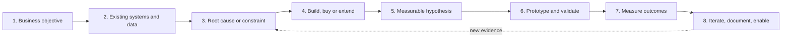

# How I think through GTM engineering problems

Most GTM requests arrive as a solution: "we need an AI SDR", "build us a lead score", "clean up the CRM". The work is to find the business problem under the request, check what already exists, and pick the cheapest change that moves a number someone cares about. This is the method, step by step, with the decisions in this repository that show each step in practice.

## 1. Understand the business objective

Start from the company's North Star: the revenue target for the year or quarter. Work backward from it across both sides of the bowtie.

1. **Decompose the target.** New-logo ARR needed = target - (starting ARR x net revenue retention). The existing base does part of the work before any pipeline is built.
2. **Run the funnel math for each part.** New logos: deals, opportunities, meetings, contacts. Existing base: renewals at risk, expansion opportunities.
3. **Check it against bottom-up capacity.** ICP accounts available, rep capacity, observed conversion rates. The gap between what the target demands and what capacity supports is the problem to solve.
4. **Find the cheapest lever per dollar of gap.** Retention, expansion, conversion rates or volume. Fund one or two, not all of them.

A five-point change in NRR can remove dozens of opportunities from the new-business plan. Worked example: [start from the company's revenue target](docs/01-gtm-foundations/README.md#start-from-the-companys-revenue-target).

| | |
|---|---|
| Questions | What is the revenue target, and how much of it must come from new logos versus the existing base? What number should move: pipeline, meetings, conversion, retention, cost per meeting, hours? By how much, by when? Who owns that number? What happens if nothing is built? |
| Evidence sought | The current value of the metric and how it is calculated today |
| Alternatives | Restating the request as a metric often shows a non-technical fix (a process change, a training gap) |
| Tradeoffs | Precision of the goal versus speed of starting |
| Decision criteria | A goal is ready when it names a metric, a baseline and an owner |
| Risks | Building to the request instead of the outcome; optimizing a proxy (replies) instead of the goal (qualified meetings) |
| Would change my approach | No one can say what the metric is today: then measurement is the first deliverable |

In practice: RouteHero's question was never "show restaurants on a map". It was "which kitchens near the shop are worth the most to call first", which put job size and distance at the center of the score ([project](projects/routehero/README.md)).

## 2. Investigate existing infrastructure and data

| | |
|---|---|
| Questions | Which systems are of record for which fields? What data exists, how complete is it, who enters it? What has been tried before, and why did it stop? |
| Evidence sought | Field fill rates, duplicate rates, integration paths, vendor contracts and their terms |
| Alternatives | A configuration change in an existing tool versus anything new |
| Tradeoffs | Investigation time versus the risk of building on bad data |
| Decision criteria | Know where each input comes from and how much to trust it before using it |
| Risks | Assuming greenfield; trusting vendor coverage claims |
| Would change my approach | Data so poor that the first project must be data quality |

In practice: a live test of a contact-data provider showed it returns people at headquarters addresses, not sites, which ruled it out for discovery and kept it as a later enrichment option ([ADR 0001](decision-examples/adr/0001-routehero-data-source.md)).

## 3. Identify the root cause or constraint

| | |
|---|---|
| Questions | Where in the funnel is the drop? Is it volume, quality, timing or conversion? What is the binding constraint: data, deliverability, licensing, labor, budget? |
| Evidence sought | Conversion by stage, by segment, by source; failure cases read one by one |
| Alternatives | Several plausible causes, tested cheapest first |
| Tradeoffs | Depth of diagnosis versus time to act |
| Decision criteria | The cause explains the data and predicts what a fix would change |
| Risks | Fixing a symptom, such as rewriting copy when the problem is deliverability |
| Would change my approach | Two causes explaining the same drop: test them separately |

In practice: the binding constraint for RouteHero was data licensing, not code. Licensed map APIs prohibit storing their content, which would have made the shared database illegal ([ADR 0001](decision-examples/adr/0001-routehero-data-source.md)).

## 4. Evaluate build versus buy versus extend

| | |
|---|---|
| Questions | Does the current stack already do this? Is there a mature product? Does doing this better win deals? |
| Evidence sought | Total cost of ownership, vendor terms, data ownership, who maintains it |
| Alternatives | Extend, buy, build, or do nothing |
| Tradeoffs | Control and differentiation versus maintenance and time |
| Decision criteria | The [build vs buy vs extend](docs/03-data-architecture/build-buy-extend.md) scorecard, weights set before scoring |
| Risks | Building for interest rather than value; buying a tool nobody adopts |
| Would change my approach | Price or terms changes, or a requirement becoming a differentiator |

In practice: RouteHero buys auth and maps and builds the territory engine, because only the engine is the product.

## 5. Form a measurable hypothesis

| | |
|---|---|
| Questions | If we change X for segment Y, which metric moves, by how much, and why? What result would prove it wrong? |
| Evidence sought | A baseline and the minimum effect worth acting on |
| Alternatives | Several hypotheses ranked by expected value and cost to test |
| Tradeoffs | Ambition of the effect versus the sample needed to detect it |
| Decision criteria | The decision rule is written before the test |
| Risks | A hypothesis that cannot fail; changing the metric after seeing results |
| Would change my approach | A required sample larger than the available volume: test a bigger change or a faster proxy with a known link to the goal |

In practice: the [proposed AI experiment](case-studies/experimentation/proposed-ai-experiment.md) fixes its metric (qualified meetings per 1,000 delivered), its cost math and its decision rule before launch.

## 6. Prototype and validate

| | |
|---|---|
| Questions | What is the smallest version that tests the hypothesis? How will correctness be checked before a buyer or rep sees the output? |
| Evidence sought | Labeled examples, failure cases, edge cases from real data |
| Alternatives | Deterministic rules, a single model call, a workflow, an agent, in that order |
| Tradeoffs | Coverage versus reliability |
| Decision criteria | Errors are detectable and recoverable; outputs are explainable |
| Risks | A demo that works on three examples; model output written to the CRM without validation |
| Would change my approach | Validation shows the simple version is enough: stop there |

In practice: the [conversation intelligence](projects/conversation-intelligence/README.md) pipeline rejects any signal whose quote is not in the transcript, and sends high-impact signals to a person whatever the confidence.

## 7. Measure operational and business outcomes

| | |
|---|---|
| Questions | Did the operational change happen (adoption, fill rate, time saved)? Did the GTM metric move? Is the movement caused by the change? |
| Evidence sought | Before and after with a control or holdout; sourced versus influenced kept apart |
| Alternatives | Holdout test, pre/post with a comparison group, matched cohorts |
| Tradeoffs | Rigor versus speed; holdouts cost some volume |
| Decision criteria | A result is reported with its definition, period, source and confounders, or not at all |
| Risks | Claiming influenced pipeline as sourced; crediting AI for a result a list change produced |
| Would change my approach | Adoption is low: fix adoption before judging the outcome |

In practice: the [evaluation harness](projects/ai-evaluation/README.md) reports the review share alongside F1, because a precise extractor that sends most signals to a person has a labor cost the F1 hides. [IMPACT.md](IMPACT.md) keeps historical results labeled until they have source records.

## 8. Iterate, document and enable others

| | |
|---|---|
| Questions | What did we learn? What should change next? Can the team run this without me? |
| Evidence sought | Reviewer decisions, failure logs, user feedback, metric trends |
| Alternatives | Iterate, scale, or retire |
| Tradeoffs | New features versus hardening what exists |
| Decision criteria | Documented decision records, runbooks and an owner for every workflow |
| Risks | A system that depends on one person; thresholds nobody revisits |
| Would change my approach | A metric that stops moving: go back to step 3 |

In practice: when removing a factor from the RouteHero score left Tier A empty, the thresholds were reset from the measured distribution, and the failure was written up so the next change re-checks the distribution first ([ADR 0004](decision-examples/adr/0004-routehero-remove-circular-factor.md), [failure analysis](decision-examples/failure-analysis.md)).

## When an AI agent is not the answer

Escalate only as far as the problem requires: deterministic code, then a structured workflow, then a single model call, then an agent. Routing, territory assignment, exact-key dedupe, score arithmetic and CRM writes are code. A model earns its cost on language and ambiguity, and an agent only when the steps cannot be specified in advance and errors can be caught and undone. [Scenario 5](decision-examples/scenarios.md#5-introducing-an-ai-agent) works through an "AI SDR" request this way.

## Related

- [Decision records and scenarios](decision-examples/README.md)
- [IMPACT.md](IMPACT.md)
- [AI and agents](docs/05-ai-and-agents/README.md)
