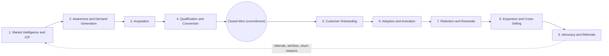

# Revenue bowtie

The revenue bowtie is the business model this repo is built around. Every project, metric and system maps to one of its stages. This page explains what the stages are, why the right side of the bowtie (everything after the contract is signed) is where recurring revenue grows, and which number and which tool own each stage. The full stage-by-stage detail is in [stages.md](stages.md).

## Why a bowtie and not a funnel

A funnel ends at closed-won. For a business that earns revenue every month or year, that is only the halfway point. The customer has signed, but most of what they will ever pay has not come in yet. The bowtie keeps the left side (winning the customer) and adds a right side (keeping and growing them). The two sides meet at the knot, where the contract is signed.

Treating closed-won as the finish line causes the same problems again and again. Sales sells to accounts that churn (cancel) within a year. Onboarding inherits promises it never heard. Expansion depends on whoever happens to notice a jump in usage.

## The nine stages

The left side narrows: many accounts in the market, fewer engaged, fewer qualified, one signature. The right side widens: one signed account becomes more users, more products, more revenue and new referred accounts.

The dotted line is the feedback loop. Happy customers send referrals. And every result on the right side (who stayed, who grew, who left and why) should flow back to correct the ICP (ideal customer profile) on the left.

## Why the right side compounds

Revenue from a new customer is added once. Recurring revenue comes in again every period, and it grows or shrinks based on how existing customers behave. Two formulas describe it. ARR means annual recurring revenue. Expansion is existing customers spending more. Contraction is customers spending less. Churn is customers leaving.

| Metric | Formula | Reads as |
|---|---|---|
| Net revenue retention (NRR) | (Starting ARR + expansion - contraction - churn) / starting ARR | Revenue from a fixed cohort a year later, including growth |
| Gross revenue retention (GRR) | (Starting ARR - contraction - churn) / starting ARR | Revenue kept from the cohort, excluding growth; cannot exceed 100% |

GRR measures how leaky the bucket is. NRR measures whether the existing customer base grows on its own. Watch for high NRR with low GRR. It means a few large accounts are growing fast enough to cover for customers who leave, and that hides a retention problem.

### Compounding example

A cohort (a group of customers who signed in the same period) starts with $1,000,000 ARR. No new customers are added.

| NRR | Year 1 | Year 2 | Year 3 |
|---|---|---|---|
| 90% | $900,000 | $810,000 | $729,000 |
| 100% | $1,000,000 | $1,000,000 | $1,000,000 |
| 110% | $1,100,000 | $1,210,000 | $1,331,000 |

For one cohort, the gap between 90% and 110% NRR is $602,000 by year 3. Every new cohort stacks on top, so the gap in total ARR gets wider each year. That is why right-side systems (onboarding, usage tracking, churn risk, expansion signals) matter as much to revenue as prospecting does.

## Stage summary

A few tool names in the table: the warehouse is the central database that holds a copy of all company data. A sequencer sends a series of outreach emails. CRM is the customer relationship management system. CPQ (configure, price, quote) is the tool that builds quotes. A CS platform is the tool customer success teams use to track account health.

| # | Stage | Primary metric | Formula | Primary system | Related project |
|---|---|---|---|---|---|
| 1 | Market intelligence and ICP | ICP win-rate lift | Win rate on ICP accounts / win rate on non-ICP accounts | Warehouse, data vendors, account scoring | [RouteHero](../../projects/routehero/README.md), [GTM ontology](../../projects/gtm-ontology/README.md) |
| 2 | Awareness and demand generation | Engaged ICP account rate | ICP accounts with a qualifying engagement / ICP accounts targeted | Sequencer, marketing automation, ad platforms, web analytics | [GTM learning engine](../../projects/gtm-learning-engine/README.md) |
| 3 | Acquisition | Cost per meeting held | Channel cost / meetings held | Sequencer, scheduler, routing, CRM | [RouteHero](../../projects/routehero/README.md), [GTM learning engine](../../projects/gtm-learning-engine/README.md) |
| 4 | Qualification and conversion | Win rate by value | Closed-won value / closed (won + lost) value | CRM, conversation intelligence, CPQ | [Conversation intelligence](../../projects/conversation-intelligence/README.md), [GTM learning engine](../../projects/gtm-learning-engine/README.md) |
| Knot | Closed-won (commitment) | Handoff completeness | Required handoff fields populated / required handoff fields | CRM, CPQ, contract system | [GTM ontology](../../projects/gtm-ontology/README.md) |
| 5 | Customer onboarding | Time to first value | Median of (first value event date - contract start date) | Onboarding tracker, product analytics | [GTM ontology](../../projects/gtm-ontology/README.md) |
| 6 | Adoption and activation | Activation rate | Accounts reaching activation event in N days / new accounts | Product analytics, warehouse | [GTM ontology](../../projects/gtm-ontology/README.md) |
| 7 | Retention and renewals | Gross revenue retention | (Starting ARR - contraction - churn) / starting ARR | CS platform, billing, support, CRM | [Conversation intelligence](../../projects/conversation-intelligence/README.md), [GTM ontology](../../projects/gtm-ontology/README.md) |
| 8 | Expansion and cross-selling | Net revenue retention | (Starting ARR + expansion - contraction - churn) / starting ARR | Product analytics, CRM, billing | [Conversation intelligence](../../projects/conversation-intelligence/README.md), [GTM learning engine](../../projects/gtm-learning-engine/README.md) |
| 9 | Advocacy and referrals | Referral-sourced new ARR share | New ARR from referred accounts / total new ARR | CRM, referral tracking, review platforms | |

## How to use this framework

1. **Find the constraint.** Calculate the main number for every stage. The weakest stage is the one doing worst against its own history, or the one with the most revenue at risk. Work there first.
2. **Ask root-cause questions before building.** A low meeting rate might be a list problem (stage 1), not a messaging problem (stage 2). Each stage in [stages.md](stages.md) lists the questions that tell the two apart.
3. **Track the handoffs.** Most revenue leaks between stages owned by different teams. If the move from one stage to the next is not recorded with a date and time, it cannot be measured.
4. **Close the loop.** What happens on the right side should change who you target on the left. If customers who left share a trait, add that trait to the ICP's list of exclusions.

## Related

- [Bowtie stages in detail](stages.md)
- [GTM foundations](../01-gtm-foundations/README.md)
- [GTM motions](../01-gtm-foundations/gtm-motions.md)
- [Data architecture](../03-data-architecture/README.md)
- [GTM engineering](../04-gtm-engineering/README.md)
- [AI and agents](../05-ai-and-agents/README.md)
- [Analytics and prediction](../06-analytics-and-prediction/README.md)
- [Governance and operations](../07-governance-and-operations/README.md)
- [Engineering method](../../README.md)
