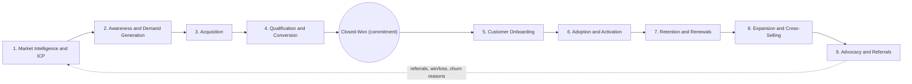

# Revenue bowtie

The revenue bowtie is the business framework this repo is organized around: every project, metric and system maps to a stage on it. This page answers what the stages are, why the right side of the bowtie (after the contract) is where recurring revenue compounds, and which metric and system own each stage. The full stage-by-stage detail is in [stages.md](stages.md).

## Why a bowtie and not a funnel

A funnel ends at closed-won. For a recurring-revenue business that is the midpoint: the customer has committed, but most of the lifetime value has not been collected yet. The bowtie keeps the left side (winning the customer) and adds the right side (keeping and growing them), joined at the knot where the commitment is made.

Treating closed-won as the finish line produces predictable problems: sales sells to accounts that churn in a year, onboarding inherits promises it did not see, and expansion depends on whoever happens to notice a usage spike.

## The nine stages

The left side narrows: many accounts in the market, fewer engaged, fewer qualified, one signature. The right side widens: one signed account becomes more users, more products, more revenue and new referred accounts. The dotted edge is the feedback loop. Advocacy produces referrals directly, and every right-side outcome (who stayed, who expanded, who churned and why) should flow back to correct the ICP on the left.

## Why the right side compounds

New-logo revenue is added once. Recurring revenue is collected again every period, and it grows or shrinks based on how existing customers behave. Two formulas describe it.

| Metric | Formula | Reads as |
|---|---|---|
| Net revenue retention (NRR) | (Starting ARR + expansion - contraction - churn) / starting ARR | Revenue from a fixed cohort a year later, including growth |
| Gross revenue retention (GRR) | (Starting ARR - contraction - churn) / starting ARR | Revenue kept from the cohort, excluding growth; cannot exceed 100% |

GRR measures how leaky the bucket is. NRR measures whether the existing base grows on its own. A company with high NRR and low GRR is replacing churned customers with expansion from a few large accounts, which hides a retention problem.

### Illustrative compounding

A cohort starts with $1,000,000 ARR. No new logos are added. **Rates are illustrative.**

| NRR | Year 1 | Year 2 | Year 3 |
|---|---|---|---|
| 90% | $900,000 | $810,000 | $729,000 |
| 100% | $1,000,000 | $1,000,000 | $1,000,000 |
| 110% | $1,100,000 | $1,210,000 | $1,331,000 |

The gap between 90% and 110% NRR on a single cohort is $602,000 by year 3. Every new cohort stacks on top, so the difference in total ARR widens each year. This is why right-side systems (onboarding, adoption tracking, churn risk, expansion signals) carry as much revenue weight as prospecting does.

## Stage summary

| # | Stage | Primary metric | Formula | Primary system | Related project |
|---|---|---|---|---|---|
| 1 | Market intelligence and ICP | ICP win-rate lift | Win rate on ICP accounts / win rate on non-ICP accounts | Warehouse, data vendors, account scoring | [RouteHero](../../projects/routehero/README.md), [GTM ontology](../../projects/gtm-ontology/README.md) |
| 2 | Awareness and demand generation | Engaged ICP account rate | ICP accounts with a qualifying engagement / ICP accounts targeted | Sequencer, marketing automation, ad platforms, web analytics | [GTM learning engine](../../projects/gtm-learning-engine/README.md) |
| 3 | Acquisition | Cost per meeting held | Channel cost / meetings held | Sequencer, scheduler, routing, CRM | [RouteHero](../../projects/routehero/README.md), [GTM learning engine](../../projects/gtm-learning-engine/README.md) |
| 4 | Qualification and conversion | Win rate by value | Closed-won value / closed (won + lost) value | CRM, conversation intelligence, CPQ | [Conversation intelligence](../../projects/conversation-intelligence/README.md), [GTM learning engine](../../projects/gtm-learning-engine/README.md) |
| Knot | Closed-won (commitment) | Handoff completeness | Required handoff fields populated / required handoff fields | CRM, CPQ, contract system | [GTM ontology](../../projects/gtm-ontology/README.md) |
| 5 | Customer onboarding | Time to first value | Median of (first value event date - contract start date) | Onboarding tracker, product analytics | [GTM ontology](../../projects/gtm-ontology/README.md) |
| 6 | Adoption and activation | Activation rate | Accounts reaching activation event in N days / new accounts | Product analytics, warehouse | [GTM ontology](../../projects/gtm-ontology/README.md) |
| 7 | Retention and renewals | Gross revenue retention | (Starting ARR - contraction - churn) / starting ARR | CS platform, billing, support, CRM | [Conversation intelligence](../../projects/conversation-intelligence/README.md), [GTM ontology](../../projects/gtm-ontology/README.md) |
| 8 | Expansion and cross-selling | Net revenue retention | (Starting ARR + expansion - contraction - churn) / starting ARR | Product analytics, CRM, billing | [Conversation intelligence](../../projects/conversation-intelligence/README.md), [GTM learning engine](../../projects/gtm-learning-engine/README.md) |
| 9 | Advocacy and referrals | Referral-sourced new ARR share | New ARR from referred accounts / total new ARR | CRM, referral tracking, review platforms | |

## How to use this framework

1. **Find the constraint.** Compute the primary metric for every stage. The stage with the worst conversion relative to its own history, or the largest revenue at risk, is the constraint. Work there first.
2. **Ask root-cause questions before building.** A low meeting rate might be a list problem (stage 1), not a messaging problem (stage 2). Each stage in [stages.md](stages.md) lists the questions that separate the two.
3. **Instrument the handoffs.** Most leakage happens between stages owned by different teams. A stage transition that is not recorded as a timestamped event cannot be measured.
4. **Close the loop.** Right-side outcomes should change left-side targeting. If churned accounts share a trait, that trait belongs in the ICP exclusion criteria.

## Related

- [Bowtie stages in detail](stages.md)
- [GTM foundations](../01-gtm-foundations/README.md)
- [GTM motions](../01-gtm-foundations/gtm-motions.md)
- [Data architecture](../03-data-architecture/README.md)
- [GTM engineering](../04-gtm-engineering/README.md)
- [AI and agents](../05-ai-and-agents/README.md)
- [Analytics and prediction](../06-analytics-and-prediction/README.md)
- [Governance and operations](../07-governance-and-operations/README.md)
- [Engineering method](../../THINKING.md)
- [Impact](../../IMPACT.md)
