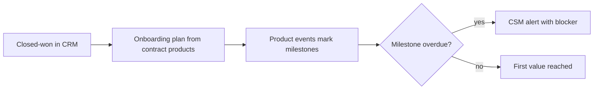

# Revenue bowtie stages

This page is the stage-by-stage reference for the [revenue bowtie](README.md). For each of the nine stages and the knot, it answers what the stage is for, what data and systems it depends on, how to measure it, where it usually breaks, and what to build. Each stage also states where an AI agent is the wrong tool, because most GTM problems are data and rules problems first.

Every stage uses the same structure so they can be compared side by side. Numbers in examples are illustrative.

## Contents

1. [Market intelligence and ICP](#1-market-intelligence-and-icp)
2. [Awareness and demand generation](#2-awareness-and-demand-generation)
3. [Acquisition](#3-acquisition)
4. [Qualification and conversion](#4-qualification-and-conversion)
5. [The knot: closed-won](#the-knot-closed-won-commitment)
6. [Customer onboarding](#5-customer-onboarding)
7. [Adoption and activation](#6-adoption-and-activation)
8. [Retention and renewals](#7-retention-and-renewals)
9. [Expansion and cross-selling](#8-expansion-and-cross-selling)
10. [Advocacy and referrals](#9-advocacy-and-referrals)

---

## 1. Market intelligence and ICP

Deciding which accounts exist, which ones fit, and which ones deserve effort now. It matters because every downstream rate (reply, meeting, win, retention) is capped by list quality. A perfect sequence sent to the wrong accounts still fails.

**Business objectives**
- Produce a countable, deduplicated universe of SAM accounts.
- Score each account on fit and timing, and assign an A/B/C tier.
- Estimate contract value per account so territories and targets reflect potential.

**Stakeholders:** RevOps, sales leadership, marketing, finance (targets), product marketing (ICP definition).

**Required data:** firmographics (industry, size, locations), technographics, triggers (hiring, funding, new sites), closed-won and churn history by account.

**Systems:** data vendors and public sources, warehouse, scoring jobs, CRM account object, territory map.

**Metrics**

| Metric | Formula |
|---|---|
| ICP win-rate lift | Win rate on ICP accounts / win rate on non-ICP accounts |
| Tier precision | Closed-won from tier A / opportunities from tier A |
| SAM coverage | SAM accounts present in CRM / SAM accounts in the universe |
| Field fill rate | Accounts with required fields populated / total accounts |
| Duplicate rate | Accounts sharing a resolved identity / total accounts |

**Common bottlenecks**
- ICP written from opinion, never checked against closed-won data.
- Location and parent-child relationships missing, so multi-site accounts look small.
- Vendor data stale or inconsistent across sources.

**Root-cause questions**
- Do tier A accounts actually win more often and at higher ACV than tier B?
- Which traits do churned accounts share that the ICP does not exclude?
- Is the account universe bounded by real data or by what one vendor sells?

**GTM engineering opportunities**
- Bottom-up account universe built from public sources, resolved to one record per company.
- Scoring job that recomputes tiers when triggers or firmographics change.
- Estimated contract value per account from the pricing unit (for example locations x price).

**AI and automation opportunities**
- LLM classification of unstructured website text into industry or service type when no standard code exists, measured against a labeled sample.
- Extraction of location counts or services from web pages.
- **Not an agent:** counting accounts, applying fit thresholds and computing tier scores are deterministic SQL. An LLM in that loop adds cost and run-to-run variance with no accuracy gain.

**Example architecture**

```text
public sources + vendor data -> staging -> identity resolution -> account table
  -> fit score + trigger score -> tier (A/B/C) -> CRM sync + territory map
```

**Validation:** backtest tiers against the last 12 months of closed-won and closed-lost; check score distribution per tier; hand-review a random sample of 50 records.

**Data-quality considerations**
- Match on domain plus normalized name plus address, not name alone.
- Record source and fetched date per field so stale values can be found.

**Security and governance:** respect source terms of use; keep personal data out of account-level tables; document scoring logic so tier changes are explainable.

**Failure modes**
- Score becomes a proxy for company size and stops predicting wins.
- Tiers are computed once and never refreshed.

**Business impact:** higher win rate and lower CAC from the same rep capacity, because effort concentrates on accounts that convert.

**Related projects:** [RouteHero](../../projects/routehero/README.md), [GTM ontology](../../projects/gtm-ontology/README.md)

---

## 2. Awareness and demand generation

Getting target accounts to know the company exists and to associate it with a specific problem. It matters because cold outreach to an account that has never heard of you converts worse, and inbound only arrives from accounts that already know you.

**Business objectives**
- Reach ICP accounts with a message tied to a trigger or a known problem.
- Generate engagement that can be measured per account, not only per channel.
- Protect sending reputation and brand while operating at volume.

**Stakeholders:** marketing, SDR or BDR team, product marketing, RevOps.

**Required data:** tiered account list, contacts with verified emails, triggers, message variants, engagement events (opens are unreliable, replies and clicks are better), deliverability data.

**Systems:** sequencer, marketing automation, ad platforms, web analytics, website visitor identification, CRM.

**Metrics**

| Metric | Formula |
|---|---|
| Engaged ICP account rate | ICP accounts with a qualifying engagement / ICP accounts targeted |
| Positive reply rate | Positive replies / emails delivered |
| Bounce rate | Bounced emails / emails sent |
| Spam complaint rate | Complaints / emails delivered |
| Cost per engaged account | Program cost / engaged ICP accounts |

**Common bottlenecks**
- Generic messaging sent to everyone in the list.
- Domain reputation damaged by unverified lists or volume spikes.
- Engagement tracked per contact, so account-level interest is invisible.

**Root-cause questions**
- Is a low reply rate a list problem, a message problem or a deliverability problem?
- Which message variants produce positive replies, not just replies?
- Are the engaged accounts in the ICP, or is the content attracting the wrong buyers?

**GTM engineering opportunities**
- Signal-triggered sequences: a trigger event starts outreach with a message tied to that trigger.
- Message experiments with a fixed sample size, where losing variants are retired automatically.
- Account-level engagement rollup across email, web and ads.

**AI and automation opportunities**
- Drafting a first line from account research, with human review on tier A.
- Classifying replies (positive, objection, referral, out of office, unsubscribe).
- **Not an agent:** suppression lists, send limits, unsubscribe handling and domain warmup rules must be deterministic. An agent should never decide who to contact outside the approved list or bypass an opt-out.

**Example architecture**

```text
trigger detected -> account in tier A/B? -> contacts verified -> variant assigned
  -> sequencer -> reply classified -> CRM activity + experiment results table
```

**Validation:** A/B tests with a pre-set minimum sample per variant; reply classifier checked against hand labels; seed-inbox tests for placement.

**Data-quality considerations**
- Verify emails before sending; track verification date.
- Deduplicate contacts across sequencer and marketing automation so nobody gets two programs at once.

**Security and governance:** comply with CAN-SPAM, GDPR and CASL where they apply; honor opt-outs across every system; log which message each contact received.

**Failure modes**
- Optimizing for reply rate and getting more negative replies.
- AI-written copy that is generic at scale and reads as automated.

**Business impact:** more qualified conversations per contact reached, which lowers the volume needed in the conversion economics table.

**Related projects:** [GTM learning engine](../../projects/gtm-learning-engine/README.md)

---

## 3. Acquisition

Turning engagement into a booked, held meeting with the right person at an ICP account. It matters because this is where marketing and SDR activity becomes a sales cost, and slow or wrong routing wastes demand already paid for.

**Business objectives**
- Book meetings with ICP buyers, not just anyone who replies.
- Route every inbound and reply to the right owner fast.
- Keep show rate high so AE calendars are not wasted.

**Stakeholders:** SDRs, AEs, marketing ops, RevOps.

**Required data:** lead and contact records, account ownership, territory assignments, tier, meeting outcomes, response timestamps.

**Systems:** forms, scheduler, routing engine, sequencer, CRM, dialer.

**Metrics**

| Metric | Formula |
|---|---|
| Cost per meeting held | Channel cost / meetings held |
| Meetings per 1,000 contacts | Meetings held / contacts reached x 1,000 |
| Show rate | Meetings held / meetings booked |
| Speed to lead | Median of (first touch time - inbound timestamp) |
| ICP meeting share | Meetings with ICP accounts / meetings held |

**Common bottlenecks**
- Inbound leads not matched to existing accounts, so they route to the wrong rep.
- Meetings booked with non-buyers to hit an activity target.
- No-shows with no automated reminder or reschedule path.

**Root-cause questions**
- How long does an inbound lead wait before a human responds, at the median and the 90th percentile?
- What share of meetings are with accounts outside the ICP?
- Do no-shows cluster by source, persona or time between booking and meeting?

**GTM engineering opportunities**
- Lead-to-account matching on email domain and company name before routing.
- Territory and tier-based routing with round robin inside a pod.
- Geographic prospect discovery for field or local motions, so reps work dense clusters.

**AI and automation opportunities**
- Pre-meeting account brief generated from public sources and CRM history.
- Reply intent detection to book meetings from positive replies faster.
- **Not an agent:** routing is a rules engine problem. Ownership, territory and round-robin logic must be deterministic and auditable so reps trust it. An agent choosing owners creates disputes nobody can resolve.

**Example architecture**

```text
form fill / positive reply -> lead-to-account match -> owner lookup (territory, tier)
  -> scheduler link or direct book -> reminder sequence -> meeting outcome to CRM
```

**Validation:** audit a sample of routed leads weekly for correct owner; measure speed to lead before and after changes; compare show rate by source.

**Data-quality considerations**
- Normalize company names and domains before matching.
- Record meeting outcome as a required field (held, no-show, rescheduled, disqualified).

**Security and governance:** routing rules versioned and reviewed when territories change; access to lead data scoped by role.

**Failure modes**
- Routing loop or unassigned queue that nobody monitors.
- Meeting counts rise while ICP meeting share falls.

**Business impact:** lower cost per qualified meeting and faster response on paid demand, which raises the share of inbound that converts.

**Related projects:** [RouteHero](../../projects/routehero/README.md), [GTM learning engine](../../projects/gtm-learning-engine/README.md)

---

## 4. Qualification and conversion

Deciding whether a meeting is a real opportunity and moving it to a signed contract. It matters because AE time is the most expensive resource in a sales-led motion, and forecast quality depends on what happens here.

**Business objectives**
- Qualify fast and disqualify early.
- Multi-thread into the buying committee.
- Forecast accurately and close at planned price.

**Stakeholders:** AEs, sales managers, sales engineers, finance, RevOps, deal desk.

**Required data:** opportunity stage history, amount, close date, contacts and roles, call transcripts, competitor mentions, loss reasons, discounts.

**Systems:** CRM, conversation intelligence, CPQ, e-signature, forecasting tool.

**Metrics**

| Metric | Formula |
|---|---|
| Meeting-to-opportunity rate | Qualified opportunities / meetings held |
| Stage conversion | Opportunities entering stage N+1 / opportunities entering stage N |
| Win rate by value | Closed-won value / closed (won + lost) value |
| Sales velocity | (Opportunities x win rate x ACV) / cycle length in days |
| Forecast accuracy | 1 - abs(forecast - actual) / actual |
| Discount depth | (List price - sold price) / list price |

**Common bottlenecks**
- Stages defined by rep feeling instead of exit criteria.
- CRM fields empty because reps do not update them.
- Loss reasons free-text or set to "other".

**Root-cause questions**
- At which stage do lost deals stall, and for how many days?
- Which objections and competitors appear in lost deals but not in won deals?
- Is win rate low across all reps, or concentrated in a few?

**GTM engineering opportunities**
- Stage exit criteria enforced by required fields.
- Call transcripts converted to structured fields: objections, competitors, budget, timing.
- Stage-duration alerts when a deal exceeds the won-deal median for its stage.

**AI and automation opportunities**
- Extracting signals from call transcripts into CRM fields, with precision and recall measured on a labeled set.
- Drafting follow-up emails and mutual action plans from call notes.
- **Not an agent:** forecast numbers should come from a statistical model and stage data, not LLM judgment. An agent should not change stage, amount or close date without rep confirmation, because those fields drive commission and the board forecast.

**Example architecture**

```text
call recording -> transcript -> signal extractor -> confidence check
  -> high confidence: write CRM field; low confidence: rep review queue
  -> stage and forecast reports
```

**Validation:** extractor evaluated with precision, recall and F1 per field; forecast accuracy tracked per quarter; spot-check CRM fields against transcripts.

**Data-quality considerations**
- Keep stage history as timestamped events, not only current stage.
- Use picklists for loss reason and competitor, not free text.

**Security and governance:** call recording consent per jurisdiction; transcripts contain personal and commercial data, so restrict access and set retention.

**Failure modes**
- Extracted signals written without confidence thresholds, polluting CRM data.
- Pipeline inflated by opportunities that never met exit criteria.

**Business impact:** higher win rate, shorter cycles and forecasts finance can plan hiring against.

**Related projects:** [Conversation intelligence](../../projects/conversation-intelligence/README.md), [GTM learning engine](../../projects/gtm-learning-engine/README.md), [AI evaluation](../../projects/ai-evaluation/README.md)

---

## The knot: closed-won (commitment)

The point where the customer signs and the account moves from sales to post-sale teams. It matters because everything the buyer was promised, and everything sales learned, must survive the handoff. Most onboarding problems start here.

**Business objectives**
- Record the contract accurately: products, quantities, price, term, renewal date.
- Hand off goals, stakeholders and commitments in structured form.

**Stakeholders:** AE, customer success manager, onboarding lead, finance, legal.

**Required data:** signed contract terms, buyer's success criteria, stakeholders and roles, technical requirements, special terms.

**Systems:** CPQ, contract system, CRM, billing, CS platform.

**Metrics**

| Metric | Formula |
|---|---|
| Handoff completeness | Required handoff fields populated / required handoff fields |
| Booking accuracy | Contracts matching billing setup / total contracts |
| Time to kickoff | Median of (kickoff date - signature date) |

**Engineering opportunity:** closed-won triggers creation of the customer, contract and onboarding records from CPQ data, with a handoff form that blocks stage change until required fields are filled.

**Not an agent:** contract terms come from CPQ and the signed document, not from an LLM reading the PDF. Billing setup must be deterministic and reconciled.

**Failure mode:** promises made in late-stage calls never reach onboarding.

**Related projects:** [GTM ontology](../../projects/gtm-ontology/README.md)

---

## 5. Customer onboarding

Getting a new customer from signature to first measurable value. It matters because the time between paying and getting value is when buyers start to doubt the decision, and slow onboarding delays any revenue tied to usage.

**Business objectives**
- Reach first value inside a defined window.
- Complete setup, integrations and training on schedule.
- Confirm the success criteria agreed during the sale.

**Stakeholders:** onboarding or implementation team, CSM, customer admin and champion, support, AE.

**Required data:** contract scope, success criteria, onboarding milestones, integration status, product setup events.

**Systems:** CS platform or project tracker, product analytics, CRM, support tool.

**Metrics**

| Metric | Formula |
|---|---|
| Time to first value | Median of (first value event date - contract start date) |
| Onboarding completion rate | Accounts completing all milestones in window / accounts onboarded |
| On-time milestone rate | Milestones completed by due date / milestones due |
| Early support load | Support tickets in first 30 days / accounts onboarded |

**Common bottlenecks**
- No agreed definition of "first value".
- Customer-side dependencies (IT access, data exports) not tracked.
- Onboarding starts without the sales context.

**Root-cause questions**
- Which milestone takes longest, and is the delay on our side or the customer's?
- Do accounts with slow onboarding churn at higher rates?
- Were the success criteria captured at the knot, or invented after signing?

**GTM engineering opportunities**
- Onboarding plan created automatically from contract products.
- Milestone completion detected from product events instead of manual checkboxes.
- Stalled-milestone alerts to the CSM with customer-side blockers listed.

**AI and automation opportunities**
- Summarizing sales calls into an onboarding brief.
- Drafting customer-facing status updates from milestone data.
- **Not an agent:** account provisioning, permissions and integration setup are deterministic workflows. Errors there break customer access or data, so they need tested scripts, not autonomous actions.

**Example architecture**



**Validation:** compare time to first value across cohorts; confirm milestone events match what CSMs report in a sample.

**Data-quality considerations**
- One customer record linked to the CRM account, billing account and product workspace.
- Milestone dates recorded as events, not overwritten fields.

**Security and governance:** customer data imported during setup must follow the contract's data processing terms; admin access logged.

**Failure modes**
- "Onboarding complete" marked without the customer reaching value.
- Handoff data ignored because it lives in a different tool.

**Business impact:** shorter time to value lowers early churn and moves usage-based revenue forward.

**Related projects:** [GTM ontology](../../projects/gtm-ontology/README.md)

---

## 6. Adoption and activation

Customers using the product in the way that predicts retention. It matters because a signed contract with low usage is a renewal risk, and usage is the earliest leading indicator the business has.

**Business objectives**
- Define the activation event that predicts retention.
- Raise the share of purchased seats or capacity in active use.
- Spread usage across features and teams.

**Stakeholders:** product, CSMs, growth, support, account managers.

**Required data:** product events with user and account IDs, seat counts, plan entitlements, feature usage, support tickets.

**Systems:** product analytics, warehouse, CS platform, reverse ETL to CRM.

**Metrics**

| Metric | Formula |
|---|---|
| Activation rate | Accounts reaching activation event within N days / new accounts |
| Seat usage rate | Active seats / purchased seats |
| DAU/MAU | Daily active users / monthly active users |
| Feature breadth | Core features used by account / core features available on plan |
| Health score coverage | Accounts with a current health score / active accounts |

**Common bottlenecks**
- Activation defined as "logged in" instead of an outcome event.
- Product users not linked to CRM accounts.
- Usage visible to product but not to account owners.

**Root-cause questions**
- Which early behaviors separate retained accounts from churned accounts?
- Are low-usage accounts missing a feature, a trained user or an integration?
- Does seat usage rate drop before renewal, and how far ahead?

**GTM engineering opportunities**
- Activation event chosen by comparing retained and churned cohorts.
- User-to-account identity resolution so usage rolls up correctly.
- Usage summaries synced to CRM account records for owners.

**AI and automation opportunities**
- In-product guidance triggered by state (feature not used after N days).
- Summarizing an account's usage trend for a CSM review.
- **Not an agent:** the activation definition and health score are SQL over event data. They must be stable and reproducible so trends mean something. Changing them by LLM judgment breaks comparisons over time.

**Example architecture**

```text
product events -> warehouse -> user-to-account resolution -> activation flag + seat usage rate
  -> health score -> reverse ETL to CRM and CS platform -> owner view
```

**Validation:** check that the activation event actually predicts retention in a held-out cohort; reconcile active user counts against billing seat counts.

**Data-quality considerations**
- Event naming and schema versioned; renamed events break history.
- Exclude internal and test users from usage metrics.

**Security and governance:** usage data is customer data; aggregate before syncing to sales tools; follow privacy terms on user-level tracking.

**Failure modes**
- Health score that is green for every account until it churns.
- Usage metric gamed by automated logins or integrations.

**Business impact:** earlier warning on at-risk accounts and identified expansion candidates, both measurable in GRR and NRR.

**Related projects:** [GTM ontology](../../projects/gtm-ontology/README.md), [Conversation intelligence](../../projects/conversation-intelligence/README.md)

---

## 7. Retention and renewals

Keeping the revenue already under contract. It matters because churned ARR has to be replaced before any growth counts, and churn reduces the base that expansion grows from.

**Business objectives**
- Find churn risk early enough to act.
- Renew on time at or above current price.
- Capture structured churn reasons that feed back to the ICP.

**Stakeholders:** CSMs, account managers, support, finance, product, executive sponsors.

**Required data:** renewal dates, contract value, usage trend, support tickets and sentiment, call transcripts, stakeholder changes, payment history.

**Systems:** CS platform, billing, CRM, support tool, conversation intelligence.

**Metrics**

| Metric | Formula |
|---|---|
| Gross revenue retention | (Starting ARR - contraction - churn) / starting ARR |
| Logo churn rate | Churned customers / customers at start of period |
| Renewal rate | Renewed ARR / ARR up for renewal |
| Risk lead time | Median of (renewal date - first risk flag date) for at-risk renewals |
| Save rate | At-risk accounts renewed / at-risk accounts flagged |

**Common bottlenecks**
- Risk found when the cancellation notice arrives.
- Champion leaves and nobody notices.
- Churn reason recorded as free text or not at all.

**Root-cause questions**
- How many days before renewal did the first risk signal appear, and who saw it?
- Do churned accounts share ICP traits, onboarding delays or a product gap?
- Is churn concentrated in one segment, cohort or product?

**GTM engineering opportunities**
- Risk score combining usage trend, support volume, stakeholder change and call signals.
- Renewal queue ordered by ARR at risk and days to renewal.
- Champion change detection from email bounces and contact data updates.

**AI and automation opportunities**
- Extracting churn-risk signals from call transcripts and support tickets.
- Summarizing an account's history for a renewal review.
- **Not an agent:** an agent should not send retention offers, approve discounts or change contract terms. Those carry financial authority and need a human. The risk score itself should be a model or rules with known inputs, so a CSM can see why an account is flagged.

**Example architecture**

```text
usage trend + support tickets + call signals + contact changes
  -> risk score -> renewal queue (ARR at risk x days to renewal)
  -> CSM play -> outcome (renewed, contracted, churned + reason) -> ICP feedback
```

**Validation:** measure the risk score's precision and recall on past renewals; compare risk lead time before and after changes.

**Data-quality considerations**
- Renewal date and ARR must match billing, reconciled monthly.
- Churn reason from a fixed picklist with an optional note.

**Security and governance:** support and call data contain personal information; restrict access; keep audit logs of who changed renewal terms.

**Failure modes**
- Risk score flags so many accounts that CSMs ignore it.
- Saves achieved through discounts that reduce GRR anyway.

**Business impact:** each point of GRR kept compounds across every future year of that cohort.

**Related projects:** [Conversation intelligence](../../projects/conversation-intelligence/README.md), [GTM ontology](../../projects/gtm-ontology/README.md), [AI evaluation](../../projects/ai-evaluation/README.md)

---

## 8. Expansion and cross-selling

Growing revenue from existing customers through more seats, higher tiers, more locations or additional products. It matters because expansion usually costs less to win than a new logo, and it is the term that pushes NRR above 100%.

**Business objectives**
- Find accounts with room to grow and a reason to grow now.
- Route expansion signals to the right owner with context.
- Sell additional products where the buying committee already trusts you.

**Stakeholders:** account managers, CSMs, AEs, product, growth, finance.

**Required data:** current contract and products, plan limits, usage against limits, account hierarchy (sites and business units), call signals, firmographic changes.

**Systems:** product analytics, billing, CRM, CS platform, conversation intelligence.

**Metrics**

| Metric | Formula |
|---|---|
| Net revenue retention | (Starting ARR + expansion - contraction - churn) / starting ARR |
| Expansion ARR | Sum of ARR increases from existing customers in period |
| Whitespace | Estimated account potential - current ARR |
| Expansion signal conversion | Expansion opportunities won / expansion signals routed |
| Product penetration | Customers with 2+ products / total customers |

**Common bottlenecks**
- Plan limits hit with no alert to the account owner.
- No account hierarchy, so other sites or divisions are invisible.
- Expansion signals mentioned on calls but never recorded.

**Root-cause questions**
- Which accounts are near their plan limits right now?
- How much of the whitespace is in accounts the team already owns?
- Do expansion signals from calls get logged and acted on?

**GTM engineering opportunities**
- Plan-limit alerts tied to account owners and renewal dates.
- Whitespace model by account: potential from firmographics minus current ARR.
- Call-mentioned expansion signals (new team, new location, new use case) written to CRM.

**AI and automation opportunities**
- Extracting expansion signals from calls and support conversations.
- Account research for cross-sell into a new business unit.
- **Not an agent:** whitespace and pricing math are deterministic calculations from contract and firmographic data. Quotes must come from CPQ with approved price books, never from an LLM.

**Example architecture**

```text
usage vs plan limits + call signals + new sites detected
  -> expansion signal -> account owner alert with context
  -> expansion opportunity in CRM -> CPQ quote -> billing update
```

**Validation:** track expansion signal conversion by signal type; reconcile expansion ARR between CRM and billing.

**Data-quality considerations**
- Parent-child account links must be correct before whitespace is meaningful.
- Distinguish expansion from price increases in ARR movement reports.

**Security and governance:** usage data shared with sales only at the level the customer agreement permits; pricing exceptions approved and logged.

**Failure modes**
- Aggressive upsell on accounts with low adoption, which raises churn risk.
- Expansion credited twice across CRM and billing.

**Business impact:** expansion ARR at lower acquisition cost, raising NRR and LTV.

**Related projects:** [Conversation intelligence](../../projects/conversation-intelligence/README.md), [GTM learning engine](../../projects/gtm-learning-engine/README.md), [GTM ontology](../../projects/gtm-ontology/README.md)

---

## 9. Advocacy and referrals

Satisfied customers bringing in new customers through referrals, references, reviews and case studies. It matters because referred accounts arrive with trust already established, and because this stage closes the loop back to the ICP.

**Business objectives**
- Generate referred pipeline from successful customers.
- Keep a pool of references available for late-stage deals.
- Feed outcome data back to market intelligence.

**Stakeholders:** CSMs, marketing, product marketing, sales, customer champions.

**Required data:** customer health, outcomes achieved, referral source on new opportunities, reference requests and usage, review activity.

**Systems:** CRM, referral tracking, review platforms, CS platform, marketing automation.

**Metrics**

| Metric | Formula |
|---|---|
| Referral-sourced new ARR share | New ARR from referred accounts / total new ARR |
| Referral win rate vs baseline | Win rate on referred opportunities / win rate on all opportunities |
| Reference availability | Customers approved as references / healthy customers |
| Reference load | Reference calls in period / approved references |
| NPS | % promoters - % detractors |

**Common bottlenecks**
- Referral source not captured on new opportunities.
- Same few references asked repeatedly until they decline.
- Advocacy asked of customers who have not reached value.

**Root-cause questions**
- Which customers have reached their success criteria and have not been asked?
- Do referred deals close faster and stay longer, and is that measured?
- What do advocates have in common that the ICP should prioritize?

**GTM engineering opportunities**
- Advocacy-ready flag based on health, outcomes and tenure.
- Required referral source field on opportunity creation.
- Advocate traits fed back into ICP scoring.

**AI and automation opportunities**
- Drafting a case study outline from call transcripts and outcome data, for customer approval.
- Matching a prospect to the most similar reference customer.
- **Not an agent:** referral attribution is a deterministic field and rules. Testimonials, quotes and outcome numbers must come from the customer and be approved by them, never generated.

**Example architecture**

```text
health + outcomes + tenure -> advocacy-ready flag -> CSM ask
  -> referral / reference / review -> referral source on new opportunity
  -> advocate traits -> ICP scoring (stage 1)
```

**Validation:** compare cycle length, win rate and retention of referred vs non-referred cohorts; audit referral source fill rate.

**Data-quality considerations**
- Referral source from a picklist plus the referring account ID.
- Reference usage logged per customer to prevent overuse.

**Security and governance:** written consent before using a customer's name, logo or quote; track expiry of approvals.

**Failure modes**
- Published claims that the customer never approved.
- Feedback loop never built, so the ICP ignores what advocates have in common.

**Business impact:** lower CAC on referred pipeline and a sharper ICP that improves every left-side stage.

**Related projects:** [GTM ontology](../../projects/gtm-ontology/README.md)

---

## Related

- [Revenue bowtie overview](README.md)
- [GTM foundations](../01-gtm-foundations/README.md)
- [GTM motions](../01-gtm-foundations/gtm-motions.md)
- [Data architecture](../03-data-architecture/README.md)
- [GTM engineering](../04-gtm-engineering/README.md)
- [AI and agents](../05-ai-and-agents/README.md)
- [Analytics and prediction](../06-analytics-and-prediction/README.md)
- [Governance and operations](../07-governance-and-operations/README.md)
- [Engineering method](../../THINKING.md)
- [RouteHero](../../projects/routehero/README.md)
- [GTM learning engine](../../projects/gtm-learning-engine/README.md)
- [Conversation intelligence](../../projects/conversation-intelligence/README.md)
- [AI evaluation](../../projects/ai-evaluation/README.md)
- [GTM ontology](../../projects/gtm-ontology/README.md)
