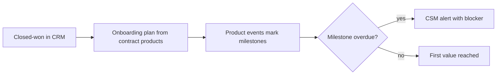

# Revenue bowtie stages

This page walks through each stage of the [revenue bowtie](README.md) in detail. For each of the nine stages, plus the knot where the contract is signed, it covers: what the stage is for, what data and tools it needs, how to measure it, where it usually breaks, and what to build.

Each stage also says where an AI agent is the wrong tool. An AI agent is software that uses an AI model to make its own decisions and take actions. Most GTM problems are data problems and rules problems first, and plain code with fixed rules solves them better.

Every stage uses the same layout, so you can compare them side by side.

A few terms used throughout this page:

- **CRM**: the customer relationship management system, such as Salesforce or HubSpot.
- **Warehouse**: the central database that holds a copy of all company data.
- **Sequencer**: the tool that sends a series of outreach emails.
- **LLM**: large language model, the type of AI behind tools like ChatGPT and Claude.
- **SQL**: the standard language for asking a database questions. "Plain SQL" means a fixed, repeatable calculation.
- **Reverse ETL**: copying data from the warehouse back into working tools such as the CRM.
- **CS platform**: the tool customer success teams use to track account health.
- **CPQ** (configure, price, quote): the tool that builds quotes from an approved price list.

## Contents

1. [Market intelligence and ICP](#1-market-intelligence-and-icp)
2. [Awareness and demand generation](#2-awareness-and-demand-generation)
3. [Acquisition](#3-acquisition)
4. [Qualification and conversion](#4-qualification-and-conversion)
5. [The knot: closed-won](#the-knot-closed-won-commitment)
6. [Customer onboarding](#5-customer-onboarding)
7. [Adoption and activation](#6-adoption-and-activation)
8. [Retention and renewals](#7-retention-and-renewals)
9. [Expansion and cross-selling](#8-expansion-and-cross-selling)
10. [Advocacy and referrals](#9-advocacy-and-referrals)

---

## 1. Market intelligence and ICP

This stage decides which accounts exist, which ones fit, and which ones deserve effort right now. ICP means ideal customer profile. List quality sets the ceiling on every later rate: reply, meeting, win and retention. A perfect email sequence sent to the wrong accounts still fails.

**Business objectives**
- Build a countable list of every account in the SAM (serviceable addressable market: the accounts you can actually serve), with duplicates merged.
- Score each account on fit and timing, and give it an A, B or C tier.
- Estimate a contract value for each account, so territories and targets reflect real potential.

**Stakeholders:** RevOps (revenue operations), sales leadership, marketing, finance (targets), product marketing (ICP definition).

**Required data:** firmographics (basic company facts: industry, size, locations), technographics (the software a company runs), triggers (recent changes such as hiring, funding or new sites), and won-deal and lost-customer history by account.

**Systems:** data vendors and public sources, the warehouse, scheduled scoring jobs, the CRM account record, the territory map.

**Metrics**

| Metric | Formula |
|---|---|
| ICP win-rate lift | Win rate on ICP accounts / win rate on non-ICP accounts |
| Tier precision | Closed-won from tier A / opportunities from tier A |
| SAM coverage | SAM accounts present in CRM / SAM accounts in the universe |
| Field fill rate | Accounts with required fields populated / total accounts |
| Duplicate rate | Accounts sharing a resolved identity / total accounts |

**Common bottlenecks**
- The ICP is written from opinion and never checked against won deals.
- Locations and parent-company links are missing, so a company with many sites looks small.
- Vendor data is out of date, or different sources disagree.

**Root-cause questions**
- Do tier A accounts actually win more often, and at a higher ACV (annual contract value), than tier B?
- What do lost customers have in common that the ICP does not exclude?
- Is the account list based on real data, or only on what one vendor happens to sell?

**GTM engineering opportunities**
- Build the account list from the ground up using public sources, with one record per company.
- Run a scoring job that recalculates tiers whenever triggers or company facts change.
- Estimate contract value for each account from the pricing unit (for example, locations x price).

**AI and automation opportunities**
- Use an LLM to sort companies into an industry or service type from their website text, when no standard code exists. Check its accuracy against a sample that a person has labeled by hand.
- Pull location counts or services from web pages.
- **Not an agent:** counting accounts, applying fit rules and calculating tier scores are plain SQL. Putting an LLM in that loop adds cost and gives different answers on different runs, with no gain in accuracy.

**Example architecture**

Data from public sources and vendors lands in a staging area. Duplicate records are matched and merged. Each account gets a fit score and a trigger score, then a tier, and the result is copied to the CRM and the territory map.

```text
public sources + vendor data -> staging -> identity resolution -> account table
  -> fit score + trigger score -> tier (A/B/C) -> CRM sync + territory map
```

**Validation:** test the tiers against the last 12 months of won and lost deals (a backtest). Check how scores spread out within each tier. Have a person review a random sample of 50 records.

**Data-quality considerations**
- Match records on website domain plus cleaned-up company name plus address, not on name alone.
- Record where each field came from and when, so old values can be found.

**Security and governance:** follow each data source's terms of use. Keep personal data out of account-level tables. Write down how scoring works, so anyone can explain why a tier changed.

**Failure modes**
- The score turns into a stand-in for company size and stops predicting wins.
- Tiers are calculated once and never refreshed.

**Business impact:** a higher win rate and lower CAC (customer acquisition cost) with the same number of reps, because effort goes to the accounts that convert.

**Related projects:** [RouteHero](../../projects/routehero/README.md), [GTM ontology](../../projects/gtm-ontology/README.md)

---

## 2. Awareness and demand generation

This stage gets target accounts to know the company exists and to link it to a specific problem. Cold outreach to an account that has never heard of you converts worse. And inbound interest only comes from accounts that already know you.

**Business objectives**
- Reach ICP accounts with a message tied to a recent change or a known problem.
- Create engagement that can be measured for each account, not only for each channel.
- Protect email sending reputation and brand while working at volume.

**Stakeholders:** marketing, the SDR or BDR team (sales and business development reps who book meetings), product marketing, RevOps.

**Required data:** the tiered account list, contacts with checked email addresses, triggers, message versions, engagement data (email opens are unreliable; replies and clicks are better), and deliverability data (whether emails reach the inbox).

**Systems:** sequencer, marketing automation, ad platforms, web analytics, website visitor identification, CRM.

**Metrics**

| Metric | Formula |
|---|---|
| Engaged ICP account rate | ICP accounts with a qualifying engagement / ICP accounts targeted |
| Positive reply rate | Positive replies / emails delivered |
| Bounce rate | Bounced emails / emails sent |
| Spam complaint rate | Complaints / emails delivered |
| Cost per engaged account | Program cost / engaged ICP accounts |

**Common bottlenecks**
- The same generic message goes to everyone on the list.
- The sending domain's reputation is damaged by unchecked lists or sudden jumps in volume.
- Engagement is tracked per person, so interest across a whole account is invisible.

**Root-cause questions**
- Is a low reply rate caused by the list, the message, or emails not reaching the inbox?
- Which message versions produce positive replies, not just any replies?
- Are the engaged accounts in the ICP, or is the content attracting the wrong buyers?

**GTM engineering opportunities**
- Signal-triggered sequences: when a trigger happens, outreach starts with a message about that trigger.
- Message tests with a sample size set in advance, where losing versions are retired automatically.
- One engagement total per account, combining email, web and ads.

**AI and automation opportunities**
- Draft a first line from account research, with a person reviewing it for tier A accounts.
- Sort replies into types: positive, objection, referral, out of office, unsubscribe.
- **Not an agent:** do-not-contact lists, sending limits, unsubscribe handling and domain warmup rules must be plain code with fixed rules. An agent should never decide to contact someone outside the approved list, or skip past an opt-out.

**Example architecture**

```text
trigger detected -> account in tier A/B? -> contacts verified -> variant assigned
  -> sequencer -> reply classified -> CRM activity + experiment results table
```

**Validation:** run A/B tests with a minimum sample size per version set in advance. Check the reply sorter against replies a person labeled by hand. Send to test inboxes (seed inboxes) to see whether mail lands in the inbox or in spam.

**Data-quality considerations**
- Check email addresses before sending, and record when each was checked.
- Merge duplicate contacts across the sequencer and marketing automation, so nobody gets two programs at once.

**Security and governance:** follow email and privacy laws where they apply (CAN-SPAM in the US, GDPR in the EU, CASL in Canada). Honor opt-outs in every system. Log which message each contact received.

**Failure modes**
- Chasing a higher reply rate and getting more negative replies.
- AI-written copy that sounds generic at scale and reads as automated.

**Business impact:** more qualified conversations per contact reached. That lowers the volume needed in the conversion economics table on the [GTM foundations](../01-gtm-foundations/README.md) page.

**Related projects:** [GTM learning engine](../../projects/gtm-learning-engine/README.md)

---

## 3. Acquisition

This stage turns engagement into a booked meeting that actually happens, with the right person at an ICP account. This is where marketing and SDR activity becomes a sales cost. Slow or wrong routing wastes demand the company already paid for.

**Business objectives**
- Book meetings with ICP buyers, not just anyone who replies.
- Send every inbound lead and reply to the right owner, fast.
- Keep the show rate high, so AE (account executive) calendars are not wasted.

**Stakeholders:** SDRs, AEs, marketing ops, RevOps.

**Required data:** lead and contact records, account ownership, territory assignments, tier, meeting outcomes, response times.

**Systems:** forms, scheduler, routing engine (the rules that decide who gets each lead), sequencer, CRM, dialer.

**Metrics**

| Metric | Formula |
|---|---|
| Cost per meeting held | Channel cost / meetings held |
| Meetings per 1,000 contacts | Meetings held / contacts reached x 1,000 |
| Show rate | Meetings held / meetings booked |
| Speed to lead | Median of (first touch time - inbound timestamp) |
| ICP meeting share | Meetings with ICP accounts / meetings held |

**Common bottlenecks**
- Inbound leads are not matched to accounts already in the CRM, so they go to the wrong rep.
- Meetings get booked with people who are not buyers, just to hit an activity target.
- No-shows get no automatic reminder or way to reschedule.

**Root-cause questions**
- How long does an inbound lead wait for a human reply? Look at the typical case (median) and the slow cases (90th percentile).
- What share of meetings are with accounts outside the ICP?
- Do no-shows cluster by source, persona, or the gap between booking and meeting?

**GTM engineering opportunities**
- Match each lead to an existing account by email domain and company name before routing it.
- Route by territory and tier, taking turns among reps inside a team (round robin).
- Find prospects by location for field or local sales, so reps work tight clusters of accounts.

**AI and automation opportunities**
- Generate a pre-meeting account brief from public sources and CRM history.
- Detect reply intent, so positive replies turn into booked meetings faster.
- **Not an agent:** routing is a rules problem. Ownership, territory and round-robin logic must be fixed rules that anyone can check, so reps trust it. An agent choosing owners creates disputes nobody can settle.

**Example architecture**

```text
form fill / positive reply -> lead-to-account match -> owner lookup (territory, tier)
  -> scheduler link or direct book -> reminder sequence -> meeting outcome to CRM
```

**Validation:** check a sample of routed leads each week for the correct owner. Measure speed to lead before and after changes. Compare show rate by source.

**Data-quality considerations**
- Clean up company names and domains into a standard form before matching.
- Make meeting outcome a required field (held, no-show, rescheduled, disqualified).

**Security and governance:** keep a history of routing rule changes and review the rules when territories change. Limit access to lead data by role.

**Failure modes**
- Leads bounce between owners in a loop, or pile up in an unassigned queue nobody watches.
- Meeting counts go up while the share of ICP meetings goes down.

**Business impact:** lower cost per qualified meeting and faster response to paid demand. More of the inbound interest turns into pipeline.

**Related projects:** [RouteHero](../../projects/routehero/README.md), [GTM learning engine](../../projects/gtm-learning-engine/README.md)

---

## 4. Qualification and conversion

This stage decides whether a meeting is a real opportunity, then moves it to a signed contract. AE time is the most expensive resource in a sales-led team, and forecast quality depends on what happens here.

**Business objectives**
- Qualify fast, and disqualify early.
- Build relationships with several people in the buying group (multi-threading).
- Forecast accurately, and close at the planned price.

**Stakeholders:** AEs, sales managers, sales engineers, finance, RevOps, deal desk.

**Required data:** opportunity stage history, amount, close date, contacts and their roles, call transcripts, competitor mentions, loss reasons, discounts.

**Systems:** CRM, conversation intelligence (software that records and analyzes sales calls), CPQ, e-signature, forecasting tool.

**Metrics**

| Metric | Formula |
|---|---|
| Meeting-to-opportunity rate | Qualified opportunities / meetings held |
| Stage conversion | Opportunities entering stage N+1 / opportunities entering stage N |
| Win rate by value | Closed-won value / closed (won + lost) value |
| Sales velocity | (Opportunities x win rate x ACV) / cycle length in days |
| Forecast accuracy | 1 - abs(forecast - actual) / actual |
| Discount depth | (List price - sold price) / list price |

**Common bottlenecks**
- Stages are set by how the rep feels, not by clear exit rules.
- CRM fields are empty because reps do not update them.
- Loss reasons are typed in freely or set to "other."

**Root-cause questions**
- At which stage do lost deals stall, and for how many days?
- Which objections and competitors show up in lost deals but not in won deals?
- Is win rate low for every rep, or only for a few?

**GTM engineering opportunities**
- Enforce stage exit rules with required fields.
- Turn call transcripts into structured CRM fields: objections, competitors, budget, timing.
- Alert when a deal sits in a stage longer than won deals usually do.

**AI and automation opportunities**
- Pull signals from call transcripts into CRM fields. Measure accuracy against a set of calls a person labeled by hand.
- Draft follow-up emails and mutual action plans (a shared timeline with the buyer) from call notes.
- **Not an agent:** forecast numbers should come from a statistical model and stage data, not from an LLM's judgment. An agent should not change stage, amount or close date without the rep confirming, because those fields drive commission and the board forecast.

**Example architecture**

Each call is recorded and transcribed. Software pulls out signals and rates how confident it is. Confident answers go straight into the CRM. Uncertain ones go to the rep to check.

```text
call recording -> transcript -> signal extractor -> confidence check
  -> high confidence: write CRM field; low confidence: rep review queue
  -> stage and forecast reports
```

**Validation:** score the extractor on each field. Precision asks: of what it flagged, how much was right? Recall asks: of what was really there, how much did it catch? F1 combines the two into one number. Track forecast accuracy each quarter. Spot-check CRM fields against transcripts.

**Data-quality considerations**
- Keep every stage change as a dated entry, not only the current stage.
- Use dropdown lists (picklists) for loss reason and competitor, not free text.

**Security and governance:** get call-recording consent as each location's law requires. Transcripts contain personal and business data, so limit access and set how long they are kept.

**Failure modes**
- Signals are written to the CRM with no confidence check, filling it with bad data.
- Pipeline is padded with opportunities that never met the exit rules.

**Business impact:** a higher win rate, shorter cycles, and forecasts that finance can plan hiring around.

**Related projects:** [Conversation intelligence](../../projects/conversation-intelligence/README.md), [GTM learning engine](../../projects/gtm-learning-engine/README.md), [AI evaluation](../../projects/ai-evaluation/README.md)

---

## The knot: closed-won (commitment)

This is the point where the customer signs and the account moves from sales to the post-sale teams. Everything the buyer was promised, and everything sales learned, has to survive the handoff. Most onboarding problems start here.

**Business objectives**
- Record the contract accurately: products, quantities, price, term, renewal date.
- Hand off goals, contacts and commitments in a structured form.

**Stakeholders:** AE, customer success manager (CSM), onboarding lead, finance, legal.

**Required data:** signed contract terms, the buyer's definition of success, contacts and their roles, technical requirements, special terms.

**Systems:** CPQ, contract system, CRM, billing, CS platform.

**Metrics**

| Metric | Formula |
|---|---|
| Handoff completeness | Required handoff fields populated / required handoff fields |
| Booking accuracy | Contracts matching billing setup / total contracts |
| Time to kickoff | Median of (kickoff date - signature date) |

**Engineering opportunity:** when a deal is marked closed-won, automatically create the customer, contract and onboarding records from the CPQ data. Use a handoff form that blocks the stage change until required fields are filled in.

**Not an agent:** contract terms come from CPQ and the signed document, not from an LLM reading the PDF. Billing setup must follow fixed rules and be checked against the contract.

**Failure mode:** promises made on late-stage calls never reach onboarding.

**Related projects:** [GTM ontology](../../projects/gtm-ontology/README.md)

---

## 5. Customer onboarding

This stage gets a new customer from signature to the first real, measurable value. The time between paying and getting value is when buyers start to doubt their decision. Slow onboarding also delays any revenue tied to usage.

**Business objectives**
- Reach first value inside an agreed time window.
- Finish setup, integrations and training on schedule.
- Confirm the success criteria agreed during the sale.

**Stakeholders:** onboarding or implementation team, CSM, the customer's admin and champion, support, AE.

**Required data:** contract scope, success criteria, onboarding milestones, integration status, product setup activity.

**Systems:** CS platform or project tracker, product analytics, CRM, support tool.

**Metrics**

| Metric | Formula |
|---|---|
| Time to first value | Median of (first value event date - contract start date) |
| Onboarding completion rate | Accounts completing all milestones in window / accounts onboarded |
| On-time milestone rate | Milestones completed by due date / milestones due |
| Early support load | Support tickets in first 30 days / accounts onboarded |

**Common bottlenecks**
- Nobody agreed on what "first value" means.
- Tasks waiting on the customer (IT access, data exports) are not tracked.
- Onboarding starts without the context sales gathered.

**Root-cause questions**
- Which milestone takes longest, and is the delay on our side or the customer's?
- Do accounts with slow onboarding leave at higher rates?
- Were the success criteria captured at signing, or made up afterward?

**GTM engineering opportunities**
- Create the onboarding plan automatically from the products in the contract.
- Mark milestones complete from product activity instead of manual checkboxes.
- Alert the CSM when a milestone stalls, listing what the customer still owes.

**AI and automation opportunities**
- Summarize sales calls into an onboarding brief.
- Draft customer status updates from milestone data.
- **Not an agent:** setting up accounts, permissions and integrations are fixed workflows. Mistakes there break customer access or data, so they need tested scripts, not an agent acting on its own.

**Example architecture**



**Validation:** compare time to first value across cohorts (groups of customers who started in the same period). Check a sample to confirm product activity matches what CSMs report.

**Data-quality considerations**
- Keep one customer record linked to the CRM account, the billing account and the product workspace.
- Record milestone dates as new entries, not by overwriting a field.

**Security and governance:** customer data brought in during setup must follow the contract's data-handling terms. Log admin access.

**Failure modes**
- Onboarding is marked "complete" before the customer gets value.
- Handoff notes are ignored because they live in a different tool.

**Business impact:** a shorter time to value lowers early churn (customers leaving) and brings usage-based revenue in sooner.

**Related projects:** [GTM ontology](../../projects/gtm-ontology/README.md)

---

## 6. Adoption and activation

This stage is about customers using the product in the ways that predict they will stay. A signed contract with low usage is a renewal risk. Usage is the earliest warning sign the business has.

**Business objectives**
- Define the activation event: the action that predicts a customer will stay.
- Raise the share of purchased seats or capacity actually in use.
- Spread usage across features and teams.

**Stakeholders:** product, CSMs, growth, support, account managers.

**Required data:** product activity tagged with user and account IDs, seat counts, what each plan includes, feature usage, support tickets.

**Systems:** product analytics, the warehouse, CS platform, reverse ETL to the CRM.

**Metrics**

| Metric | Formula |
|---|---|
| Activation rate | Accounts reaching activation event within N days / new accounts |
| Seat usage rate | Active seats / purchased seats |
| DAU/MAU | Daily active users / monthly active users |
| Feature breadth | Core features used by account / core features available on plan |
| Health score coverage | Accounts with a current health score / active accounts |

**Common bottlenecks**
- Activation is defined as "logged in" instead of a real result.
- Product users are not linked to CRM accounts.
- The product team can see usage, but account owners cannot.

**Root-cause questions**
- Which early behaviors separate customers who stay from customers who leave?
- Are low-usage accounts missing a feature, a trained user or an integration?
- Does seat usage drop before renewal, and how far ahead?

**GTM engineering opportunities**
- Choose the activation event by comparing customers who stayed with customers who left.
- Match each user to their company, so usage adds up correctly per account.
- Copy usage summaries onto CRM account records so owners can see them.

**AI and automation opportunities**
- Show in-product tips based on what the user has done (for example, a feature not used after N days).
- Summarize an account's usage trend for a CSM review.
- **Not an agent:** the activation definition and the health score are plain SQL over usage data. They must stay stable and repeatable so trends mean something. Letting an LLM change them breaks comparisons over time.

**Example architecture**

```text
product events -> warehouse -> user-to-account resolution -> activation flag + seat usage rate
  -> health score -> reverse ETL to CRM and CS platform -> owner view
```

**Validation:** check that the activation event really predicts staying, using a group of customers held back from the analysis. Compare active user counts with the seat counts in billing.

**Data-quality considerations**
- Keep a history of event names and their structure. Renaming an event breaks the history.
- Leave internal and test users out of usage numbers.

**Security and governance:** usage data is customer data. Roll it up to account level before sending it to sales tools. Follow privacy terms on tracking individual users.

**Failure modes**
- A health score that shows green for every account right up until it cancels.
- Usage numbers inflated by automated logins or integrations.

**Business impact:** earlier warning on at-risk accounts and a clear list of accounts ready to grow. Both show up in GRR and NRR (gross and net revenue retention, defined on the [bowtie overview](README.md)).

**Related projects:** [GTM ontology](../../projects/gtm-ontology/README.md), [Conversation intelligence](../../projects/conversation-intelligence/README.md)

---

## 7. Retention and renewals

This stage keeps the revenue already under contract. ARR (annual recurring revenue) lost to churn has to be replaced before any growth counts. Churn also shrinks the base that expansion grows from.

**Business objectives**
- Spot churn risk early enough to act.
- Renew on time, at or above the current price.
- Record churn reasons from a fixed list, and feed them back to the ICP.

**Stakeholders:** CSMs, account managers, support, finance, product, executive sponsors.

**Required data:** renewal dates, contract value, usage trend, support tickets and their tone, call transcripts, contact changes, payment history.

**Systems:** CS platform, billing, CRM, support tool, conversation intelligence.

**Metrics**

| Metric | Formula |
|---|---|
| Gross revenue retention | (Starting ARR - contraction - churn) / starting ARR |
| Logo churn rate | Churned customers / customers at start of period |
| Renewal rate | Renewed ARR / ARR up for renewal |
| Risk lead time | Median of (renewal date - first risk flag date) for at-risk renewals |
| Save rate | At-risk accounts renewed / at-risk accounts flagged |

**Common bottlenecks**
- Risk is only discovered when the cancellation notice arrives.
- The champion leaves and nobody notices.
- Churn reason is typed in freely, or not recorded at all.

**Root-cause questions**
- How many days before renewal did the first warning sign appear, and who saw it?
- Do lost customers share ICP traits, onboarding delays or a product gap?
- Is churn concentrated in one segment, cohort or product?

**GTM engineering opportunities**
- A risk score that combines usage trend, support volume, contact changes and call signals.
- A renewal list sorted by ARR at risk and days until renewal.
- Spot when a champion leaves, from bounced emails and contact data updates.

**AI and automation opportunities**
- Pull churn-risk signals from call transcripts and support tickets.
- Summarize an account's history for a renewal review.
- **Not an agent:** an agent should not send retention offers, approve discounts or change contract terms. Those involve money and need a person to sign off. The risk score itself should be a model or a set of rules with known inputs, so a CSM can see why an account is flagged.

**Example architecture**

```text
usage trend + support tickets + call signals + contact changes
  -> risk score -> renewal queue (ARR at risk x days to renewal)
  -> CSM play -> outcome (renewed, contracted, churned + reason) -> ICP feedback
```

**Validation:** measure the risk score's precision (of accounts flagged, how many were really at risk) and recall (of accounts really at risk, how many were flagged) on past renewals. Compare risk lead time before and after changes.

**Data-quality considerations**
- Renewal date and ARR must match billing. Check them against each other every month.
- Churn reason comes from a fixed dropdown list, with an optional note.

**Security and governance:** support and call data contain personal information, so limit access. Keep a log of who changed renewal terms.

**Failure modes**
- The risk score flags so many accounts that CSMs ignore it.
- Accounts are saved with discounts that lower GRR anyway.

**Business impact:** each point of GRR kept adds up across every future year of that cohort.

**Related projects:** [Conversation intelligence](../../projects/conversation-intelligence/README.md), [GTM ontology](../../projects/gtm-ontology/README.md), [AI evaluation](../../projects/ai-evaluation/README.md)

---

## 8. Expansion and cross-selling

This stage grows revenue from existing customers: more seats, higher tiers, more locations or extra products. Expansion usually costs less to win than a new customer. It is also the part of the formula that pushes NRR above 100%.

**Business objectives**
- Find accounts with room to grow and a reason to grow now.
- Send expansion signals to the right owner, with context.
- Sell more products where the buying group already trusts you.

**Stakeholders:** account managers, CSMs, AEs, product, growth, finance.

**Required data:** current contract and products, plan limits, usage against those limits, account structure (sites and business units), call signals, changes in company facts.

**Systems:** product analytics, billing, CRM, CS platform, conversation intelligence.

**Metrics**

| Metric | Formula |
|---|---|
| Net revenue retention | (Starting ARR + expansion - contraction - churn) / starting ARR |
| Expansion ARR | Sum of ARR increases from existing customers in period |
| Whitespace | Estimated account potential - current ARR |
| Expansion signal conversion | Expansion opportunities won / expansion signals routed |
| Product penetration | Customers with 2+ products / total customers |

Whitespace is the revenue still available inside a customer you already have.

**Common bottlenecks**
- Customers hit their plan limits and the account owner is never told.
- There is no record of how accounts connect, so other sites or divisions are invisible.
- Expansion signals come up on calls but are never recorded.

**Root-cause questions**
- Which accounts are close to their plan limits right now?
- How much of the whitespace is in accounts the team already owns?
- Do expansion signals from calls get logged and acted on?

**GTM engineering opportunities**
- Plan-limit alerts tied to account owners and renewal dates.
- A whitespace estimate for each account: potential based on company facts, minus current ARR.
- Expansion signals mentioned on calls (new team, new location, new use) written to the CRM.

**AI and automation opportunities**
- Pull expansion signals from calls and support conversations.
- Research a new business unit inside an existing customer for cross-selling.
- **Not an agent:** whitespace and pricing math are fixed calculations from contract and company data. Quotes must come from CPQ with approved price lists, never from an LLM.

**Example architecture**

```text
usage vs plan limits + call signals + new sites detected
  -> expansion signal -> account owner alert with context
  -> expansion opportunity in CRM -> CPQ quote -> billing update
```

**Validation:** track how often each type of expansion signal turns into a win. Check that expansion ARR matches between the CRM and billing.

**Data-quality considerations**
- Parent-to-child account links must be correct before whitespace means anything.
- Separate real expansion from price increases in reports on ARR changes.

**Security and governance:** share usage data with sales only at the level the customer agreement allows. Approve and log any pricing exceptions.

**Failure modes**
- Pushing upsells on accounts that barely use the product, which raises churn risk.
- The same expansion counted twice, once in the CRM and once in billing.

**Business impact:** expansion ARR at a lower cost to win, which raises NRR and LTV (lifetime value: the total gross profit a customer brings in).

**Related projects:** [Conversation intelligence](../../projects/conversation-intelligence/README.md), [GTM learning engine](../../projects/gtm-learning-engine/README.md), [GTM ontology](../../projects/gtm-ontology/README.md)

---

## 9. Advocacy and referrals

This stage is happy customers bringing in new ones through referrals, reference calls, reviews and case studies. Referred accounts arrive already trusting you. This stage also closes the loop back to the ICP.

**Business objectives**
- Create referred pipeline from successful customers.
- Keep a group of references ready for late-stage deals.
- Feed results data back to market intelligence (stage 1).

**Stakeholders:** CSMs, marketing, product marketing, sales, customer champions.

**Required data:** customer health, results achieved, referral source on new opportunities, reference requests and how often each reference is used, review activity.

**Systems:** CRM, referral tracking, review platforms, CS platform, marketing automation.

**Metrics**

| Metric | Formula |
|---|---|
| Referral-sourced new ARR share | New ARR from referred accounts / total new ARR |
| Referral win rate vs baseline | Win rate on referred opportunities / win rate on all opportunities |
| Reference availability | Customers approved as references / healthy customers |
| Reference load | Reference calls in period / approved references |
| NPS | % promoters - % detractors |

NPS (net promoter score) asks customers how likely they are to recommend you. Promoters score high, detractors score low.

**Common bottlenecks**
- Referral source is not recorded on new opportunities.
- The same few references are asked again and again until they say no.
- Customers are asked to advocate before they have gotten value.

**Root-cause questions**
- Which customers have reached their success criteria and have not been asked yet?
- Do referred deals close faster and stay longer, and is anyone measuring that?
- What do advocates have in common that the ICP should favor?

**GTM engineering opportunities**
- An "advocacy-ready" flag based on health, results and how long they have been a customer.
- A required referral source field when an opportunity is created.
- Advocate traits fed back into ICP scoring.

**AI and automation opportunities**
- Draft a case study outline from call transcripts and results data, for the customer to approve.
- Match a prospect to the most similar reference customer.
- **Not an agent:** referral credit is a fixed field with fixed rules. Testimonials, quotes and result numbers must come from the customer and be approved by them. They are never generated.

**Example architecture**

```text
health + outcomes + tenure -> advocacy-ready flag -> CSM ask
  -> referral / reference / review -> referral source on new opportunity
  -> advocate traits -> ICP scoring (stage 1)
```

**Validation:** compare cycle length, win rate and retention for referred and non-referred cohorts. Check how often the referral source field is filled in.

**Data-quality considerations**
- Referral source comes from a dropdown list, plus the ID of the referring account.
- Log each reference call per customer, so nobody gets overused.

**Security and governance:** get written consent before using a customer's name, logo or quote. Track when each approval expires.

**Failure modes**
- Publishing claims the customer never approved.
- The feedback loop is never built, so the ICP ignores what advocates have in common.

**Business impact:** a lower CAC on referred pipeline, and a sharper ICP that improves every stage on the left side.

**Related projects:** [GTM ontology](../../projects/gtm-ontology/README.md)

---

## Related

- [Revenue bowtie overview](README.md)
- [GTM foundations](../01-gtm-foundations/README.md)
- [GTM motions](../01-gtm-foundations/gtm-motions.md)
- [Data architecture](../03-data-architecture/README.md)
- [GTM engineering](../04-gtm-engineering/README.md)
- [AI and agents](../05-ai-and-agents/README.md)
- [Analytics and prediction](../06-analytics-and-prediction/README.md)
- [Governance and operations](../07-governance-and-operations/README.md)
- [Engineering method](../../README.md)
- [RouteHero](../../projects/routehero/README.md)
- [GTM learning engine](../../projects/gtm-learning-engine/README.md)
- [Conversation intelligence](../../projects/conversation-intelligence/README.md)
- [AI evaluation](../../projects/ai-evaluation/README.md)
- [GTM ontology](../../projects/gtm-ontology/README.md)
