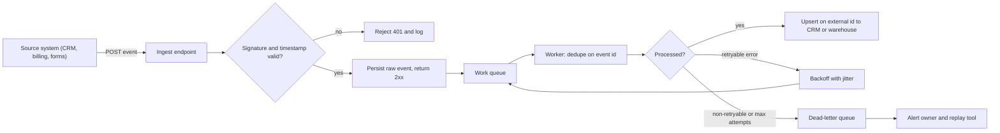

# Data architecture for GTM systems

Revenue systems break because of bad data far more often than because of bad tools. Routing breaks because two records describe one company. Marketing credit breaks because a campaign was never linked to the deal it helped create. Automations send the same email twice because a system sent the same update twice.

This page covers how sales data is organized, how systems pass data to each other, and the safety checks that keep the CRM (customer relationship management system), the data warehouse (the central database that holds a copy of all company data) and the outreach tools in agreement. That agreement is what lets a company run its revenue on the data.

For the five-layer view of the full set of tools, see [architecture-layers.md](architecture-layers.md). For whether to build, buy or extend a part, see [build-buy-extend.md](build-buy-extend.md).

## CRM data models

A data model is the set of record types a system keeps (companies, people, deals) and how they link to each other. In Salesforce, each record type is called an "object."

### Salesforce standard objects

| Object | Represents | Notes that matter in practice |
|---|---|---|
| Lead | An unqualified person, not yet tied to a company record | Has its own `Company` text field, not a lookup. Converts into Account + Contact (+ optional Opportunity). |
| Account | A company (or a person, with Person Accounts enabled) | Parent/child hierarchy via `ParentId`. Usually the anchor for territory and ownership. |
| Contact | A person tied to an Account | Must have an Account in most configurations. Engagement history moves here after conversion. |
| Opportunity | A specific deal with an amount, stage and close date | Belongs to one Account. Forecasting, pipeline and win rate all come from here. |
| OpportunityContactRole | Junction between Opportunity and Contact | Holds `Role` and `IsPrimary`. Without it, you cannot say which people influenced a deal. |
| Campaign / CampaignMember | A marketing program and who touched it | CampaignMember links a Lead or Contact to a Campaign with a status. Primary input for attribution. |

A "lookup" is a link to another record, as opposed to plain typed text. A "junction" is a record whose only job is to connect two other records. Attribution means giving marketing programs credit for the deals they helped create.

Most reporting depends on one chain of links: Campaign -> CampaignMember -> Contact -> OpportunityContactRole -> Opportunity. If any link is missing, multi-touch attribution (credit split across every program that touched a deal) quietly undercounts. A quick health check: what share of won deals have no contacts attached? The query below calculates it for the last 180 days.

```sql
SELECT
  COUNT(*) FILTER (WHERE ocr_count = 0)::float / COUNT(*) AS pct_won_without_contact_roles
FROM (
  SELECT o.id, COUNT(ocr.id) AS ocr_count
  FROM opportunity o
  LEFT JOIN opportunity_contact_role ocr ON ocr.opportunity_id = o.id
  WHERE o.is_won AND o.close_date >= CURRENT_DATE - INTERVAL '180 days'
  GROUP BY o.id
) t;
```

### HubSpot objects and associations

HubSpot keeps contacts, companies, deals and tickets as separate record types, linked by "associations." One contact can link to many companies and the reverse. Each link can carry a label, such as "Decision maker" or "Billing contact." Those labels do the same job as contact roles in Salesforce.

HubSpot can link contacts to companies automatically by email domain. That is convenient, but it is also a common source of wrong links when people use personal or agency email addresses. Newer versions of HubSpot also have a separate Leads record type. Check whether a given account uses it before designing anything around lifecycle stage alone.

### The lead vs contact problem

In Salesforce, a new person from an existing customer often comes in as a Lead, with no link to the Account the account team owns. Marketing treats it as a brand-new prospect. The AE (account executive) who owns the account never sees it. The rep who does call has no account context.

| Approach | How it works | Tradeoff |
|---|---|---|
| Lead-to-account matching | Match on email domain (and fallback rules) at creation, stamp `Matched_Account__c`, route to the account owner | Keeps the Lead object, but every report must respect the match field |
| Convert on create when matched | Auto-convert matched Leads into Contacts on the existing Account | Clean account view; loses Lead-stage funnel reporting unless you track it separately |
| Contact-only model | Skip Leads entirely, create Account + Contact immediately | Simplest data model; requires a lifecycle field to represent qualification |

The right choice depends on the business. If it mostly sells to brand-new companies, Leads are worth keeping. If it mostly grows inside companies it already knows, Leads mostly create duplicates.

## Systems of record, engagement and intelligence

Every tool in the stack plays one of three roles.

| Category | Job | Examples | Rule |
|---|---|---|---|
| System of record | The authoritative value for an entity or field | Salesforce, HubSpot, billing system, HRIS | Each field has exactly one owner |
| System of engagement | Where people act: send, call, meet | Salesloft, Outreach, Instantly, Gong, calendar tools | Writes activities back; does not own account or opportunity fields |
| System of intelligence | Joins, scores, models and explains | Warehouse, dbt models, scoring services, LLM extraction | Produces derived fields; publishes them through reverse ETL or API with lineage |

In plain terms: the system of record holds the one official value. The system of engagement is where reps do their work. The system of intelligence combines data and calculates scores. HRIS is the HR system. dbt is a tool for writing data transformations in SQL. An LLM is a large language model, the type of AI behind ChatGPT and Claude. Reverse ETL means copying data from the warehouse back into working tools. An API is the doorway one system offers for other systems to read and write its data. Lineage means a record of where each value came from.

Most sync conflicts happen because an outreach tool or a data-enrichment tool was allowed to overwrite a field that belongs to the system of record.

## Entity relationships

An "entity" is a real-world thing the system tracks: a company, a person, a deal. Below is a minimal model that fits both Salesforce and HubSpot. Read `1---*` as "one to many" (one account has many contacts) and `*---*` as "many to many."

```
Account 1---* Contact
Account 1---* Opportunity *---* Contact   (via contact role / association label)
Account 1---* Location                    (for field or multi-site businesses)
Contact *---* Campaign                    (via campaign member)
Account 1---* Signal                      (hiring, funding, tech change, with observed_at)
Any entity 1---* SourceRecord             (one row per system that knows about it)
```

The `SourceRecord` table is what lets you work out which records are the same company or person, and trace where each value came from. It stores `(entity_id, source_system, source_id, first_seen_at, last_seen_at)`: which system knows about the entity, under what ID, and since when. See [the GTM ontology project](../../projects/gtm-ontology/README.md) for a fuller model.

## Identity resolution

Identity resolution means deciding when two records are the same real company or person. You can get it wrong in two directions. Miss a match, and you get duplicate outreach and a deal split across two records. Make a false match, and you merge two different companies, which can send a prospect to the account owner of a competitor.

### Deterministic keys

Start with exact matches on cleaned-up identifiers ("deterministic" means plain code with fixed rules, so the same input always gives the same answer). Exact matches are cheap, easy to explain and rarely wrong.

| Key | Normalization | Pitfalls |
|---|---|---|
| Company domain | Lowercase, strip scheme, `www.`, path and trailing dot; resolve known redirects | Exclude freemail domains (gmail.com, outlook.com); parent and subsidiaries can share a domain |
| Phone | Parse to E.164 (for example with `libphonenumber`) using the record's country as default region | Main lines shared by many locations; call-tracking numbers |
| Provider id | Store as-is with its namespace: `salesforce:001...`, `hubspot:12345`, `overture:...` | Ids can be recycled or re-keyed after a vendor migration |
| Email (people) | Lowercase, trim; do not strip `+tags` unless you know the provider semantics | Role addresses (`info@`) are not people |

"Normalization" means cleaning a value into one standard form before comparing it. E.164 is the international standard phone format (for example +15551234567).

### Probabilistic matching

When no exact identifier matches, score how likely two records are the same. For local businesses or businesses with many locations, two signals work well together: how similar the names are, and how close the addresses are on a map.

```
name_sim   = jaro_winkler(normalize(name_a), normalize(name_b))     # strip "Inc", "LLC", punctuation
geo_score  = max(0, 1 - distance_m / 500)                            # 500 m radius
match      = 0.6 * name_sim + 0.4 * geo_score                         # example weights
```

Jaro-Winkler is a standard way to score how similar two names are, from 0 (nothing alike) to 1 (identical). Then, instead of a single yes or no, sort the score into bands:

| Score band | Action |
|---|---|
| >= 0.92 | Auto-link to the existing entity |
| 0.75 to 0.92 | Send to a human review queue with both records side by side |
| < 0.75 | Treat as a new entity |

Set the bands from real examples, not gut feel. Have a person label a few hundred pairs as "same" or "different." At each possible cutoff, measure precision (of the pairs linked, how many were really the same) and recall (of the real matches, how many were caught). Pick the auto-link cutoff where precision meets what the business can tolerate. Merging two different customers is usually worse than leaving a duplicate. Measure again when data sources change. The [RouteHero project](../../projects/routehero/README.md) uses this method, with a review queue for business locations.

### Deduplication and merging

Deduplication means merging duplicate records. Prefer linking records over merging them for good. Keep one master ID for each real company (the "golden" ID) and a table linking each source record to it. That way a bad match can be undone.

When you do merge inside the CRM, decide in advance which value wins for each field. Options include the most recent value from the owning system, the most complete value, or a fixed ranking of sources. Save what the records looked like before the merge. Test the merge rules on known tricky cases: franchises that share a brand name, a hospital system with fifty sites, a company that changed its website domain.

## APIs

An API is how one system lets another read and write its data. These are the practical points that matter when connecting to CRM and vendor APIs.

| Concern | What to know | Implementation habit |
|---|---|---|
| REST basics | Resources, verbs, status codes; most CRM APIs are REST plus a query language (SOQL, HubSpot search) | Wrap each vendor in one client module with typed responses |
| Pagination | Offset pagination drifts when records change mid-read; cursor pagination (`after`, `nextRecordsUrl`) does not | Always follow the cursor; never assume one page |
| Rate limits | Vendors enforce burst and daily limits, often per app or per org | Read limit headers, throttle client-side, honor `Retry-After` |
| Bulk APIs | Salesforce Bulk API 2.0 and HubSpot batch endpoints move large volumes as jobs | Use them above a few thousand records; poll job status; process per-row failures |
| Incremental reads | Filter by `SystemModstamp` / `lastmodifieddate` with an overlap window | Store a high-water mark per object; re-read a small overlap to cover clock skew |

What the table means in plain terms:

- **REST** is the most common style of API. You ask for a type of record and get an answer plus a status code that says whether it worked.
- **Pagination**: APIs return results one page at a time. The safe method (a "cursor") remembers exactly where you left off, so nothing is skipped when records change during the read.
- **Rate limits**: vendors cap how many requests you can make per second or per day. Slow down on your side, and wait as long as the vendor asks when it says "retry after."
- **Bulk APIs**: for thousands of records, send them as one large job instead of one at a time.
- **Incremental reads**: only fetch records changed since the last run. Remember the last time you read (the "high-water mark") and re-read a few extra minutes, in case two systems' clocks disagree slightly.

## Webhooks

A webhook is a message one system sends another the moment something happens. It replaces checking again and again for changes (polling). Three facts shape how you handle them:

1. **Authenticity.** Check that the message really came from the vendor before trusting it. Most vendors sign each message with a secret key (an HMAC signature). Check the signature, and reject old timestamps so nobody can resend a captured message (a "replay").
2. **At-least-once delivery.** If your system is slow to answer, the vendor sends the message again. Duplicates are normal. Your handling must be safe to run twice without creating duplicates (this property is called "idempotency").
3. **No ordering guarantee.** An "updated" message can arrive before the "created" message. Use the timestamp or version number to ignore stale updates, or fetch the current record fresh each time.

The code below checks a signature and rejects messages older than five minutes.

```python
import hmac, hashlib, time

def verify(raw_body: bytes, signature: str, timestamp: str, secret: bytes) -> bool:
    if abs(time.time() - int(timestamp)) > 300:
        return False
    expected = hmac.new(secret, timestamp.encode() + b"." + raw_body, hashlib.sha256).hexdigest()
    return hmac.compare_digest(expected, signature)
```

Each vendor signs a slightly different string. Read their documentation rather than copying this exact version.

Answer the vendor right away. Save the raw message, put it in a work queue, and process it afterward. If you update the CRM before answering, a slow CRM makes the vendor time out. Timeouts cause resends, and resends cause duplicates.

The diagram shows the full path. A "worker" is the background process that picks items off the queue. "Upsert" means update the record if it exists, or create it if it does not. "Backoff with jitter" means waiting a little longer after each failed retry, with a small random delay so many retries do not hit at once. The dead-letter queue is a holding area for items that keep failing.



## ETL, ELT, warehouses and reverse ETL

These are the main ways of moving data from one system to another. The letters stand for extract (pull data out), transform (clean and reshape it) and load (put it somewhere).

| Pattern | Flow | Fits when | Watch out for |
|---|---|---|---|
| ETL | Extract, transform in pipeline code, load clean data | Small volumes, strict shape needed at load, no warehouse | Logic hidden in scripts; hard to re-run history |
| ELT | Load raw into warehouse, transform with SQL (often dbt) | You want replayable history and analysts can read the logic | Raw tables grow; needs naming and ownership discipline |
| Reverse ETL | Push modeled warehouse fields back into CRM and engagement tools | Scores, health, product usage need to reach reps where they work | Writing to fields the CRM should own; API limits on large syncs |

ETL cleans the data before storing it. ELT stores the raw data first and cleans it inside the warehouse, so you can always go back and redo the cleaning. Reverse ETL sends finished results back to the tools reps use.

A common setup looks like this. Connector tools (Fivetran, Airbyte or custom code) copy raw CRM, billing and product data into a warehouse (Snowflake, BigQuery or Postgres). dbt builds clean tables from it: one for accounts (`dim_account`), one for deals (`fct_opportunity`) and one for signals (`fct_signal`). A reverse ETL tool (Hightouch, Census or a custom job) then writes `account_score`, `score_tier` and `health_score` back into the CRM as fields reps can see but not edit.

## Event-driven architecture

The older approach runs a big job every night that compares everything. The event-driven approach announces each change as it happens, such as `account.signal_detected`, `opportunity.stage_changed` or `contact.unsubscribed`. Any system that cares listens and reacts.

The benefits: faster response (which matters for speed to lead), systems that do not depend on each other directly, and a history you can replay. The costs: more moving parts, harder troubleshooting, and every listener must be safe to run twice without creating duplicates.

For most GTM teams, a simple queue stored in the database, or the queue built into their workflow tool, is enough. A dedicated event system only pays off when several separate systems all need the same events.

Unsubscribe and do-not-contact events should travel the fastest path in the system, never wait for a nightly job.

## Data synchronization and field ownership

When two systems sync both ways and both can edit the same field, they will conflict. The fix is not cleverer conflict handling. The fix is a table that says which system owns each field.

| Field | Owner | Other systems |
|---|---|---|
| Account owner, territory | CRM (routing logic) | Read-only everywhere else |
| Employee count, industry | Enrichment pipeline | CRM displays; reps request corrections through a field, not by editing |
| Account score, tier | Scoring service / warehouse | Read-only in CRM |
| Sequence status, last touch | Sequencer | Written to CRM activity fields |
| Opt-out, do-not-contact | Whichever system receives it, propagated everywhere | Never overwritten by a sync |

The enrichment pipeline is the process that fills in company facts from data vendors. The sequencer is the tool that sends a series of outreach emails.

If both sides really must stay editable, let the most recent change win, based on a timestamp you trust, and log every overwrite so someone can review it. Watch for sync loops: system A updates B, B tells A about the change, A updates B again, forever. Break the loop by skipping writes when the value has not changed, and by tagging each write with where it came from.

## Idempotency

An action is idempotent if running it twice has the same effect as running it once. In plain terms: safe to run twice without creating duplicates. Every process that writes GTM data needs this, because retries and repeated messages are certain to happen.

Two methods cover most cases:

- **Idempotency keys.** Give each action a unique ID, such as the vendor's message ID, or a code built from the source, the record and the action. Keep a list of IDs already handled, and skip any repeat.
- **Upserts on external IDs.** Write each record using the ID from the system it came from. If the record already exists, it gets updated instead of copied. In Postgres this is `INSERT ... ON CONFLICT`. In Salesforce it is an upsert on an External ID field.

The SQL below saves a contact using the source system's ID. It also ignores any update older than what is already stored, which handles messages that arrive out of order.

```sql
-- Upsert keyed on the source system's id, and ignore stale events that arrive out of order.
INSERT INTO contact (source, source_id, email, phone_e164, source_updated_at)
VALUES ($1, $2, $3, $4, $5)
ON CONFLICT (source, source_id) DO UPDATE
SET email = EXCLUDED.email,
    phone_e164 = EXCLUDED.phone_e164,
    source_updated_at = EXCLUDED.source_updated_at
WHERE contact.source_updated_at < EXCLUDED.source_updated_at;
```

The Python below records each message ID the first time it is seen. If the ID is already there, it stops. The record and the change are saved together, so either both happen or neither does.

```python
def handle(conn, event):
    with conn.transaction():
        first_time = conn.execute(
            "INSERT INTO processed_event (source, event_id) VALUES (%s, %s) "
            "ON CONFLICT DO NOTHING RETURNING event_id",
            (event["source"], event["id"]),
        ).fetchone()
        if not first_time:
            return "duplicate"
        apply_change(conn, event)   # same transaction: both commit or neither does
    return "processed"
```

Some actions happen outside your database, such as sending an email or creating a task in another tool. For those, pass a unique ID to the vendor if it accepts one. Otherwise, record that you intend to do the action first, and check that record before doing it.

## Retry handling

Retry failures that are temporary. Do not retry requests that were wrong in the first place. The numbers in the table are standard web response codes.

| Response | Retry? | Notes |
|---|---|---|
| Network error, timeout | Yes | Assume the request may have succeeded; rely on idempotency |
| 408, 429 | Yes | For 429, honor `Retry-After` when present |
| 500, 502, 503, 504 | Yes | Transient server or gateway errors |
| 401 | Once, after refreshing the token | Then fail |
| 400, 403, 404, 422 | No | Fix the data or permissions; send to DLQ with the error |
| 409 | Usually no | Conflict: re-read state and decide |

In short: 429 means "too many requests, slow down." The 500s mean the other system had a temporary problem. 401 means your login expired. The 400s mean the request itself was bad. DLQ is the dead-letter queue, the holding area for items that keep failing.

Wait a little longer after each failed retry (exponential backoff), and add a small random delay (jitter). Without the random delay, a burst of failures all retries at the same moment and fails again.

```python
import random, time

def call_with_retry(fn, max_attempts=6, base=0.5, cap=60):
    for attempt in range(max_attempts):
        try:
            return fn()
        except RetryableError as e:
            if attempt == max_attempts - 1:
                raise
            delay = e.retry_after or random.uniform(0, min(cap, base * 2 ** attempt))
            time.sleep(delay)
```

After the last attempt, move the item to the dead-letter queue, with the original data, the error and the number of attempts. A dead-letter queue with no owner, no alert and no way to re-run items is just a slower way to lose data. Track how many items are waiting there and how old they are.

## Data validation

Check data at the door, where it enters your system, so bad records never reach the CRM.

- **Shape checks (schema validation).** Check every incoming message against a defined format, using a tool such as Pydantic, Zod or JSON Schema. Reject or set aside anything that fails, and store the reason.
- **Sense checks.** The website domain exists. The phone number parses into the standard E.164 format. The country uses the standard ISO-3166 code. The close date is not in 1970.
- **Freshness checks.** Alert when a source stops sending updates.
- **Blank-value monitoring.** A sudden jump in empty fields usually means a vendor renamed a field or a mapping broke.

The first query finds sources that have not loaded in over 24 hours. The second compares today's share of missing phone numbers with the average of the last 7 days.

```sql
-- Freshness: hours since last successful load per source
SELECT source, EXTRACT(EPOCH FROM now() - MAX(loaded_at)) / 3600 AS hours_stale
FROM raw_load_log GROUP BY source HAVING MAX(loaded_at) < now() - INTERVAL '24 hours';

-- Null rate today vs trailing 7-day average for a field
SELECT
  AVG((phone_e164 IS NULL)::int) FILTER (WHERE loaded_at::date = CURRENT_DATE) AS null_rate_today,
  AVG((phone_e164 IS NULL)::int) FILTER (WHERE loaded_at >= CURRENT_DATE - 7 AND loaded_at::date < CURRENT_DATE) AS null_rate_7d
FROM stg_contact;
```

Tools such as dbt tests or Great Expectations make these checks more formal. A scheduled query that posts results to Slack is a fine place to start.

## Testing and measuring this layer

How to test it:

- Replay a recorded day of incoming messages twice, and confirm the record counts do not change.
- Send messages out of order, and confirm the final record matches the newest message.
- Run a hand-labeled set of match pairs through the matching step, and report precision and recall.
- Stop the background worker halfway through a batch, and confirm nothing is lost or doubled.

How to measure business impact: duplicate rate for accounts and contacts, share of inbound leads matched to an existing account, share of won deals with contacts attached, typical time from a change in the source to the CRM update, and how many items sit in the dead-letter queue and for how long. These lead straight to fewer double-touches, faster routing, and marketing credit reports leadership can trust.

## What would change the approach

- Low volume and one CRM: skip the warehouse. Check data and upsert straight into the CRM, and keep a small table of messages already handled.
- Many sources and heavy reporting: move to ELT, with the warehouse as the system of intelligence and reverse ETL back to the CRM.
- Strict speed requirements (responding to leads within minutes): react to webhooks as they arrive instead of running batch jobs.
- Regulated data or many regions: field ownership, plus rules on which countries data may be stored in, decide where data may be copied at all. See [governance and operations](../07-governance-and-operations/README.md).

## Related

- [Architecture layers](architecture-layers.md)
- [Build, buy or extend](build-buy-extend.md)
- [Technology ecosystem](technology-ecosystem.md)
- [GTM engineering](../04-gtm-engineering/README.md)
- [Governance and operations](../07-governance-and-operations/README.md)
- [Analytics and prediction](../06-analytics-and-prediction/README.md)
- [GTM ontology project](../../projects/gtm-ontology/README.md)
- [RouteHero project](../../projects/routehero/README.md)
- [Decision examples](../../decision-examples/README.md)
