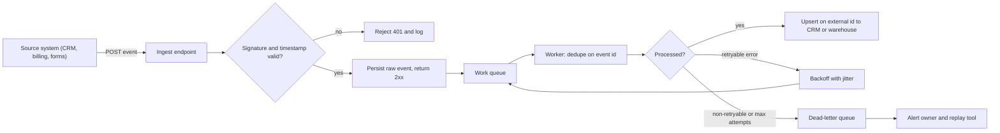

# Data architecture for GTM systems

GTM systems fail at the data layer far more often than at the tool layer. Routing breaks because two records describe one company, attribution breaks because a campaign member was never linked to an opportunity, and automations double-send because a webhook arrived twice. This page covers the data models, integration patterns and safety mechanisms that keep CRM, warehouse and engagement tools consistent enough to run revenue on.

For the five-layer view of the full stack, see [architecture-layers.md](architecture-layers.md). For whether to build, buy or extend a component, see [build-buy-extend.md](build-buy-extend.md).

## CRM data models

### Salesforce standard objects

| Object | Represents | Notes that matter in practice |
|---|---|---|
| Lead | An unqualified person, not yet tied to a company record | Has its own `Company` text field, not a lookup. Converts into Account + Contact (+ optional Opportunity). |
| Account | A company (or a person, with Person Accounts enabled) | Parent/child hierarchy via `ParentId`. Usually the anchor for territory and ownership. |
| Contact | A person tied to an Account | Must have an Account in most configurations. Engagement history moves here after conversion. |
| Opportunity | A specific deal with an amount, stage and close date | Belongs to one Account. Forecasting, pipeline and win rate all come from here. |
| OpportunityContactRole | Junction between Opportunity and Contact | Holds `Role` and `IsPrimary`. Without it, you cannot say which people influenced a deal. |
| Campaign / CampaignMember | A marketing program and who touched it | CampaignMember links a Lead or Contact to a Campaign with a status. Primary input for attribution. |

The chain that most reporting depends on is: Campaign -> CampaignMember -> Contact -> OpportunityContactRole -> Opportunity. If any link is missing, multi-touch attribution silently undercounts. A cheap health check is the share of closed-won opportunities with zero contact roles:

```sql
SELECT
  COUNT(*) FILTER (WHERE ocr_count = 0)::float / COUNT(*) AS pct_won_without_contact_roles
FROM (
  SELECT o.id, COUNT(ocr.id) AS ocr_count
  FROM opportunity o
  LEFT JOIN opportunity_contact_role ocr ON ocr.opportunity_id = o.id
  WHERE o.is_won AND o.close_date >= CURRENT_DATE - INTERVAL '180 days'
  GROUP BY o.id
) t;
```

### HubSpot objects and associations

HubSpot models contacts, companies, deals and tickets as separate objects joined by associations. Associations are many-to-many and can carry labels (for example "Decision maker" or "Billing contact"), which play the role that OpportunityContactRole plays in Salesforce. HubSpot can auto-associate contacts to companies by email domain; that setting is convenient and also a common source of wrong associations when people use personal or agency email addresses. HubSpot has also added a separate Leads object in recent versions; check whether a given portal uses it before designing around lifecycle stage alone.

### The lead vs contact problem

In Salesforce, a new person from an existing customer often lands as a Lead, disconnected from the Account the account team owns. Marketing routes it as net-new, the AE never sees it, and the rep who does call it has no account context.

| Approach | How it works | Tradeoff |
|---|---|---|
| Lead-to-account matching | Match on email domain (and fallback rules) at creation, stamp `Matched_Account__c`, route to the account owner | Keeps the Lead object, but every report must respect the match field |
| Convert on create when matched | Auto-convert matched Leads into Contacts on the existing Account | Clean account view; loses Lead-stage funnel reporting unless you track it separately |
| Contact-only model | Skip Leads entirely, create Account + Contact immediately | Simplest data model; requires a lifecycle field to represent qualification |

The decision depends on whether the business sells to net-new logos (Leads earn their keep) or mostly expands inside known accounts (Leads mostly create duplication).

## Systems of record, engagement and intelligence

| Category | Job | Examples | Rule |
|---|---|---|---|
| System of record | The authoritative value for an entity or field | Salesforce, HubSpot, billing system, HRIS | Each field has exactly one owner |
| System of engagement | Where people act: send, call, meet | Salesloft, Outreach, Instantly, Gong, calendar tools | Writes activities back; does not own account or opportunity fields |
| System of intelligence | Joins, scores, models and explains | Warehouse, dbt models, scoring services, LLM extraction | Produces derived fields; publishes them through reverse ETL or API with lineage |

Most sync conflicts trace back to an engagement tool or enrichment tool being allowed to overwrite a field owned by the system of record.

## Entity relationships

A minimal GTM entity model that maps to both CRMs:

```
Account 1---* Contact
Account 1---* Opportunity *---* Contact   (via contact role / association label)
Account 1---* Location                    (for field or multi-site businesses)
Contact *---* Campaign                    (via campaign member)
Account 1---* Signal                      (hiring, funding, tech change, with observed_at)
Any entity 1---* SourceRecord             (one row per system that knows about it)
```

The `SourceRecord` table is what makes identity resolution and lineage possible: it stores `(entity_id, source_system, source_id, first_seen_at, last_seen_at)`. See [the GTM ontology project](../../projects/gtm-ontology/README.md) for a fuller domain model.

## Identity resolution

Identity resolution decides when two records are the same real-world entity. Get it wrong in one direction and you get duplicate outreach and split pipeline; wrong in the other and you merge two different companies and route a prospect to a competitor's account owner.

### Deterministic keys

Use exact matches on normalized keys first. They are cheap, explainable and high precision.

| Key | Normalization | Pitfalls |
|---|---|---|
| Company domain | Lowercase, strip scheme, `www.`, path and trailing dot; resolve known redirects | Exclude freemail domains (gmail.com, outlook.com); parent and subsidiaries can share a domain |
| Phone | Parse to E.164 (for example with `libphonenumber`) using the record's country as default region | Main lines shared by many locations; call-tracking numbers |
| Provider id | Store as-is with its namespace: `salesforce:001...`, `hubspot:12345`, `overture:...` | Ids can be recycled or re-keyed after a vendor migration |
| Email (people) | Lowercase, trim; do not strip `+tags` unless you know the provider semantics | Role addresses (`info@`) are not people |

### Probabilistic matching

When no deterministic key matches, score candidate pairs. For local or multi-location businesses, name similarity plus geographic distance works well:

```
name_sim   = jaro_winkler(normalize(name_a), normalize(name_b))     # strip "Inc", "LLC", punctuation
geo_score  = max(0, 1 - distance_m / 500)                            # 500 m radius, illustrative
match      = 0.6 * name_sim + 0.4 * geo_score                         # weights illustrative
```

Then apply thresholds instead of a single yes/no:

| Score band (illustrative) | Action |
|---|---|
| >= 0.92 | Auto-link to the existing entity |
| 0.75 to 0.92 | Send to a human review queue with both records side by side |
| < 0.75 | Treat as a new entity |

Set the bands from a labeled sample, not intuition: label a few hundred candidate pairs, compute precision and recall at each threshold, and pick the auto-link threshold where precision meets the business tolerance (merging two different customers is usually worse than a duplicate). Re-measure when sources change. The [RouteHero project](../../projects/routehero/README.md) uses this pattern with a review queue for business locations.

### Deduplication and merging

Prefer linking over destructive merging. Keep a golden entity id and a link table from each source record to it, so a bad match can be undone. When you do merge in the CRM, define survivorship rules per field (most recent from the owning system, most complete, or a fixed source priority) and log the before state. Test dedupe logic against known-tricky pairs: franchises sharing a brand name, a hospital system with fifty sites, a company that changed domains.

## APIs

| Concern | What to know | Implementation habit |
|---|---|---|
| REST basics | Resources, verbs, status codes; most CRM APIs are REST plus a query language (SOQL, HubSpot search) | Wrap each vendor in one client module with typed responses |
| Pagination | Offset pagination drifts when records change mid-read; cursor pagination (`after`, `nextRecordsUrl`) does not | Always follow the cursor; never assume one page |
| Rate limits | Vendors enforce burst and daily limits, often per app or per org | Read limit headers, throttle client-side, honor `Retry-After` |
| Bulk APIs | Salesforce Bulk API 2.0 and HubSpot batch endpoints move large volumes as jobs | Use them above a few thousand records; poll job status; process per-row failures |
| Incremental reads | Filter by `SystemModstamp` / `lastmodifieddate` with an overlap window | Store a high-water mark per object; re-read a small overlap to cover clock skew |

## Webhooks

Webhooks push changes instead of making you poll. Three properties shape every handler:

1. **Authenticity.** Verify the signature before trusting the payload. Most vendors sign with an HMAC over the raw body (sometimes plus timestamp and URL). Compare with a constant-time function and reject stale timestamps to block replays.
2. **At-least-once delivery.** Vendors retry on timeouts and non-2xx responses, so duplicates are normal. Handlers must be idempotent.
3. **No ordering guarantee.** An "updated" event can arrive before the "created" event. Use the source timestamp or version to discard stale writes, or re-fetch the current record from the API on each event.

```python
import hmac, hashlib, time

def verify(raw_body: bytes, signature: str, timestamp: str, secret: bytes) -> bool:
    if abs(time.time() - int(timestamp)) > 300:
        return False
    expected = hmac.new(secret, timestamp.encode() + b"." + raw_body, hashlib.sha256).hexdigest()
    return hmac.compare_digest(expected, signature)
```

The exact signed string differs by vendor; read their spec rather than copying this shape.

Return 2xx fast. Persist the raw event, enqueue it, and process asynchronously. Doing CRM writes inside the request handler means a slow CRM causes vendor timeouts, which cause retries, which cause duplicates.



## ETL, ELT, warehouses and reverse ETL

| Pattern | Flow | Fits when | Watch out for |
|---|---|---|---|
| ETL | Extract, transform in pipeline code, load clean data | Small volumes, strict shape needed at load, no warehouse | Logic hidden in scripts; hard to re-run history |
| ELT | Load raw into warehouse, transform with SQL (often dbt) | You want replayable history and analysts can read the logic | Raw tables grow; needs naming and ownership discipline |
| Reverse ETL | Push modeled warehouse fields back into CRM and engagement tools | Scores, health, product usage need to reach reps where they work | Writing to fields the CRM should own; API limits on large syncs |

A common shape: connectors (Fivetran, Airbyte or custom) land raw CRM, billing and product data in Snowflake, BigQuery or Postgres; dbt builds `dim_account`, `fct_opportunity`, `fct_signal`; reverse ETL (Hightouch, Census or a custom job) writes `account_score`, `score_tier` and `health_score` back to the CRM as read-only fields.

## Event-driven architecture

Instead of nightly batch jobs that diff everything, publish events (`account.signal_detected`, `opportunity.stage_changed`, `contact.unsubscribed`) to a queue or log and let consumers react. Benefits: lower latency for speed-to-lead, decoupled consumers, a replayable history. Costs: more moving parts, harder debugging, and the need for idempotent consumers. For most GTM teams a database-backed queue or the orchestration tool's own queue is enough; a dedicated event bus earns its keep when several independent consumers need the same events.

Unsubscribe and do-not-contact events should be the fastest path in the system, not a nightly batch.

## Data synchronization and field ownership

Bidirectional sync between two systems creates conflicts whenever both can edit the same field. The fix is a field ownership matrix, not smarter conflict resolution.

| Field | Owner | Other systems |
|---|---|---|
| Account owner, territory | CRM (routing logic) | Read-only everywhere else |
| Employee count, industry | Enrichment pipeline | CRM displays; reps request corrections through a field, not by editing |
| Account score, tier | Scoring service / warehouse | Read-only in CRM |
| Sequence status, last touch | Sequencer | Written to CRM activity fields |
| Opt-out, do-not-contact | Whichever system receives it, propagated everywhere | Never overwritten by a sync |

When both sides must stay editable, use last-writer-wins on a trusted source timestamp, and log every overwrite so someone can audit it. Watch for sync loops: system A updates B, B's webhook updates A, repeat. Break them by skipping writes when the value is unchanged and tagging writes with their origin.

## Idempotency

An operation is idempotent if running it twice has the same effect as running it once. Every GTM write path needs this because retries and duplicate webhooks are guaranteed.

Two tools cover most cases:

- **Idempotency keys.** A unique id per logical operation (the vendor event id, or a hash of source + record + action). Store processed keys and skip repeats.
- **Upserts on external ids.** Write with `INSERT ... ON CONFLICT` in Postgres, or Salesforce upsert on an External ID field, so a retry updates instead of duplicating.

```sql
-- Upsert keyed on the source system's id, and ignore stale events that arrive out of order.
INSERT INTO contact (source, source_id, email, phone_e164, source_updated_at)
VALUES ($1, $2, $3, $4, $5)
ON CONFLICT (source, source_id) DO UPDATE
SET email = EXCLUDED.email,
    phone_e164 = EXCLUDED.phone_e164,
    source_updated_at = EXCLUDED.source_updated_at
WHERE contact.source_updated_at < EXCLUDED.source_updated_at;
```

```python
def handle(conn, event):
    with conn.transaction():
        first_time = conn.execute(
            "INSERT INTO processed_event (source, event_id) VALUES (%s, %s) "
            "ON CONFLICT DO NOTHING RETURNING event_id",
            (event["source"], event["id"]),
        ).fetchone()
        if not first_time:
            return "duplicate"
        apply_change(conn, event)   # same transaction: both commit or neither does
    return "processed"
```

For side effects outside the database (sending an email, creating a task in another tool), pass an idempotency key to the vendor if it supports one, or record the intent first and check it before sending.

## Retry handling

Retry transient failures, not bad requests.

| Response | Retry? | Notes |
|---|---|---|
| Network error, timeout | Yes | Assume the request may have succeeded; rely on idempotency |
| 408, 429 | Yes | For 429, honor `Retry-After` when present |
| 500, 502, 503, 504 | Yes | Transient server or gateway errors |
| 401 | Once, after refreshing the token | Then fail |
| 400, 403, 404, 422 | No | Fix the data or permissions; send to DLQ with the error |
| 409 | Usually no | Conflict: re-read state and decide |

Use exponential backoff with jitter so a burst of failures does not retry in lockstep:

```python
import random, time

def call_with_retry(fn, max_attempts=6, base=0.5, cap=60):
    for attempt in range(max_attempts):
        try:
            return fn()
        except RetryableError as e:
            if attempt == max_attempts - 1:
                raise
            delay = e.retry_after or random.uniform(0, min(cap, base * 2 ** attempt))
            time.sleep(delay)
```

After the last attempt, move the message to a dead-letter queue with the payload, error and attempt count. A DLQ without an owner, an alert and a replay command is just a slower way to lose data. Track DLQ depth and age as metrics.

## Data validation

Validate at the boundary, where data enters your system, so bad records never reach the CRM.

- **Schema validation.** Parse every inbound payload with a schema (Pydantic, Zod, JSON Schema). Reject or quarantine records that fail, with the reason stored.
- **Semantic checks.** Domain resolves, phone parses to E.164, country is ISO-3166, close date is not in 1970.
- **Freshness checks.** Alert when a source stops updating.
- **Null-rate monitoring.** A sudden jump in nulls usually means a vendor changed a field name or a mapping broke.

```sql
-- Freshness: hours since last successful load per source
SELECT source, EXTRACT(EPOCH FROM now() - MAX(loaded_at)) / 3600 AS hours_stale
FROM raw_load_log GROUP BY source HAVING MAX(loaded_at) < now() - INTERVAL '24 hours';

-- Null rate today vs trailing 7-day average for a field
SELECT
  AVG((phone_e164 IS NULL)::int) FILTER (WHERE loaded_at::date = CURRENT_DATE) AS null_rate_today,
  AVG((phone_e164 IS NULL)::int) FILTER (WHERE loaded_at >= CURRENT_DATE - 7 AND loaded_at::date < CURRENT_DATE) AS null_rate_7d
FROM stg_contact;
```

Tools such as dbt tests or Great Expectations formalize these checks; a scheduled SQL query that posts to Slack is a fine start.

## Testing and measuring this layer

How to test: replay a recorded day of webhooks twice and assert record counts do not change; send events out of order and assert the final state matches the newest event; feed a labeled set of match pairs through identity resolution and report precision and recall; kill the worker mid-batch and confirm nothing is lost or doubled.

How to measure business impact: duplicate rate on accounts and contacts, share of inbound leads matched to an existing account, share of closed-won opportunities with contact roles, median time from source event to CRM update, DLQ volume and age. These map directly to fewer double-touches, faster routing and attribution reports that leadership can trust.

## What would change the approach

- Low volume and one CRM: skip the warehouse; validate and upsert directly, and keep a small processed-event table.
- Many sources and heavy reporting: move to ELT with a warehouse as the system of intelligence and reverse ETL back to the CRM.
- Strict latency (speed-to-lead in minutes): event-driven ingestion with webhooks, not batch.
- Regulated data or many regions: field-level ownership plus residency constraints decide where data may be copied at all. See [governance and operations](../07-governance-and-operations/README.md).

## Related

- [Architecture layers](architecture-layers.md)
- [Build, buy or extend](build-buy-extend.md)
- [Technology ecosystem](technology-ecosystem.md)
- [GTM engineering](../04-gtm-engineering/README.md)
- [Governance and operations](../07-governance-and-operations/README.md)
- [Analytics and prediction](../06-analytics-and-prediction/README.md)
- [GTM ontology project](../../projects/gtm-ontology/README.md)
- [RouteHero project](../../projects/routehero/README.md)
- [Decision examples](../../decision-examples/README.md)
