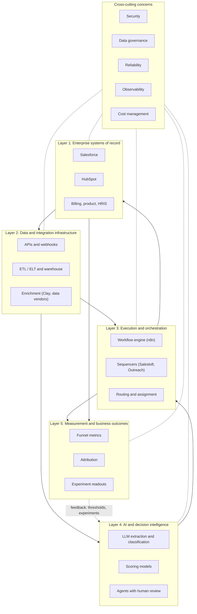

# GTM systems architecture in five layers

A GTM stack is easier to design, debug and staff when each component has one clear job. This page splits the stack into five layers, from systems of record up to measured business outcomes, plus five concerns that cut across all of them. Use it to place a new tool or workflow, to find where a failure originated, and to decide what to monitor.

## Starting principle: companies are never greenfield

Every company already has a CRM, a pile of spreadsheets, a sequencer someone bought two years ago, and fields that three different integrations write to. The default move is to extend what exists: add a field, a validation rule, a flow, a well-scoped integration. Build custom only where it creates differentiation (a scoring model built on proprietary signals, a territory engine for a business with physical locations) or fills a real capability gap the existing tools cannot cover at reasonable cost. Replacing a system of record is a multi-quarter project with adoption risk; it is rarely the right answer to a data quality problem. See [build, buy or extend](build-buy-extend.md) for the decision framework.

## The layers at a glance

Two flows matter. Data flows up: records and events from Layer 1 are cleaned and joined in Layer 2, interpreted in Layer 4, acted on in Layer 3, and measured in Layer 5. Decisions flow back down: Layer 3 writes outcomes (owner, stage, activity) to Layer 1, and Layer 5 results change thresholds and experiments in Layer 4.

## Layer 1: Enterprise systems of record

The authoritative store for accounts, contacts, opportunities, revenue and the people who own them. Reps and leadership trust what they see here, so every other layer ultimately publishes into it.

| Aspect | Detail |
|---|---|
| Responsibilities | Own core entities and their authoritative fields; enforce permissions and validation rules; hold pipeline and forecast; record activities |
| Typical tools | Salesforce, HubSpot, billing (Stripe, Zuora), product database, HRIS for rep and territory data |
| Failure modes | Duplicate accounts; fields written by multiple integrations; validation rules bypassed by API users; stage definitions that differ by team; Leads disconnected from Accounts |
| What to monitor | Duplicate rate; required-field completion by stage; API request usage against allocation; number of integration users with write access; opportunities missing contact roles |

Design rule: one system owns each field. Write the ownership matrix down before adding a new integration. Details in [data architecture](README.md#data-synchronization-and-field-ownership).

## Layer 2: Data and integration infrastructure

Moves data between systems, standardizes it, and adds external data. This is where identity resolution, deduplication, validation and enrichment happen.

| Aspect | Detail |
|---|---|
| Responsibilities | API clients and webhook ingestion; incremental sync; ELT into a warehouse; transformation models; identity resolution; enrichment waterfalls; reverse ETL back to Layer 1 |
| Typical tools | Vendor APIs and bulk APIs; Fivetran or Airbyte; Snowflake, BigQuery or Postgres; dbt; Clay and data vendors for enrichment; Hightouch or Census for reverse ETL |
| Failure modes | Silent schema changes upstream; duplicated or reordered webhooks; rate-limit exhaustion; stale enrichment; licensing terms that forbid storing vendor data; sync loops between two tools |
| What to monitor | Freshness per source; null rate per important field; DLQ depth and age; enrichment coverage and cost per found record; sync error rate; API quota headroom |

Design rule: validate at the boundary and make every write idempotent. Bad data that reaches the CRM costs more to remove than to block.

## Layer 3: Execution and orchestration

Turns data and decisions into actions: assign this account, start this sequence, create this task, alert this rep.

| Aspect | Detail |
|---|---|
| Responsibilities | Lead and account routing; sequence enrollment and suppression; task and alert creation; scheduled and event-triggered workflows; handoffs between teams |
| Typical tools | n8n, Workato, Zapier or code-based workers; Salesloft, Outreach, Instantly; Salesforce Flow or HubSpot workflows; LeanData-style routing tools; Slack for alerts |
| Failure modes | Routing to inactive or out-of-office reps; double enrollment from duplicate triggers; suppression list not checked before send; workflows that fail silently; logic spread across five tools so nobody can explain an assignment |
| What to monitor | Speed to lead (event to first touch); SLA breaches; workflow success rate and run duration; enrollments blocked by suppression; unassigned records older than SLA |

Design rule: routing and CRM writes come from deterministic code with logged inputs, so any assignment can be explained after the fact.

## Layer 4: AI and decision intelligence

Interprets data that rules alone cannot: unstructured text, ambiguous categories, prioritization across many signals.

| Aspect | Detail |
|---|---|
| Responsibilities | Extract structured fields from text (job posts, call transcripts, websites); classify (industry, persona, intent); compute fit and intent scores; draft research and messages for human review; run agents that propose actions |
| Typical tools | Claude or OpenAI APIs with structured output; Python scoring services; warehouse-native models; evaluation harnesses; review queues |
| Failure modes | Hallucinated fields written straight to the CRM; scores nobody can explain; prompt or model changes that shift outputs without a test; cost spikes from re-processing; agents taking irreversible actions |
| What to monitor | Extraction accuracy on a labeled set; score distribution drift; human override rate; cost per processed record; latency; share of outputs routed to review |

Design rule: models propose, code decides. An LLM can extract "new VP of Sales started in March" from a page; the score, the tier and the CRM write are computed by code from that extracted field. Anything irreversible (sending, merging, deleting) passes through a human or a deterministic gate. See [AI and agents](../05-ai-and-agents/README.md) and [the AI evaluation project](../../projects/ai-evaluation/README.md).

## Layer 5: Measurement and business outcomes

Answers whether the system produced revenue, and feeds that answer back into the layers below.

| Aspect | Detail |
|---|---|
| Responsibilities | Funnel conversion by stage and segment; pipeline created and sourced; attribution; experiment design and readouts; score calibration (do higher tiers convert better?); cost per outcome |
| Typical tools | Warehouse plus BI (Looker, Metabase, Hex, Sigma); CRM reports for operational views; notebooks for experiment analysis |
| Failure modes | Metrics defined differently in CRM and BI; attribution that ignores missing links; experiments read too early or without a holdout; vanity metrics (emails sent) standing in for outcomes |
| What to monitor | Metric definitions under version control; conversion by score tier; experiment sample sizes against plan; cost per meeting and per opportunity; pipeline coverage |

Design rule: every workflow in Layer 3 and every model in Layer 4 should map to a Layer 5 metric. If nobody can name the metric a workflow moves, it is a candidate for removal. See [analytics and prediction](../06-analytics-and-prediction/README.md) and [the revenue bowtie](../02-revenue-bowtie/README.md).

## Cross-cutting concerns

These apply to every layer. Treating them as a separate "platform" project usually means they never get done; build them into each component as it ships.

| Concern | What it means here | Minimum bar per component |
|---|---|---|
| Security | Who and what can read or write which data | Scoped API keys per integration; service accounts, not personal logins; secrets in a vault or environment store; least-privilege CRM profiles |
| Data governance | Ownership, lineage, licensing, privacy | Named owner per field and dataset; source and timestamp stored with derived values; suppression and do-not-contact honored everywhere; vendor terms checked before storing data |
| Reliability | Workflows keep working and recover from failure | Idempotent writes; retries with backoff; DLQ with an owner; an SLO for each workflow that touches revenue |
| Observability | You can see what ran, what failed and why | Run log with inputs, outputs, status and duration; alerts on failure and on silence; dashboards for the monitors listed in each layer table |
| Cost management | Spend tracks value | Cost per run and per record logged; budget alerts on enrichment and LLM spend; caching so unchanged inputs are not re-processed |

More detail in [governance and operations](../07-governance-and-operations/README.md).

## Tracing one signal through the layers

An example of how a single buying signal moves through the stack:

1. **Layer 2:** A job-posting feed shows a target account posting four SDR roles in two weeks. The ingest job validates the payload, resolves the company by domain to an existing Account, and stores a `signal` row with `observed_at` and source.
2. **Layer 4:** An LLM extracts structured fields from the posting text (team, seniority, tools mentioned). Code computes an updated intent score with stored factor contributions.
3. **Layer 3:** The score crosses the tier threshold. The workflow checks suppression and open opportunities, routes to the account owner, creates a task with the reason, and enrolls priority contacts in a sequence.
4. **Layer 1:** The task, the score, the tier and the sequence enrollment are written to the CRM through the integration user, each with a source tag.
5. **Layer 5:** Weekly, the readout compares meeting rate for signal-triggered accounts against a holdout group. If the lift does not appear, the signal weight or the threshold changes.

Each step has its own failure mode and monitor, which is the practical value of the layer split: when meetings drop, you can check freshness (Layer 2), score distribution (Layer 4), enrollment and suppression (Layer 3) and the experiment design (Layer 5) independently.

## Contracts between layers

Layers stay independent only if the hand-offs between them are explicit. Each boundary should have a written contract: the shape of the data, who owns it, and how freshness is guaranteed.

| Boundary | Contract | Example |
|---|---|---|
| Layer 1 to Layer 2 | Incremental extract by modified timestamp, or change events, with a high-water mark per object | `account` changes since last `SystemModstamp`, re-reading a 15-minute overlap |
| Layer 2 to Layer 4 | Clean, deduplicated entity tables with stable ids and a freshness column | `dim_account(account_id, domain, industry, size_band, refreshed_at)` |
| Layer 4 to Layer 3 | Decisions as rows, not as side effects: score, tier, reason codes, model or rule version | `account_score(account_id, score, tier, contributions jsonb, version, scored_at)` |
| Layer 3 to Layer 1 | Idempotent upserts on external ids through a named integration user, tagged with origin | `Account.Score_Tier__c` written by `svc-scoring`, with `run_id` in the audit log |
| Layers 1 and 3 to Layer 5 | Events and stamped dates that let metrics be recomputed from history | Stage-entry dates, campaign member status changes, enrollment events |

When a contract changes (a new column, a renamed tier), version it and update consumers before producers start emitting the new shape.

## Placing a new component

Before adding a tool or workflow, answer these in order:

1. **Which layer is it?** If it spans three layers, it is probably several components bundled together; split the responsibilities even if one vendor provides them.
2. **What does it own?** List the fields or decisions it will be the source of truth for. If the answer overlaps an existing owner, resolve that first.
3. **What already exists?** Check whether a current system can do it with configuration. Most "we need a new tool" requests are really "we need a field, a rule and a report".
4. **What contract does it read and write?** Name the input tables or events and the output rows or fields.
5. **What metric does it move?** Name the Layer 5 metric and how it will be measured, including the comparison group.
6. **What does it cost per unit?** Estimate cost at 1, 1,000, 10,000 and 50,000 records before building. Enrichment and LLM calls scale linearly with volume; put them late in the funnel, after cheap filters.
7. **Who operates it?** Name the owner and backup, and write the runbook before go-live.

## Ownership by layer

Ownership gaps show up as incidents nobody picks up. A typical split, adjusted to team size:

| Layer | Usual owner | Usual partner |
|---|---|---|
| 1: Systems of record | CRM admin or RevOps | Sales and marketing leadership for definitions |
| 2: Data and integration | GTM engineering or data engineering | Security for credentials and vendor review |
| 3: Execution | GTM engineering or marketing ops | Sales managers for routing rules and SLAs |
| 4: AI and decision intelligence | GTM engineering or analytics | Frontline reviewers who label and override outputs |
| 5: Measurement | Analytics or RevOps | Finance for revenue definitions |

In small teams one person may own several layers. That is workable as long as the boundaries and contracts above still exist, so the work can be split when the team grows.

## Maturity by layer

Not every company needs every layer fully built. Match investment to the stage, and move a layer up only when its current form is the measured bottleneck.

| Layer | Early (one CRM, small team) | Scaling (several tools, dedicated ops) | Mature (multiple teams, regions or products) |
|---|---|---|---|
| 1: Records | One CRM, basic stages, few custom fields | Stage exit criteria enforced, field ownership written down | Multiple business units, governed schema changes |
| 2: Data | Native CRM integrations, Clay tables | Warehouse with ELT, identity resolution, reverse ETL | Contracts between producers and consumers, data quality SLOs |
| 3: Execution | CRM workflows, one sequencer | Central orchestration, routing service, global suppression | Event-driven, multi-region rules, capacity-aware routing |
| 4: Intelligence | Manual research, simple fit rules | Factor-based scores, LLM extraction with validation | Calibrated models, evaluation suites, agents with review queues |
| 5: Measurement | CRM reports | Warehouse metrics, holdout experiments | Versioned metric definitions, standing experiment program |

A common mistake is building Layer 4 before Layer 2 is reliable. A scoring model on top of duplicated accounts and stale enrichment produces confident, wrong priorities. Fix identity, freshness and field ownership first; the model gets better for free.

## How to test the architecture

- **Trace test:** pick ten recent CRM changes at random and trace each back to the source event, rule version and actor. Any that cannot be traced points to a missing log or contract.
- **Failure drill:** disable one upstream source in staging and confirm the freshness alert fires and downstream workflows degrade safely (pause, not act on stale data).
- **Replay test:** replay a day of events through Layers 2 to 4 and confirm the decisions match production.
- **Cost check:** compare the logged cost per record at each layer with the estimate made before building.

## Anti-patterns

| Anti-pattern | Why it hurts | Better |
|---|---|---|
| Layer skipping: an LLM writes directly to CRM fields | No validation, no audit, no explanation | Model output goes to a staging table; code validates and writes |
| Shadow systems of record (a spreadsheet that is the "real" territory map) | Two truths; routing drifts from reality | Bring the data into Layer 1 or a governed Layer 2 table with an owner |
| Orchestration logic in every tool | Nobody can explain an assignment or a send | One orchestration layer, with other tools as executors |
| Measurement bolted on later | Cannot tell whether anything worked | Define the metric and the holdout before launch |
| Rip-and-replace as the first move | High adoption risk, long time to value | Extend, measure, then replace only if the gap persists |

## What would change the layout

- A small team on HubSpot only may collapse Layers 2 and 3 into HubSpot workflows plus Clay, with Layer 5 in CRM reports. That is fine until volume or reporting needs outgrow it.
- A product-led company adds product usage as a first-class Layer 1 source and makes Layer 4 scoring lean heavily on it.
- Field or location-based businesses add geospatial data to Layer 2 and territory logic to Layer 3, as in [RouteHero](../../projects/routehero/README.md).
- Strict data residency or regulated industries push more of Layer 2 and Layer 4 into infrastructure the company controls, and limit which fields may reach external enrichment or model providers.
- A company mid-migration between CRMs runs two Layer 1 systems for a period. Pick one as owner per field for the duration, and route all writes through Layer 2 so the cutover is a configuration change, not a rewrite.
- Heavy conversation volume (calls, meetings) makes transcripts a major Layer 2 source and Layer 4 extraction a large cost line, as in [conversation intelligence](../../projects/conversation-intelligence/README.md).

## Diagnosing a drop by layer

| Symptom | Check first | Layer |
|---|---|---|
| Fewer meetings from outbound | Freshness of signal sources, enrichment coverage | 2 |
| Reps say priorities look wrong | Score distribution drift, tier conversion | 4 |
| Leads untouched | Routing logs, unassigned queue, rep availability | 3 |
| Leadership numbers disagree | Metric definitions in CRM vs BI | 5 |

## Related

- [Data architecture](README.md)
- [Build, buy or extend](build-buy-extend.md)
- [Technology ecosystem](technology-ecosystem.md)
- [GTM engineering](../04-gtm-engineering/README.md)
- [AI and agents](../05-ai-and-agents/README.md)
- [Analytics and prediction](../06-analytics-and-prediction/README.md)
- [Governance and operations](../07-governance-and-operations/README.md)
- [GTM learning engine project](../../projects/gtm-learning-engine/README.md)
- [Decision examples](../../decision-examples/README.md)
- [THINKING.md](../../THINKING.md)
