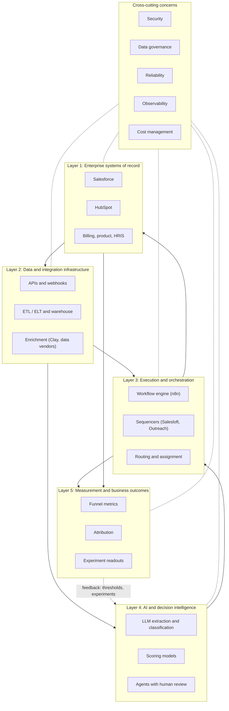

# GTM systems architecture in five layers

A go-to-market (GTM) tool stack is easier to design, fix and staff when each part has one clear job. This page splits the stack into five layers, from the core systems that hold the official records up to the business results. It also covers five concerns that apply to every layer.

Use this page to decide where a new tool or workflow belongs, to find where a problem started, and to decide what to watch.

## Starting principle: companies are never greenfield

"Greenfield" means starting from scratch. No company does. Every company already has a CRM (customer relationship management system), a pile of spreadsheets, an email sequencer someone bought two years ago, and fields that three different integrations write to.

So the default move is to extend what already exists: add a field, a validation rule, a workflow, or a carefully limited integration. Build something custom only when it sets the company apart (for example, a scoring model built on data only this company has, or a territory engine for a business with physical locations), or when it fills a real gap the current tools cannot cover at a reasonable cost.

Replacing a core system takes several quarters and risks people not adopting the new one. It is rarely the right answer to a data quality problem. See [build, buy or extend](build-buy-extend.md) for how to make that call.

## The layers at a glance

Two flows matter.

Data flows up. Records and changes from Layer 1 are cleaned and combined in Layer 2, interpreted in Layer 4, acted on in Layer 3, and measured in Layer 5.

Decisions flow back down. Layer 3 writes results (owner, stage, activity) back to Layer 1. Layer 5 results change the score cutoffs and experiments in Layer 4.

## Layer 1: Enterprise systems of record

This layer holds the official records: accounts, contacts, opportunities, revenue, and the people who own them. Reps and leadership trust what they see here, so every other layer ends up sending its results here.

| Aspect | Detail |
|---|---|
| Responsibilities | Own core entities and their authoritative fields; enforce permissions and validation rules; hold pipeline and forecast; record activities |
| Typical tools | Salesforce, HubSpot, billing (Stripe, Zuora), product database, HRIS for rep and territory data |
| Failure modes | Duplicate accounts; fields written by multiple integrations; validation rules bypassed by API users; stage definitions that differ by team; Leads disconnected from Accounts |
| What to monitor | Duplicate rate; required-field completion by stage; API request usage against allocation; number of integration users with write access; opportunities missing contact roles |

HRIS is the HR system. An API is the doorway one system offers for other systems to read and write its data. "Integration users" are the logins that other tools use to write into the CRM.

Design rule: one system owns each field. Write down which system owns which field before adding any new integration. Details in [data architecture](README.md#data-synchronization-and-field-ownership).

## Layer 2: Data and integration infrastructure

This layer moves data between systems, puts it in a standard form, and adds outside data. This is where duplicate records are matched and merged, data is checked, and company facts are filled in from vendors (enrichment).

| Aspect | Detail |
|---|---|
| Responsibilities | API clients and webhook ingestion; incremental sync; ELT into a warehouse; transformation models; identity resolution; enrichment waterfalls; reverse ETL back to Layer 1 |
| Typical tools | Vendor APIs and bulk APIs; Fivetran or Airbyte; Snowflake, BigQuery or Postgres; dbt; Clay and data vendors for enrichment; Hightouch or Census for reverse ETL |
| Failure modes | Silent schema changes upstream; duplicated or reordered webhooks; rate-limit exhaustion; stale enrichment; licensing terms that forbid storing vendor data; sync loops between two tools |
| What to monitor | Freshness per source; null rate per important field; DLQ depth and age; enrichment coverage and cost per found record; sync error rate; API quota headroom |

Plain-English versions of the terms in this table:

- **Webhook**: a message one system sends another the moment something happens.
- **Incremental sync**: copying only what changed since last time.
- **ELT** (extract, load, transform): copying raw data into the warehouse, then cleaning it there. The warehouse is the central database that holds a copy of all company data.
- **Identity resolution**: working out which records are the same company or person.
- **Enrichment waterfall**: trying data vendors one after another until one has the answer, cheapest first.
- **Reverse ETL**: copying finished data from the warehouse back into the CRM and other working tools.
- **Schema change**: a vendor renaming or restructuring its data fields.
- **Rate limit**: the cap a vendor sets on how many requests you can send.
- **Null rate**: the share of records where a field is blank.
- **DLQ** (dead-letter queue): a holding area for items that keep failing.

Design rule: check data where it enters, and make every write safe to run twice without creating duplicates. Bad data that reaches the CRM costs more to clean out than to block.

## Layer 3: Execution and orchestration

This layer turns data and decisions into actions: assign this account, start this email sequence, create this task, alert this rep. "Orchestration" means coordinating steps across several tools in the right order.

| Aspect | Detail |
|---|---|
| Responsibilities | Lead and account routing; sequence enrollment and suppression; task and alert creation; scheduled and event-triggered workflows; handoffs between teams |
| Typical tools | n8n, Workato, Zapier or code-based workers; Salesloft, Outreach, Instantly; Salesforce Flow or HubSpot workflows; LeanData-style routing tools; Slack for alerts |
| Failure modes | Routing to inactive or out-of-office reps; double enrollment from duplicate triggers; suppression list not checked before send; workflows that fail silently; logic spread across five tools so nobody can explain an assignment |
| What to monitor | Speed to lead (event to first touch); SLA breaches; workflow success rate and run duration; enrollments blocked by suppression; unassigned records older than SLA |

Suppression means a do-not-contact list. An SLA (service level agreement) is an agreed deadline, such as "every inbound lead gets a reply within 15 minutes."

Design rule: routing and CRM updates come from plain code with fixed rules, and every input is logged. Then anyone can explain any assignment after the fact.

## Layer 4: AI and decision intelligence

This layer handles data that fixed rules cannot: free-form text, fuzzy categories, and ranking accounts across many signals at once.

| Aspect | Detail |
|---|---|
| Responsibilities | Extract structured fields from text (job posts, call transcripts, websites); classify (industry, persona, intent); compute fit and intent scores; draft research and messages for human review; run agents that propose actions |
| Typical tools | Claude or OpenAI APIs with structured output; Python scoring services; warehouse-native models; evaluation harnesses; review queues |
| Failure modes | Hallucinated fields written straight to the CRM; scores nobody can explain; prompt or model changes that shift outputs without a test; cost spikes from re-processing; agents taking irreversible actions |
| What to monitor | Extraction accuracy on a labeled set; score distribution drift; human override rate; cost per processed record; latency; share of outputs routed to review |

An LLM (large language model) is the type of AI behind ChatGPT and Claude. "Hallucinated" means the AI made something up. An agent is AI software that decides and takes actions on its own. An evaluation harness is a test setup that checks AI answers against known correct answers. "Drift" means the scores slowly shifting over time without anyone changing the rules.

Design rule: the AI suggests, plain code decides. An LLM can read a web page and pull out "a new VP of Sales started in March." The score, the tier and the CRM update are then calculated by code from that fact. Anything that cannot be undone (sending, merging, deleting) has to pass a person or a fixed-rule check first. See [AI and agents](../05-ai-and-agents/README.md) and [the AI evaluation project](../../projects/ai-evaluation/README.md).

## Layer 5: Measurement and business outcomes

This layer answers one question: did the system produce revenue? It then feeds that answer back to the layers below.

| Aspect | Detail |
|---|---|
| Responsibilities | Funnel conversion by stage and segment; pipeline created and sourced; attribution; experiment design and readouts; score calibration (do higher tiers convert better?); cost per outcome |
| Typical tools | Warehouse plus BI (Looker, Metabase, Hex, Sigma); CRM reports for operational views; notebooks for experiment analysis |
| Failure modes | Metrics defined differently in CRM and BI; attribution that ignores missing links; experiments read too early or without a holdout; vanity metrics (emails sent) standing in for outcomes |
| What to monitor | Metric definitions under version control; conversion by score tier; experiment sample sizes against plan; cost per meeting and per opportunity; pipeline coverage |

BI (business intelligence) tools build dashboards and reports. Attribution means giving each program credit for the deals it helped create. A holdout is a comparison group that does not get the new treatment, so you can see whether the treatment made a difference. "Under version control" means every change to a definition is saved with a history.

Design rule: every workflow in Layer 3 and every model in Layer 4 should tie to a number in Layer 5. If nobody can name the number a workflow moves, consider removing it. See [analytics and prediction](../06-analytics-and-prediction/README.md) and [the revenue bowtie](../02-revenue-bowtie/README.md).

## Cross-cutting concerns

These apply to every layer. Treating them as a separate project usually means they never get done. Build them into each part as it ships.

| Concern | What it means here | Minimum bar per component |
|---|---|---|
| Security | Who and what can read or write which data | Scoped API keys per integration; service accounts, not personal logins; secrets in a vault or environment store; least-privilege CRM profiles |
| Data governance | Ownership, lineage, licensing, privacy | Named owner per field and dataset; source and timestamp stored with derived values; suppression and do-not-contact honored everywhere; vendor terms checked before storing data |
| Reliability | Workflows keep working and recover from failure | Idempotent writes; retries with backoff; DLQ with an owner; an SLO for each workflow that touches revenue |
| Observability | You can see what ran, what failed and why | Run log with inputs, outputs, status and duration; alerts on failure and on silence; dashboards for the monitors listed in each layer table |
| Cost management | Spend tracks value | Cost per run and per record logged; budget alerts on enrichment and LLM spend; caching so unchanged inputs are not re-processed |

Some terms from the table: an API key is a password a tool uses to connect to another system. A service account is a login meant for a tool, not a person. Least privilege means each login can do only what it needs. Lineage is a record of where each value came from. Idempotent writes are safe to run twice without creating duplicates. Backoff means waiting a little longer after each failed retry. An SLO (service level objective) is a reliability target, such as "this workflow succeeds 99% of the time." Caching means saving a result so it does not have to be calculated again.

More detail in [governance and operations](../07-governance-and-operations/README.md).

## Tracing one signal through the layers

Here is how a single buying signal moves through the stack:

1. **Layer 2:** A job-posting feed shows a target account posting four SDR (sales development rep) roles in two weeks. The intake job checks the data, matches the company to an existing Account by its website domain, and saves a `signal` record with the date seen (`observed_at`) and the source.
2. **Layer 4:** An LLM pulls structured facts from the posting text (team, seniority, tools mentioned). Code then calculates an updated intent score and saves how much each factor contributed.
3. **Layer 3:** The score crosses the cutoff for a higher tier. The workflow checks the do-not-contact list and any open deals, sends the account to its owner, creates a task that says why, and adds the most important contacts to an email sequence.
4. **Layer 1:** The task, score, tier and sequence enrollment are written to the CRM through the integration login, each tagged with where it came from.
5. **Layer 5:** Each week, a report compares the meeting rate for signal-triggered accounts against a holdout group. If there is no lift, the signal's weight or the cutoff changes.

Each step can fail in its own way and has its own check. That is the practical value of splitting the stack into layers. When meetings drop, you can check each layer on its own: data freshness (Layer 2), score patterns (Layer 4), enrollment and do-not-contact handling (Layer 3), and the experiment design (Layer 5).

## Contracts between layers

Layers only stay independent if the handoffs between them are clearly defined. Each boundary should have a written agreement (a "contract"): what the data looks like, who owns it, and how fresh it is guaranteed to be.

| Boundary | Contract | Example |
|---|---|---|
| Layer 1 to Layer 2 | Incremental extract by modified timestamp, or change events, with a high-water mark per object | `account` changes since last `SystemModstamp`, re-reading a 15-minute overlap |
| Layer 2 to Layer 4 | Clean, deduplicated entity tables with stable ids and a freshness column | `dim_account(account_id, domain, industry, size_band, refreshed_at)` |
| Layer 4 to Layer 3 | Decisions as rows, not as side effects: score, tier, reason codes, model or rule version | `account_score(account_id, score, tier, contributions jsonb, version, scored_at)` |
| Layer 3 to Layer 1 | Idempotent upserts on external ids through a named integration user, tagged with origin | `Account.Score_Tier__c` written by `svc-scoring`, with `run_id` in the audit log |
| Layers 1 and 3 to Layer 5 | Events and stamped dates that let metrics be recomputed from history | Stage-entry dates, campaign member status changes, enrollment events |

In plain terms, row by row: Layer 2 reads only what changed since the last read, remembering where it stopped (the "high-water mark"). Layer 4 gets clean tables with duplicates merged and a "last refreshed" date. Layer 4 hands decisions to Layer 3 as saved records with the reasons and the rule version, not as hidden actions. Layer 3 writes to the CRM in a way that is safe to repeat ("upsert" means update if the record exists, create it if not), using a named login. Layer 5 gets dated records so any number can be recalculated from history.

When a contract changes (a new column, a renamed tier), give it a new version number. Update the systems that read the data before the systems that write it start sending the new format.

## Placing a new component

Before adding a tool or workflow, answer these questions in order:

1. **Which layer is it?** If it covers three layers, it is probably several parts bundled together. Split the jobs, even if one vendor provides all of them.
2. **What does it own?** List the fields or decisions it will be the official source for. If that overlaps with something that already owns them, settle that first.
3. **What already exists?** Check whether a current tool can do the job with settings alone. Most "we need a new tool" requests are really "we need a field, a rule and a report."
4. **What contract does it read and write?** Name the data it takes in and the records or fields it puts out.
5. **What metric does it move?** Name the Layer 5 number, how it will be measured, and what it will be compared against.
6. **What does it cost per unit?** Estimate the cost at 1, 1,000, 10,000 and 50,000 records before building. Enrichment and LLM costs grow in step with volume, so use them late in the funnel, after cheap filters have removed what you do not need.
7. **Who operates it?** Name the owner and a backup, and write the runbook (step-by-step instructions for running and fixing it) before launch.

## Ownership by layer

When nobody owns a layer, problems sit unfixed. A typical split, adjusted to team size:

| Layer | Usual owner | Usual partner |
|---|---|---|
| 1: Systems of record | CRM admin or RevOps | Sales and marketing leadership for definitions |
| 2: Data and integration | GTM engineering or data engineering | Security for credentials and vendor review |
| 3: Execution | GTM engineering or marketing ops | Sales managers for routing rules and SLAs |
| 4: AI and decision intelligence | GTM engineering or analytics | Frontline reviewers who label and override outputs |
| 5: Measurement | Analytics or RevOps | Finance for revenue definitions |

On small teams one person may own several layers. That works as long as the boundaries and contracts above still exist, so the work can be split up as the team grows.

## Maturity by layer

Not every company needs every layer fully built. Match the investment to the company's stage. Only upgrade a layer when its current form is the measured bottleneck.

| Layer | Early (one CRM, small team) | Scaling (several tools, dedicated ops) | Mature (multiple teams, regions or products) |
|---|---|---|---|
| 1: Records | One CRM, basic stages, few custom fields | Stage exit criteria enforced, field ownership written down | Multiple business units, governed schema changes |
| 2: Data | Native CRM integrations, Clay tables | Warehouse with ELT, identity resolution, reverse ETL | Contracts between producers and consumers, data quality SLOs |
| 3: Execution | CRM workflows, one sequencer | Central orchestration, routing service, global suppression | Event-driven, multi-region rules, capacity-aware routing |
| 4: Intelligence | Manual research, simple fit rules | Factor-based scores, LLM extraction with validation | Calibrated models, evaluation suites, agents with review queues |
| 5: Measurement | CRM reports | Warehouse metrics, holdout experiments | Versioned metric definitions, standing experiment program |

A common mistake is building Layer 4 before Layer 2 is reliable. A scoring model running on duplicate accounts and out-of-date company data produces confident, wrong priorities. Fix duplicates, data freshness and field ownership first. The model then improves without any extra work.

## How to test the architecture

- **Trace test:** pick ten recent CRM changes at random. Trace each one back to what triggered it, which rule version ran, and who or what made the change. Any you cannot trace points to a missing log or contract.
- **Failure drill:** in a test environment, switch off one data source. Confirm the "data is stale" alert fires, and that the workflows that depend on it pause instead of acting on old data.
- **Replay test:** run a recorded day of changes through Layers 2 to 4 again, and confirm the decisions match what happened in the live system.
- **Cost check:** compare the logged cost per record at each layer with the estimate made before building.

## Anti-patterns

Anti-patterns are common setups that look reasonable but cause problems.

| Anti-pattern | Why it hurts | Better |
|---|---|---|
| Layer skipping: an LLM writes directly to CRM fields | No validation, no audit, no explanation | Model output goes to a staging table; code validates and writes |
| Shadow systems of record (a spreadsheet that is the "real" territory map) | Two truths; routing drifts from reality | Bring the data into Layer 1 or a governed Layer 2 table with an owner |
| Orchestration logic in every tool | Nobody can explain an assignment or a send | One orchestration layer, with other tools as executors |
| Measurement bolted on later | Cannot tell whether anything worked | Define the metric and the holdout before launch |
| Rip-and-replace as the first move | High adoption risk, long time to value | Extend, measure, then replace only if the gap persists |

## What would change the layout

- A small team using only HubSpot may fold Layers 2 and 3 into HubSpot workflows plus Clay, with Layer 5 in CRM reports. That is fine until volume or reporting needs outgrow it.
- A product-led company (one that wins customers mainly through the product itself) adds product usage as a main Layer 1 source, and its Layer 4 scoring relies heavily on usage.
- Field and location-based businesses add map data to Layer 2 and territory logic to Layer 3, as in [RouteHero](../../projects/routehero/README.md).
- Strict data-location rules or regulated industries push more of Layer 2 and Layer 4 onto systems the company controls. They also limit which fields may be sent to outside data vendors or AI providers.
- A company moving from one CRM to another runs two Layer 1 systems for a while. Pick one owner for each field during that time, and send all writes through Layer 2. Then the final switch is a settings change, not a rebuild.
- Lots of call and meeting volume makes transcripts a major Layer 2 source, and pulling facts from them in Layer 4 a large cost, as in [conversation intelligence](../../projects/conversation-intelligence/README.md).

## Diagnosing a drop by layer

| Symptom | Check first | Layer |
|---|---|---|
| Fewer meetings from outbound | Freshness of signal sources, enrichment coverage | 2 |
| Reps say priorities look wrong | Score distribution drift, tier conversion | 4 |
| Leads untouched | Routing logs, unassigned queue, rep availability | 3 |
| Leadership numbers disagree | Metric definitions in CRM vs BI | 5 |

## Related

- [Data architecture](README.md)
- [Build, buy or extend](build-buy-extend.md)
- [Technology ecosystem](technology-ecosystem.md)
- [GTM engineering](../04-gtm-engineering/README.md)
- [AI and agents](../05-ai-and-agents/README.md)
- [Analytics and prediction](../06-analytics-and-prediction/README.md)
- [Governance and operations](../07-governance-and-operations/README.md)
- [GTM learning engine project](../../projects/gtm-learning-engine/README.md)
- [Decision examples](../../decision-examples/README.md)
- [How I think](../../README.md)
