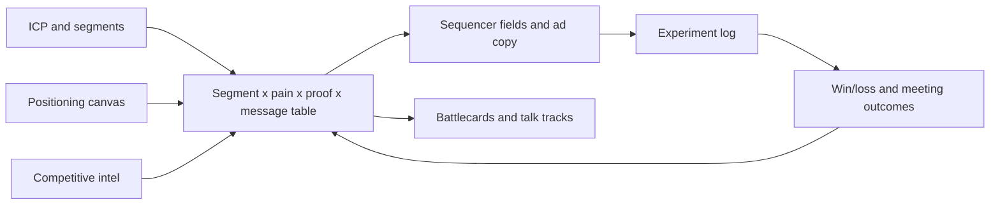

# Product marketing as structured data

Product marketing produces the decisions that every GTM system depends on: who to target, what to say, what proof to show and how to beat specific competitors. When those decisions live in slide decks, they drift away from what sequencers, ad platforms and reps actually use. This section treats each product marketing artifact as a dataset with owners, keys and versions, so the message a prospect receives can be traced back to a positioning decision and measured.

## The core idea

Every product marketing output should answer: what table does this become, what system reads it, and how do we know if it worked?



The loop closes when outcomes (qualified meetings, win rate by segment) update the message table and the ICP definition.

## ICP development

**What it is.** A testable definition of the accounts most likely to buy, succeed and expand. Written as filters a database can execute, not adjectives.

**How to build it.**

1. Pull closed-won and closed-lost accounts from the last several quarters, plus retained and churned customers.
2. Join firmographic (industry, headcount, revenue band, geography), technographic (stack), and situational attributes (hiring, funding, recent leadership change).
3. Compare win rate, sales cycle length, ACV and net retention across attribute values.
4. Write the ICP as rules with tiers.

```yaml
icp_version: 2026-11-01
tier_1:
  industry: [b2b_saas, fintech]
  employees: { min: 200, max: 2000 }
  has_tech: [salesforce]
  signal_any: [hiring_revops_role_90d, new_cro_180d]
tier_2:
  industry: [b2b_saas, fintech, healthtech]
  employees: { min: 50, max: 5000 }
exclude:
  - is_customer
  - is_competitor
  - employees < 20
```

**What can go wrong.** Building from closed-won only (survivorship: you learn who you sold to, not who was best to sell to). Small samples per attribute. Defining ICP by who reps enjoyed selling to. Test the ICP by checking whether tier 1 accounts convert at a higher rate than tier 2 on accounts not used to build it.

**Measure.** Win rate, cycle length, ACV and 12-month retention by tier. A useful ICP shows a clear gradient across tiers.

## Buyer personas

Personas in a GTM system are roles with attributes a sequencer and a rep can use: title patterns, seniority, function, the decisions they own, their top problems in their words, and the objections they raise.

| persona_id | title_patterns | owns_decision | top_pain | common_objection |
|---|---|---|---|---|
| revops_lead | "RevOps", "Revenue Operations", "Sales Ops" | Tooling, data model | Reporting nobody trusts | "We'd have to migrate fields" |
| cro | "CRO", "Chief Revenue", "VP Sales" | Budget, headcount | Forecast misses | "Not a priority this quarter" |
| marketing_ops | "Marketing Ops", "MOps" | Lead routing, attribution | Leads lost in handoff | "Our MAP already does this" |

Source the pain and objection columns from call transcripts and win/loss interviews, coded into a fixed taxonomy, not from brainstorming. Title patterns become the matching rules for contact enrichment and persona assignment.

## Positioning

A positioning canvas makes positioning a set of explicit choices. One common structure has five components:

| Component | Question | Example (illustrative) |
|---|---|---|
| Competitive alternatives | What would the buyer do if this product did not exist? | Spreadsheets plus a part-time analyst; a BI tool; the CRM's native reports |
| Unique attributes | What does this product have that the alternatives lack? | Stage history captured as events; forecast accuracy tracked per rep |
| Value | What does each attribute enable for the buyer? | Forecast misses explained by stage and segment, not guessed |
| Target segment | Who cares most about that value? | Series B to D SaaS with 15 or more AEs and a new revenue leader |
| Market category | What frame makes the value obvious? | Revenue analytics, not BI |

Write positioning per segment when segments have different alternatives. A mid-market buyer's alternative is a spreadsheet; an enterprise buyer's is an incumbent platform. Same product, different positioning.

## Messaging: the message house

A message house organizes what is said:

- **Roof:** one positioning statement per segment.
- **Pillars:** three or so value themes, each tied to a unique attribute.
- **Foundation:** proof for each pillar: customer evidence, product capability, third-party validation, demonstrable data.

The failure mode is pillars with no proof. A claim without evidence should not ship to a sequencer.

**From message house to table.** The operational artifact is a message matrix keyed by segment and persona:

| segment | persona | pain | proof_point_id | message_variant_id | opening_line | cta |
|---|---|---|---|---|---|---|
| saas_mm | revops_lead | untrusted_reporting | pp_014 | mv_031 | Opens on stage-history gap | 15-min teardown |
| saas_mm | revops_lead | untrusted_reporting | pp_014 | mv_032 | Opens on hiring signal | 15-min teardown |
| saas_mm | cro | forecast_miss | pp_007 | mv_040 | Opens on board forecast | Benchmark review |

Each row maps to sequencer custom fields (`{{pain_line}}`, `{{proof_line}}`, `{{cta}}`) so copy changes are data changes, not template rewrites. `proof_point_id` references a proof table with source, approval status and expiry date, so an outdated customer reference stops being sent when it expires. `message_variant_id` is the join key into the experiment log.

## Competitive intelligence

**Detecting competitor usage.**

| Signal | Method | Reliability |
|---|---|---|
| Website source code | Fetch HTML, match script tags, pixels, iframe domains and CSS class prefixes against a signature list | High for client-side tools; misses server-side and internal tools |
| DNS and email records | MX, SPF and TXT verification records reveal email, CRM and security vendors | High for those categories |
| Job posts | Tools named in requirements ("experience with X required") | Moderate: may describe aspiration or legacy |
| Call mentions | Extract competitor names from transcripts with evidence quotes | High when grounded; needs entity normalization |
| Review sites and community posts | Mentions by employees of the account | Low to moderate, sparse |

```python
SIGNATURES = {
    "competitor_a": [r"cdn\.competitor-a\.com", r"ca-widget\.js"],
    "competitor_b": [r"js\.competitorb\.io"],
}
def detect(html: str) -> list[str]:
    return [name for name, pats in SIGNATURES.items()
            if any(re.search(p, html) for p in pats)]
```

Store detections with `account_id, competitor, source, evidence, detected_at` so they can expire and be re-verified. The [GTM learning engine](../../projects/gtm-learning-engine/README.md) includes a competitor HTML scan. Respect site terms and robots rules when fetching.

**Battlecards as data.** One row per competitor x topic: their claim, our counter, proof point, landmine question to ask, when we lose to them. Version and date each row. Track battlecard usage (opened before a call) against win rate in deals where that competitor was present, while noting that correlation here is confounded by rep skill.

## Product launches

A tiered launch framework sets effort by impact so every release does not get the same treatment.

| Tier | Criteria | Assets | Channels | Enablement |
|---|---|---|---|---|
| 1 | New product, new segment, or pricing change | Positioning update, message matrix rows, launch page, demo, battlecard updates | Press or analyst, email to base, outbound play, paid | Live training, certification, talk track |
| 2 | Major feature affecting a segment's buying decision | Feature page, message rows, demo clip | Customer email, in-app, social | Recorded walkthrough, FAQ |
| 3 | Improvement or fix | Release note | Changelog, in-app | Release note in enablement channel |

Data to capture: launch ID on every asset and campaign, so pipeline and adoption can be filtered by launch. Measure tier 1 launches on pipeline created in segments the launch targets, compared against a pre-launch baseline and, where possible, against segments not targeted.

## Win/loss analysis

**Structured reasons.** Free-text "closed lost reason" fields are unanalyzable. Use a two-level taxonomy (primary category, specific reason) with a required evidence field.

```text
primary: [product_gap, price, competitor, no_decision, timing, relationship, implementation_risk]
specific: e.g. product_gap > missing_sso, competitor > competitor_b_incumbent
competitor_id: nullable FK
evidence: quote or note, required
source: [rep_entry, buyer_interview, call_transcript]
```

**Sample bias.** Rep-entered reasons skew toward external causes (price, timing) over sales execution. Buyer interviews have selection bias: buyers who agree to talk differ from those who do not. Mitigate by interviewing a fixed share of both wins and losses, using a neutral interviewer, and comparing rep-entered reasons to interview findings on the same deals. Disagreement rate between the two is itself a useful metric.

**Measure.** Reason distribution by segment and quarter, win rate against each competitor, and the share of losses with a product gap that maps to a roadmap item.

## Market segmentation

Segments must be mutually exclusive, collectively exhaustive and assignable from data you have. "Innovative mid-market companies" fails the third test.

Common GTM segmentation axes: company size (employees or revenue band), industry, geography, motion (new logo vs expansion), and buying situation (greenfield, replacing incumbent, consolidating tools). Encode segment assignment as a deterministic function in the data layer so every system (CRM, sequencer, BI) uses the same segment for the same account. See [data architecture](../03-data-architecture/README.md) and the [GTM ontology](../../projects/gtm-ontology/README.md).

Size each segment: accounts in segment x expected win rate x expected ACV gives a rough revenue potential, which sets coverage and channel investment.

## Sales enablement

Enablement is the delivery layer for everything above. Treat it as a system with measurable adoption:

- Content mapped to segment, persona and stage, so the CRM can surface the right asset on the opportunity record.
- Talk tracks derived from the message matrix, so reps and sequences say the same thing.
- Certification on tier 1 launches, tracked per rep.
- Usage data: which assets are opened, shared with prospects and present in won deals.

Measure enablement on behavior change (talk track adoption detected in call transcripts, ramp time for new reps), then on outcomes (stage conversion for certified vs not-yet-certified reps, with the caveat that early certifiers may be stronger reps).

## Messaging experimentation

Message tests are where positioning meets evidence.

**Design.**

- Test within a segment: ICP tier x persona (or seniority). A message that wins for one persona can lose for another.
- Change one element per test (opening line, proof point, CTA), or the result cannot be attributed.
- Primary metric: qualified meetings per delivered email. Replies and opens are diagnostic only.
- Fixed retirement rule: retire a variant when it is worse than the current leader at a set confidence threshold (for example, 95%) and only after a minimum sample (for example, 400 delivered per variant). Both values are set before launch. The [GTM learning engine](../../projects/gtm-learning-engine/README.md) uses 95% confidence after 400 delivered.
- Always keep a challenger running against the leader so the system keeps learning and catches decay.

Note on minimum samples: with low meeting base rates, 400 delivered per arm will only detect large differences. The minimum sample is a floor against retiring on noise, not a guarantee of detecting small effects. See the sample size formula in [analytics and prediction](../06-analytics-and-prediction/README.md).

**Experiment log schema.**

```text
experiment_id, segment, persona, element_tested, control_variant_id, challenger_variant_id,
hypothesis, primary_metric, min_sample_per_arm, confidence_threshold, start_date, end_date,
delivered_control, delivered_challenger, meetings_control, meetings_challenger,
decision (retire_control | retire_challenger | inconclusive), decided_at, notes
```

The log is the institutional memory. Without it, teams rerun the same losing test every year.

**What can go wrong.** Deliverability differences between arms (different sending domains or send times) masquerade as message effects. Seasonality across a long test. Segment leakage when contacts are misclassified. Novelty effects where a new message wins early and fades.

## Systems and ownership

| Dataset | Owner | System of record | Consumers | Refresh |
|---|---|---|---|---|
| ICP rules and tiers | Product marketing with RevOps | Version-controlled config or warehouse table | Enrichment, scoring, list building, ad audiences | Quarterly, or on win-rate shift |
| Personas and title patterns | Product marketing | Warehouse table | Contact enrichment, persona assignment | Quarterly |
| Message matrix | Product marketing | Warehouse table or CMS | Sequencer fields, ad copy, talk tracks | On experiment decisions |
| Proof points | Product marketing with legal approval | Table with expiry dates | Message matrix, battlecards, website | Monthly expiry check |
| Competitor detections | GTM engineering | Warehouse table | Account scoring, battlecard triggers, routing notes | Weekly re-scan |
| Win/loss reasons | Sales ops with product marketing | CRM fields plus interview table | Roadmap, positioning, battlecards | Monthly review |
| Experiment log | Growth or GTM engineering | Warehouse table | Message matrix updates, quarterly review | Per decision |

Every consumer reads the current version through a sync job, not a copy pasted into a tool. When product marketing updates a row, the sequencer field updates on the next sync.

**How to test the data model.**

- Every active message variant references an approved, unexpired proof point.
- Every account maps to exactly one segment and at most one ICP tier.
- Every persona title pattern matches a sample of real titles, and no common title matches two personas.
- Every live sequencer step maps to a `message_variant_id` that exists in the experiment log.

These are assertions that can run as scheduled data tests, failing loudly when someone edits a tool directly.

## Measuring product marketing impact

| Question | Metric | Caveat |
|---|---|---|
| Is the ICP right? | Win rate and ACV gradient across tiers | Needs enough closed deals per tier |
| Is the message working? | Qualified meetings per delivered, by variant and segment | Low base rates need large samples |
| Is positioning landing? | Stage 2 to stage 3 conversion by segment; "no decision" loss share | Many factors move conversion |
| Is competitive work paying off? | Win rate vs each competitor, quarter over quarter | Confounded by deal mix |
| Is enablement adopted? | Talk track presence in transcripts; asset use in won deals | Adoption is not effect |
| Did the launch work? | Pipeline in targeted segments vs baseline and untargeted segments | Seasonality and concurrent campaigns |

Report these with sample sizes. A win rate of 50% on four deals is not a finding.

## What would change the approach

- Very small TAM (a few hundred target accounts) makes statistical message testing impractical. Use qualitative signal (call recordings, buyer interviews) and account-level judgment instead.
- Product-led motions shift measurement from meetings to activation and conversion events, and the message matrix extends to in-product copy.
- Long enterprise cycles make win/loss the slower but more reliable feedback, with meetings as the leading indicator.

## Related

- [SEO and generative engine optimization](./seo-and-geo.md)
- [GTM learning engine](../../projects/gtm-learning-engine/README.md)
- [GTM ontology](../../projects/gtm-ontology/README.md)
- [Conversation intelligence](../../projects/conversation-intelligence/README.md)
- [Message rotation case study](../../case-studies/experimentation/message-rotation.md)
- [Revenue bowtie](../02-revenue-bowtie/README.md)
- [Data architecture](../03-data-architecture/README.md)
- [GTM engineering](../04-gtm-engineering/README.md)
- [Analytics and prediction](../06-analytics-and-prediction/README.md)
- [Thinking](../../THINKING.md)
