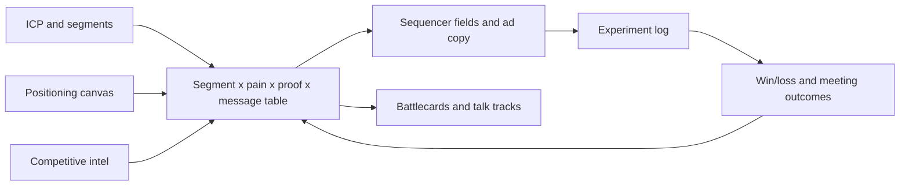

# Product marketing as structured data

Product marketing makes the decisions every GTM system depends on: who to target, what to say, what proof to show, and how to beat specific competitors. When those decisions live in slide decks, they drift away from what the sequencer, the ad platforms and the reps actually use. This section treats each product marketing output as a table of data, with an owner, an ID for each row, and a version history. Then the message a prospect receives can be traced back to a positioning decision, and its results can be measured.

## The core idea

For every product marketing output, ask three questions: what table does this become, which system reads it, and how do we know if it worked?



The loop closes when results (qualified meetings, win rate by segment) feed back into the message table and the ICP definition.

## ICP development

**What it is.** The ICP (ideal customer profile) is a testable definition of the accounts most likely to buy, succeed and expand. It is written as filters a database can run, not as adjectives.

**How to build it.**

1. Pull closed-won and closed-lost accounts from the last several quarters, plus customers who stayed and customers who left.
2. Add company facts (industry, headcount, revenue band, location), the tools they use, and what is happening at the company (hiring, funding, a recent leadership change).
3. Compare win rate, sales cycle length, average contract value (ACV) and net retention across those attributes.
4. Write the ICP as rules, grouped into tiers.

```yaml
icp_version: 2026-11-01
tier_1:
  industry: [b2b_saas, fintech]
  employees: { min: 200, max: 2000 }
  has_tech: [salesforce]
  signal_any: [hiring_revops_role_90d, new_cro_180d]
tier_2:
  industry: [b2b_saas, fintech, healthtech]
  employees: { min: 50, max: 5000 }
exclude:
  - is_customer
  - is_competitor
  - employees < 20
```

**What can go wrong.** Building only from closed-won deals: you learn who you sold to, not who was best to sell to (survivorship bias). Too few deals behind each attribute. Defining the ICP by who reps enjoyed selling to. To test the ICP, check whether tier 1 accounts convert better than tier 2 on accounts that were not used to build it.

**Measure.** Win rate, cycle length, ACV and 12-month retention by tier. A useful ICP shows a clear step down from tier to tier.

## Buyer personas

In a GTM system, a persona is a buyer role described in fields that a sequencer and a rep can use: title patterns, seniority, function, the decisions they own, their top problems in their own words, and the objections they raise.

| persona_id | title_patterns | owns_decision | top_pain | common_objection |
|---|---|---|---|---|
| revops_lead | "RevOps", "Revenue Operations", "Sales Ops" | Tooling, data model | Reporting nobody trusts | "We'd have to migrate fields" |
| cro | "CRO", "Chief Revenue", "VP Sales" | Budget, headcount | Forecast misses | "Not a priority this quarter" |
| marketing_ops | "Marketing Ops", "MOps" | Lead routing, attribution | Leads lost in handoff | "Our MAP already does this" |

Fill the pain and objection columns from call transcripts and win/loss interviews, sorted into a fixed set of categories, not from brainstorming. The title patterns become the matching rules that assign each contact to a persona.

## Positioning

A positioning canvas turns positioning into a set of clear choices. One common version has five parts:

| Component | Question | Example |
|---|---|---|
| Competitive alternatives | What would the buyer do if this product did not exist? | Spreadsheets plus a part-time analyst; a BI tool; the CRM's native reports |
| Unique attributes | What does this product have that the alternatives lack? | Stage history captured as events; forecast accuracy tracked per rep |
| Value | What does each attribute enable for the buyer? | Forecast misses explained by stage and segment, not guessed |
| Target segment | Who cares most about that value? | Series B to D SaaS with 15 or more AEs and a new revenue leader |
| Market category | What frame makes the value obvious? | Revenue analytics, not BI |

Write separate positioning for each segment when segments have different alternatives. A mid-market buyer's alternative is a spreadsheet. An enterprise buyer's alternative is a platform they already own. Same product, different positioning.

## Messaging: the message house

A message house organizes what you say:

- **Roof:** one positioning statement per segment.
- **Pillars:** about three value themes, each tied to a unique attribute.
- **Foundation:** proof for each pillar: customer evidence, product capability, outside validation, or data you can demonstrate.

The common failure is pillars with no proof. A claim without evidence should not go into a sequencer.

**From message house to table.** The working version is a message matrix, with one row per segment and persona combination:

| segment | persona | pain | proof_point_id | message_variant_id | opening_line | cta |
|---|---|---|---|---|---|---|
| saas_mm | revops_lead | untrusted_reporting | pp_014 | mv_031 | Opens on stage-history gap | 15-min teardown |
| saas_mm | revops_lead | untrusted_reporting | pp_014 | mv_032 | Opens on hiring signal | 15-min teardown |
| saas_mm | cro | forecast_miss | pp_007 | mv_040 | Opens on board forecast | Benchmark review |

Each row maps to custom fields in the sequencer (`{{pain_line}}`, `{{proof_line}}`, `{{cta}}`). So changing copy means changing a row of data, not rewriting templates. `proof_point_id` points to a proof table that records the source, approval status and expiry date, so an outdated customer reference stops going out when it expires. `message_variant_id` links each message to its results in the experiment log.

## Competitive intelligence

**Detecting competitor usage.** Ways to tell which competitor tools an account uses:

| Signal | Method | Reliability |
|---|---|---|
| Website source code | Fetch HTML, match script tags, pixels, iframe domains and CSS class prefixes against a signature list | High for client-side tools; misses server-side and internal tools |
| DNS and email records | MX, SPF and TXT verification records reveal email, CRM and security vendors | High for those categories |
| Job posts | Tools named in requirements ("experience with X required") | Moderate: may describe aspiration or legacy |
| Call mentions | Extract competitor names from transcripts with evidence quotes | High when grounded; needs entity normalization |
| Review sites and community posts | Mentions by employees of the account | Low to moderate, sparse |

The first method reads a company's website code and looks for each competitor's tracking scripts. The second reads public domain settings that reveal which email and security vendors a company uses. The code below shows the first method:

```python
SIGNATURES = {
    "competitor_a": [r"cdn\.competitor-a\.com", r"ca-widget\.js"],
    "competitor_b": [r"js\.competitorb\.io"],
}
def detect(html: str) -> list[str]:
    return [name for name, pats in SIGNATURES.items()
            if any(re.search(p, html) for p in pats)]
```

Store each detection with `account_id, competitor, source, evidence, detected_at`, so it can expire and be checked again. The [GTM learning engine](../../projects/gtm-learning-engine/README.md) includes a competitor website scan. Follow each site's terms and its robots.txt rules (the file that tells automated tools what they may fetch) when collecting pages.

**Battlecards as data.** One row per competitor and topic: their claim, our answer, the proof point, a question that exposes their weakness, and when we tend to lose to them. Date and version each row. Track whether reps open the battlecard before a call, and compare that against win rate in deals with that competitor. Keep in mind that stronger reps may also be the ones who open battlecards, which muddies the comparison.

## Product launches

A tiered launch framework matches effort to impact, so every release does not get the same treatment.

| Tier | Criteria | Assets | Channels | Enablement |
|---|---|---|---|---|
| 1 | New product, new segment, or pricing change | Positioning update, message matrix rows, launch page, demo, battlecard updates | Press or analyst, email to base, outbound play, paid | Live training, certification, talk track |
| 2 | Major feature affecting a segment's buying decision | Feature page, message rows, demo clip | Customer email, in-app, social | Recorded walkthrough, FAQ |
| 3 | Improvement or fix | Release note | Changelog, in-app | Release note in enablement channel |

Data to capture: put a launch ID on every asset and campaign, so pipeline and adoption can be filtered by launch. Judge tier 1 launches on pipeline created in the segments the launch targets. Compare that against the period before launch and, where possible, against segments the launch did not target.

## Win/loss analysis

**Structured reasons.** A free-text "closed lost reason" field cannot be analyzed. Use two levels of categories (a main reason and a specific reason), and require evidence.

```text
primary: [product_gap, price, competitor, no_decision, timing, relationship, implementation_risk]
specific: e.g. product_gap > missing_sso, competitor > competitor_b_incumbent
competitor_id: nullable FK
evidence: quote or note, required
source: [rep_entry, buyer_interview, call_transcript]
```

**Sample bias.** Reasons entered by reps lean toward outside causes (price, timing) and away from how the deal was sold. Buyer interviews have their own bias: buyers who agree to talk are different from those who do not. To reduce both, interview a fixed share of wins and losses, use a neutral interviewer, and compare rep-entered reasons with interview findings on the same deals. How often the two disagree is a useful number in itself.

**Measure.** Reason breakdown by segment and quarter, win rate against each competitor, and the share of losses caused by a product gap that is on the roadmap.

## Market segmentation

Segments must not overlap, must cover every account, and must be assignable from data you actually have. "Innovative mid-market companies" fails the third test.

Common ways to segment in GTM: company size (employees or revenue band), industry, geography, motion (new customer vs expansion), and buying situation (first purchase, replacing an existing tool, or consolidating tools). Assign segments with one fixed rule in the data layer, so every system (CRM, sequencer, BI) puts the same account in the same segment. See [data architecture](../03-data-architecture/README.md) and the [GTM ontology](../../projects/gtm-ontology/README.md).

Size each segment: number of accounts x expected win rate x expected ACV gives a rough revenue potential. That sets how much coverage and channel spend each segment gets.

## Sales enablement

Enablement is how everything above reaches the reps. Treat it as a system whose use you can measure:

- Content tagged by segment, persona and stage, so the CRM can show the right asset on the opportunity record.
- Talk tracks built from the message matrix, so reps and email sequences say the same thing.
- Certification on tier 1 launches, tracked per rep.
- Usage data: which assets get opened, shared with prospects, and appear in won deals.

Measure enablement first on behavior change (talk tracks showing up in call transcripts, faster ramp for new reps), then on results (stage conversion for certified vs not-yet-certified reps). Keep in mind that reps who certify early may simply be stronger reps.

## Messaging experimentation

Message tests are where positioning meets evidence.

**Design.**

- Test within one segment: ICP tier x persona (or seniority). A message that wins with one persona can lose with another.
- Change one thing per test (opening line, proof point, call to action). Otherwise you cannot tell what caused the result.
- Main metric: qualified meetings per delivered email. Use replies and opens only to diagnose problems.
- Fixed retirement rule: retire a version when it is worse than the current leader at a set confidence level (for example, 95%), and only after a minimum sample (for example, 400 delivered per version). Set both numbers before launch. The [GTM learning engine](../../projects/gtm-learning-engine/README.md) uses 95% confidence after 400 delivered.
- Always keep a challenger running against the leader, so the system keeps learning and notices when the leader starts to wear out.

A note on minimum samples: when meetings are rare, 400 delivered per version can only detect large differences. The minimum is a floor that stops you from retiring a message on noise. It does not guarantee you will catch small differences. See the sample size formula in [analytics and prediction](../06-analytics-and-prediction/README.md).

**Experiment log schema.** The fields recorded for every test:

```text
experiment_id, segment, persona, element_tested, control_variant_id, challenger_variant_id,
hypothesis, primary_metric, min_sample_per_arm, confidence_threshold, start_date, end_date,
delivered_control, delivered_challenger, meetings_control, meetings_challenger,
decision (retire_control | retire_challenger | inconclusive), decided_at, notes
```

The log is the team's memory. Without it, teams rerun the same losing test every year.

**What can go wrong.** Differences in inbox delivery between versions (different sending domains or send times) look like message effects. Seasons change during a long test. Contacts get put in the wrong segment. A new message wins early only because it is new, then fades.

## Systems and ownership

| Dataset | Owner | System of record | Consumers | Refresh |
|---|---|---|---|---|
| ICP rules and tiers | Product marketing with RevOps | Version-controlled config or warehouse table | Enrichment, scoring, list building, ad audiences | Quarterly, or on win-rate shift |
| Personas and title patterns | Product marketing | Warehouse table | Contact enrichment, persona assignment | Quarterly |
| Message matrix | Product marketing | Warehouse table or CMS | Sequencer fields, ad copy, talk tracks | On experiment decisions |
| Proof points | Product marketing with legal approval | Table with expiry dates | Message matrix, battlecards, website | Monthly expiry check |
| Competitor detections | GTM engineering | Warehouse table | Account scoring, battlecard triggers, routing notes | Weekly re-scan |
| Win/loss reasons | Sales ops with product marketing | CRM fields plus interview table | Roadmap, positioning, battlecards | Monthly review |
| Experiment log | Growth or GTM engineering | Warehouse table | Message matrix updates, quarterly review | Per decision |

Every tool reads the current version through an automatic sync, not a copy someone pasted in. When product marketing updates a row, the sequencer field updates on the next sync.

**How to test the data model.**

- Every active message version points to an approved proof point that has not expired.
- Every account maps to exactly one segment and at most one ICP tier.
- Every persona title pattern matches a sample of real job titles, and no common title matches two personas.
- Every live sequencer step maps to a `message_variant_id` that exists in the experiment log.

These checks can run automatically on a schedule and fail loudly when someone edits a tool directly.

## Measuring product marketing impact

| Question | Metric | Caveat |
|---|---|---|
| Is the ICP right? | Win rate and ACV gradient across tiers | Needs enough closed deals per tier |
| Is the message working? | Qualified meetings per delivered, by variant and segment | Low base rates need large samples |
| Is positioning landing? | Stage 2 to stage 3 conversion by segment; "no decision" loss share | Many factors move conversion |
| Is competitive work paying off? | Win rate vs each competitor, quarter over quarter | Confounded by deal mix |
| Is enablement adopted? | Talk track presence in transcripts; asset use in won deals | Adoption is not effect |
| Did the launch work? | Pipeline in targeted segments vs baseline and untargeted segments | Seasonality and concurrent campaigns |

Report these with the number of deals or sends behind them. A 50% win rate on four deals is not a finding.

## What would change the approach

- A very small total market (a few hundred target accounts) makes statistical message testing impractical. Use qualitative signals (call recordings, buyer interviews) and account-by-account judgment instead.
- Product-led sales motions shift measurement from meetings to product signups and upgrade events, and the message matrix extends to the copy inside the product.
- Long enterprise sales cycles make win/loss the slower but more reliable feedback, with meetings as the early signal.

## Related

- [SEO and generative engine optimization](./seo-and-geo.md)
- [GTM learning engine](../../projects/gtm-learning-engine/README.md)
- [GTM ontology](../../projects/gtm-ontology/README.md)
- [Conversation intelligence](../../projects/conversation-intelligence/README.md)
- [Message rotation case study](../../case-studies/experimentation/message-rotation.md)
- [Revenue bowtie](../02-revenue-bowtie/README.md)
- [Data architecture](../03-data-architecture/README.md)
- [GTM engineering](../04-gtm-engineering/README.md)
- [Analytics and prediction](../06-analytics-and-prediction/README.md)
- [Thinking](../../README.md)
