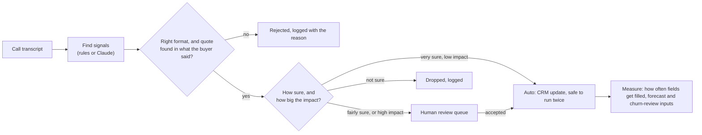

# Conversation intelligence: call transcript to CRM action

**I built this in production with Gong and Salesloft.** The call recordings came from Gong and Salesloft, which both record and store calls. Keyword detection flagged the signals, AI evaluated each call, and the results were pushed to the CRM. Real calls cannot be published, so this folder rebuilds the same design: keyword rules, an optional AI step, and the push to the CRM. The rebuild runs on twelve sample calls. No real transcript, customer or employer data is in this repository, and the numbers below come from the invented calls.

Call recorders capture what buyers say, and most of it never reaches the CRM. Objections, competitor mentions, budget and timing sit inside recordings nobody listens to again. So forecasts, competitive analysis and churn reviews run on what reps remember. This project turns a transcript into a set of checked, labeled signals. Each signal then goes one of three ways: written to the CRM automatically, sent to a person to review, or thrown out.



## What it extracts

A fixed list of 10 signal types and 38 allowed values ([ci/vocab.py](ci/vocab.py)): buying signals, objections, competitor mentions, budget, timing, feature requests, pain points, churn risk, expansion opportunities and content requests. Using a fixed list is on purpose. A value like "objection/price" can be a CRM dropdown value, a routing rule, a report column and a label for testing accuracy, all at once. A free-text summary can be none of those.

Every signal carries the exact quote it came from, the point in the call where it was said, and a confidence score (how sure the system is).

## How it works

| Step | File | What it does |
|---|---|---|
| Find signals (basic version) | [ci/rules.py](ci/rules.py) | Text-pattern and keyword rules, run only on what the buyer said. Turns "Q3" into real dates based on the call date. Lowers confidence when a "not" or similar word comes just before a match. Churn and expansion rules run only on renewal and QBR calls. |
| Find signals (optional) | [ci/llm.py](ci/llm.py) | Claude, told exactly what format to answer in, on a low effort setting, with a clear rule to say nothing when unsure. The transcript is handed over as material to read, with an instruction to ignore any instructions written inside it. |
| Check | [ci/validate.py](ci/validate.py) | First checks the format and that every value is on the allowed list. Then checks the evidence: the quote must appear at the cited point in the call, and the buyer must be the one who said it. This catches an answer that looks correct but quotes something nobody said. |
| Route | [ci/route.py](ci/route.py) | Confidence 0.8 and above: written automatically. 0.5 to 0.8: sent to review. Below 0.5: dropped. Churn risk and expansion always go to a person. A wrong churn flag starts a save play, and a wrong expansion flag sends an AM after a customer who is not ready. |
| Write | [ci/crm.py](ci/crm.py) | Builds the CRM updates (adding dropdown values, setting fields, creating tasks). Each update gets a unique key made from the call, signal type and value, so it is safe to run twice: a re-run cannot create duplicate tasks. Field names are examples. |

## Run it

Python 3.10+, standard library only (nothing extra to install).

```bash
cd projects/conversation-intelligence
python -m ci.pipeline                    # all calls: auto / review / dropped / rejected counts
python -m ci.pipeline --call call_005    # one call, full signals and CRM operations
python -m unittest discover -s tests -t .
python -m ci.pipeline --extractor llm    # optional: pip install anthropic, set credentials
```

## Results

The signal finder is scored in [projects/ai-evaluation](../ai-evaluation/README.md) against 57 answers labeled by hand. Starting results, measured on 2026-11-12, using the rules version:

| Question | Answer |
|---|---|
| When it flagged a signal, how often was it right? (precision, all kept signals) | 94.4% |
| Of the signals that were really there, how many did it find? (recall, all kept signals) | 89.5% |
| One combined score for accurate and thorough (F1, all kept signals) | 91.9% |
| Of the signals written to the CRM with no person checking, how often was it right? | 100% |
| Of the signals that were really there, how many were written automatically? | 38.6% |
| Share of kept signals sent to a person to review | 59% |
| Share of answers in the right format and backed by a real buyer quote | 100% |

The two automatic-write rows are the business tradeoff. Everything written to the CRM without a person was correct, but only because most signals were held back for review. A reviewer handling 59% of signals is the real cost of this design. Any AI version has to bring that number down without making automatic writes less accurate.

These scores are higher than real life would be, by design: the same person wrote the calls, the answer key and the rules. They prove the pipeline and the scoring work. They do not predict accuracy on real calls.

## What would change in production

- **Source:** transcripts pulled automatically from the call recorder (Gong or Salesloft). Personal information is removed before signals are pulled out, and transcripts are deleted after a set time.
- **Confidence cutoffs:** set per signal type and adjusted from reviewer decisions. For example, if reviewers accept nearly every competitor mention in the 0.6 to 0.8 range, that range becomes automatic for competitor mentions only.
- **What counts as success:** not the accuracy score, but what the signals change. How often the competitor field is filled on open opportunities. The share of churned accounts that had a churn signal 60 or more days before they left. How long it takes from an expansion signal to an AM task.
- **When not to use AI:** competitor names, SSO and SOC 2 are simple keyword lookups. The AI is worth its cost only when buyers say something in their own words, such as "the numbers never match what reps put in the CRM", which the rules miss.

## Related

- [AI evaluation harness](../ai-evaluation/README.md)
- [GTM ontology](../gtm-ontology/README.md): where accepted signals are stored, as `intent_signal` rows
- [AI and agents](../../docs/05-ai-and-agents/README.md)
- [Revenue bowtie stages](../../docs/02-revenue-bowtie/stages.md)
