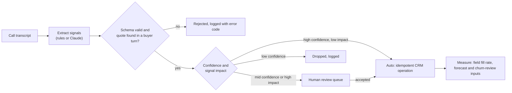

# Conversation intelligence: call transcript to CRM action

**I built this in production with Gong and Salesloft.** Gong supplied the calls; the extracted signals went back into the sales workflow in Salesloft and the CRM. This folder is a clean-room rebuild so the design can be inspected and run: twelve invented calls, a fictional seller and fictional competitors. No real transcript, customer or employer data is in this repository, and the numbers below come from the invented calls.

Call recorders capture what buyers say, and most of it never reaches the CRM. Objections, competitor mentions, budget and timing sit inside recordings that nobody re-listens to, so forecasting, competitive analysis and churn reviews run on rep memory. This project turns a transcript into structured, validated signals and routes each one to an automatic CRM write, a human reviewer, or the bin.



## What it extracts

A closed vocabulary of 10 signal types and 38 values ([ci/vocab.py](ci/vocab.py)): buying signals, objections, competitor mentions, budget, timing, feature requests, pain points, churn risk, expansion opportunities and content requests. A closed vocabulary is a deliberate choice. "objection/price" can be a CRM picklist value, a routing rule, a report column and an eval label. Free-text summaries can be none of those.

Every signal carries the verbatim evidence quote, the turn it came from and a confidence score.

## How it works

| Step | File | What it does |
|---|---|---|
| Extract (baseline) | [ci/rules.py](ci/rules.py) | Regex and dictionary rules over buyer turns only. Resolves "Q3" relative to the call date. Lowers confidence when a negation sits just before a match. Churn and expansion rules run only on renewal and QBR calls. |
| Extract (optional) | [ci/llm.py](ci/llm.py) | Claude with a JSON schema for the output, low effort, an explicit abstain rule, and the transcript passed as data with an instruction to ignore instructions inside it. |
| Validate | [ci/validate.py](ci/validate.py) | Schema and vocabulary check, then grounding: the quote must appear in the cited turn and that turn must be the buyer's. This is the check that catches a schema-valid answer quoting something nobody said. |
| Route | [ci/route.py](ci/route.py) | 0.8 and above: auto. 0.5 to 0.8: review. Below 0.5: drop. Churn risk and expansion always go to a person, because a wrong flag starts a save play or sends an AM after a customer who is not ready. |
| Write | [ci/crm.py](ci/crm.py) | Builds CRM operations (multi-select adds, field sets, tasks) with an idempotency key from call, type and value, so a retried run cannot create duplicate tasks. Field names are illustrative. |

## Run it

Python 3.10+, standard library only.

```bash
cd projects/conversation-intelligence
python -m ci.pipeline                    # all calls: auto / review / dropped / rejected counts
python -m ci.pipeline --call call_005    # one call, full signals and CRM operations
python -m unittest discover -s tests -t .
python -m ci.pipeline --extractor llm    # optional: pip install anthropic, set credentials
```

## Results

The extractor is scored in [projects/ai-evaluation](../ai-evaluation/README.md) against 57 hand labels. Baseline measured on 2026-11-12, rules extractor:

| Measure | Value |
|---|---|
| Precision / recall / F1, all kept signals | 0.944 / 0.895 / 0.919 |
| Precision / recall, auto-applied only | 1.000 / 0.386 |
| Kept signals sent to human review | 59% |
| Schema-valid and grounded | 100% |

The two lines in the middle are the business tradeoff. Everything written to the CRM without a person was correct, but only because most signals were held for review. A reviewer handling 59% of signals is the real cost of this design, and it is the number any LLM extractor has to bring down without losing auto-apply precision.

These scores are inflated by construction: the same person wrote the calls, the labels and the rules. They prove the pipeline and the measurement work. They do not predict accuracy on real calls.

## What would change in production

- **Source:** transcripts from the call recorder's API or webhook (Gong, for example), redacted for PII before extraction, with retention limits.
- **Thresholds:** per signal type, moved by reviewer data. If reviewers accept nearly all of the 0.6 to 0.8 band for competitor mentions, that band moves to auto for that type only.
- **Outcome metric:** not extraction F1 but what the signals change: competitor field fill rate on open opportunities, the share of churned accounts that had a churn signal 60 or more days before, and time from expansion signal to AM task.
- **When not to use an LLM:** competitor names, SSO and SOC 2 are dictionary lookups. The model earns its cost only on paraphrase, such as "the numbers never match what reps put in the CRM", which the rules miss.

## Related

- [AI evaluation harness](../ai-evaluation/README.md)
- [GTM ontology](../gtm-ontology/README.md): where accepted signals land as `intent_signal` rows
- [AI and agents](../../docs/05-ai-and-agents/README.md)
- [Revenue bowtie stages](../../docs/02-revenue-bowtie/stages.md)
