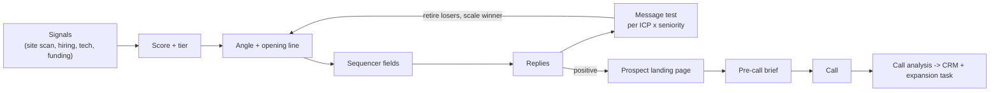

# GTM Learning Engine

**I built these workflows for real:** for RouteHero, for clients, and parts of them at Quorum. This repository rebuilds them on sample data so anyone can read and run them. Repository: https://github.com/Tamisreal/gtm-learning-engine

Nine sales and marketing automations, rebuilt from scratch so they can be read, run and inspected:

- account research
- bounce checks
- a scan of website code for competitor tools
- personalized messaging
- proof screenshots
- pre-call briefs
- call analysis
- landing pages for individual prospects
- a message test that learns which message works

Every line was written fresh against sample data (50 accounts, 3 call transcripts, 3 replies). These are clean-room rebuilds: they copy the workflow ideas, not any employer's or client's actual build, and they contain no proprietary code or data.

## What it demonstrates

| What happens | What the system does | Bowtie stage |
|---|---|---|
| A rep types `/gtm research Acme` in Slack | One reply with the CRM record, buying signals, open roles, call history and the products they do not own yet | Acquisition |
| A rep reports a bad email | Checks whether the person left and whether the address works, then fixes the CRM or suggests the new contact | Data quality |
| A territory needs prioritizing | Opens each account's website and its subpages, reads the page code for competitor tools, and saves the exact code snippet and URL as proof | Market intelligence |
| An SDR is about to send | Picks the angle and opening line, and writes both into CRM fields the email sequencing tool reads | Acquisition |
| An AE has a first call in 10 minutes | A one-screen brief: confirmed signals, an opening angle, and discovery questions tied to each signal | Qualification |
| A call ends | Logs competitors, objections (with quotes), next step and how much each side talked on the opportunity. Products they do not own yet become an expansion task | Qualification, Expansion |
| A prospect replies positively | Builds a page for that prospect that answers the question in their reply | Conversion |
| Replies come back | For each ICP and seniority level, losing messages are retired and the winner gets more sends | Acquisition (learning loop) |

## Architecture



The real versions of these workflows ran on Salesforce as the main CRM, Gong for call recording, n8n to run the automations and the Slack bots, and Claude for writing tasks. In the rebuild, each of those systems is replaced by a stand-in that plugs in the same way. So the whole thing runs with Node 18+, nothing to install and no logins. HubSpot and 6sense stand-ins are included too, because those tools are common in the setups this plugs into.

## Design decisions

- **Plain code first, AI last.** Simple text matching finds a competitor's code on a website better than an AI model does, and costs nothing. The AI writes language (opening lines, summaries) and always has a fill-in-the-blank template as a backup. Scores, tiers, routing and CRM updates never come from the AI. See [ADR 0005](../../decision-examples/adr/0005-deterministic-first.md).
- **Split by segment, then test.** Messages are tested separately for each ICP and seniority level. A message that wins on average can still lose in every segment that matters.
- **Fixed rules for retiring and scaling.** No message is judged before 400 have been delivered. A message is retired, or a winner is given more volume, only when the system is 95% sure the difference is real. Bounces are checked before the copy is blamed.

## Experimentation and feedback loops

The message test compares two approaches. One retires losing messages and gives winners more volume. The other splits sends evenly and never changes. In a simulation, the first approach produced 56% more positive replies than the even split. **That figure comes from simulated reply rates.** It shows the rules work correctly when messages really do perform differently. It says nothing about what a real program would see. Write-up: [message rotation case study](../../case-studies/experimentation/message-rotation.md).

## Evaluation methodology and limits

- **Simulated reply rates.** The 56% gain comes from the numbers fed into the simulation, not from real sends.
- **What counts as success.** The test is tuned for positive replies. In real use it should be checked against qualified meetings. Otherwise it learns to win replies that go nowhere.
- **Stand-ins.** The CRM, call recorder, data enrichment and email checks are all stand-ins. The n8n workflows use placeholder URLs.
- **No AI quality test in this repo.** The AI-written outputs have template backups, but nobody has scored their quality against hand-checked answers. How to add that is shown in [projects/ai-evaluation](../ai-evaluation/README.md).

## Run it

```bash
git clone https://github.com/Tamisreal/gtm-learning-engine
cd gtm-learning-engine
node engine/run.js                      # full sales pass, writes out/
node engine/experiments/rotation.js     # rotation vs static split
```

## Related

- [Revenue bowtie](../../docs/02-revenue-bowtie/README.md)
- [GTM engineering: signals, enrichment, scoring](../../docs/04-gtm-engineering/README.md)
- [Product marketing: messaging experiments](../../docs/08-product-marketing-and-growth/README.md)
