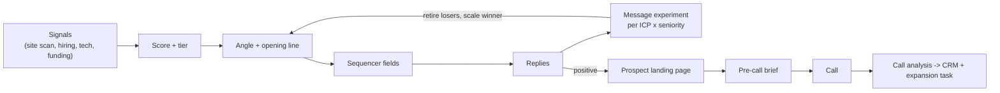

# GTM Learning Engine

**I built these workflows for real:** for RouteHero, for clients, and parts of them at Quorum. This repository rebuilds them on synthetic data so they can be read and run. Repository: https://github.com/Tamisreal/gtm-learning-engine

Nine GTM automations rebuilt from scratch so they can be read, run and inspected: account research, bounce checks, a competitor HTML scan, personalized messaging, proof screenshots, pre-call briefs, call analysis, prospect landing pages and a message experiment that learns. Every line was written fresh against synthetic data (50 accounts, 3 call transcripts, 3 replies). The demonstrations are clean-room rebuilds of workflow patterns, not copies of any employer's or client's implementation, and they contain no proprietary code or data.

## What it demonstrates

| Trigger | System response | Bowtie stage |
|---|---|---|
| A rep types `/gtm research Acme` in Slack | CRM record, signals, open roles, call history and whitespace in one reply | Acquisition |
| A rep reports a bad email | Checks whether the person left and whether the address is valid, then fixes the CRM or suggests the replacement | Data quality |
| A territory needs prioritizing | Fetches each account's site and subpages, reads raw source for competitor embeds, records the exact snippet and URL as evidence | Market intelligence |
| An SDR is about to send | Picks the angle and opening line and writes both to CRM fields the sequencer reads | Acquisition |
| An AE has a first call in 10 minutes | One-screen brief: verified signals, opening angle, discovery questions tied to each signal | Qualification |
| A call ends | Competitors, objections with quotes, next step and talk ratio to the opportunity; whitespace becomes an expansion task | Qualification, Expansion |
| A prospect replies positively | Builds a page for that prospect answering the question in their reply | Conversion |
| Replies come back | Per ICP and seniority, losing messages are retired and the winner gets the volume | Acquisition (learning loop) |

## Architecture



The production versions of these patterns ran on Salesforce as the system of record, Gong for calls, n8n for orchestration and the Slack bots, and Claude for language tasks. In the rebuild each system is a mock behind the same adapter interface, so the whole thing runs with Node 18+, no dependencies and no credentials. HubSpot and 6sense adapters are included because they are common in the stacks this plugs into.

## Design decisions

- **Deterministic first, LLM last.** String matching finds a competitor's script tag better than a model does and costs nothing. The LLM writes language (opening lines, summaries) and always has a template fallback. Scores, tiers, routing and CRM writes never come from the model. See [ADR 0005](../../decision-examples/adr/0005-deterministic-first.md).
- **Segment, then test.** Messages are tested per ICP and seniority, because a blended winner can lose in every segment that matters.
- **Fixed rules for swapping and scaling.** No message is judged before 400 delivered. A message is retired, and a winner is scaled, only at 95% confidence. Bounces are checked before copy is blamed.

## Experimentation and feedback loops

The message experiment compares a rotation policy (retire losers, scale winners) with a static even split. In simulation it produced 56% more positive replies than the static split. **That figure comes from invented reply rates.** It shows the rules behave correctly when messages truly differ. It says nothing about what a real program would see. Write-up: [message rotation case study](../../case-studies/experimentation/message-rotation.md).

## Evaluation methodology and limits

- **Synthetic reply rates.** The lift is a property of the simulation inputs.
- **Outcome definition.** The rotation optimizes positive replies. In production it should be checked against qualified meetings, or it learns to win replies that go nowhere.
- **Mocks.** CRM, call recorder, enrichment and verification are mocked. The n8n workflows use placeholder URLs.
- **No LLM eval in this repo.** The language outputs have template fallbacks but no labeled quality evaluation. The pattern for adding one is in [projects/ai-evaluation](../ai-evaluation/README.md).

## Run it

```bash
git clone https://github.com/Tamisreal/gtm-learning-engine
cd gtm-learning-engine
node engine/run.js                      # full sales pass, writes out/
node engine/experiments/rotation.js     # rotation vs static split
```

## Related

- [Revenue bowtie](../../docs/02-revenue-bowtie/README.md)
- [GTM engineering: signals, enrichment, scoring](../../docs/04-gtm-engineering/README.md)
- [Product marketing: messaging experiments](../../docs/08-product-marketing-and-growth/README.md)
