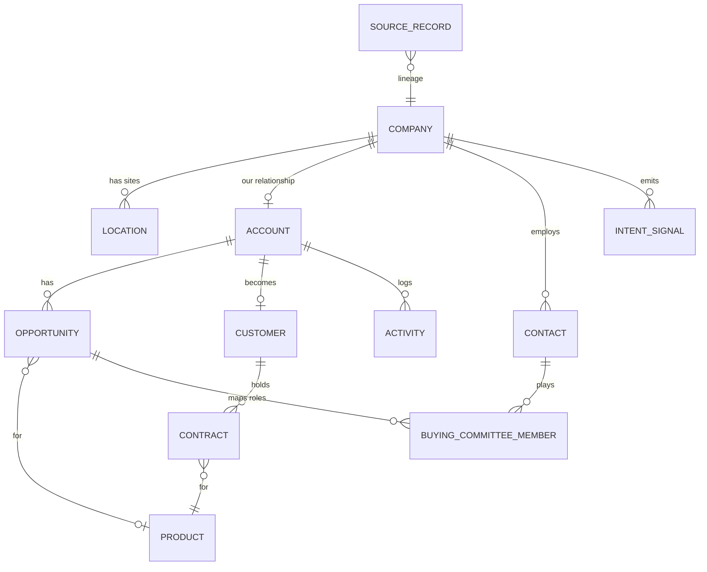

# Account data model (GTM ontology)

How a company, its branches or chapters, the people at each, and their deals and contracts connect, and how to tell when two records are the same company.

This is the structure behind my Quorum expansion work: national organizations and their state chapters, and how they bought from each other and from Quorum ([write-up](../../case-studies/revenue-impact/historical-outbound.md#quorum-expansion-whitespace-through-parent-and-child-accounts)).

**Evidence status: Synthetic Demonstration.** Invented companies and people. The modeling patterns (company versus location, domain then phone then name-and-distance matching, a review queue for probabilistic matches) are the same ones used in [RouteHero](../routehero/README.md).

Most GTM data problems are identity problems. The same customer shows up as three CRM accounts, one per branch. Enrichment attaches the headquarters address to every site. A territory report counts a holding company where the work happens at forty kitchens. AI assistants answer from whichever duplicate they retrieve. This project is a small, runnable model of the entities and relationships that prevent that.

## The model



The separation that matters most: **company and location are facts about the world; account, opportunity, customer and contract are facts about our relationship with it.** A buying-committee role belongs to a contact on one deal, not to the contact. Service is modeled as its own table for implementation or managed-service lines. Full DDL with comments: [schema.sql](schema.sql).

## Identity resolution

Thirteen company records from three systems (CRM, enrichment, places data) resolve into five companies and five locations ([ontology/resolve.py](ontology/resolve.py)):

| Evidence | Decision | Example in the data |
|---|---|---|
| Same normalized domain | auto merge | `https://www.northgateins.com/about` and `northgateins.com` |
| Same E.164 phone | auto merge | Summit Dental on two different domains, one phone number |
| Same domain, different address | new location on the same company | two Riverbend Credit Union branches |
| Similar name, under 0.25 miles apart, similarity below 0.92 | review | "Summit Dental Studio" next door to "Summit Dental Group": a different business in the same strip mall |
| Similar name, no location to compare | review, never auto | "Copper Line Mfg" versus "Copperline Manufacturing" (0.98 similar, still reviewed) |

Every decision, including matches the code chose not to make, is stored in `match_decision`. Every raw record is stored in `source_record` with the canonical entity it became, so any field can be traced to its source.

**Field survivorship** is explicit, one owner per field: the CRM owns the name, enrichment owns industry and headcount, places data owns coordinates and category. A source can fill an empty field it owns and never overwrites a field another source owns.

## What it answers

From [ontology/queries.py](ontology/queries.py):

- **Account 360:** company, sites, contacts, open opportunities, signals, metrics and source lineage in one call. This is what an AE, an AM or an AI assistant should read instead of raw CRM rows.
- **Territory planning:** every resolved site within a radius, nearest first.
- **Whitespace:** products with no active contract and no open opportunity.
- **Buying committee gaps:** required roles (economic buyer, champion, technical evaluator) nobody is mapped to.
- **Renewals at risk:** contracts ending within 120 days on accounts with a churn signal. In the demo this is fed by signals from the conversation intelligence calls.
- **Semantic layer:** `active_arr`, `open_pipeline` and `location_count` each have one definition and one SQL statement. A dashboard and an AI assistant asking "what is this account's ARR" get the same answer because they call the same function.
- **Graph view:** [ontology/graph.py](ontology/graph.py) projects one account into subject, predicate, object triples and Mermaid.

## Run it

```bash
cd projects/gtm-ontology
python -m ontology                            # loads, resolves, prints every query and the graph
python -m unittest discover -s tests -t .
```

## What this is and is not

- **It is a relational model with a graph projection.** It is not a knowledge graph in the formal sense: no ontology language (OWL, RDF schema), no triple store, no inference. For most GTM questions a relational model with clean keys answers faster and is easier to govern. A graph database earns its cost when questions are mostly multi-hop traversal ("which of our champions previously worked at this prospect's competitors").
- **Normalization is US-only** for phone numbers, and name similarity is character-based. Production would add address standardization, a business-name alias table, and match thresholds tuned on reviewer decisions.
- **Thresholds are judgment, not measured.** The 0.92 and 0.75 cutoffs are starting points. The measurement that should move them is the reviewer's accept rate per band.

## How it supports AI reasoning

An assistant asked "should we push expansion at Northgate?" should not search raw notes. It should receive the account 360 as structured context: one canonical company, active ARR from the semantic layer, the champion on the expansion deal, the missing economic buyer, and the call signal with its source. Grounding the model in resolved entities is what keeps it from blending two Summit Dentals into one answer.

## Related

- [Data architecture: identity resolution, sync, idempotency](../../docs/03-data-architecture/README.md)
- [RouteHero](../routehero/README.md): the production version of the company and location split
- [Conversation intelligence](../conversation-intelligence/README.md): source of `intent_signal` rows
- [Revenue bowtie](../../docs/02-revenue-bowtie/README.md)
