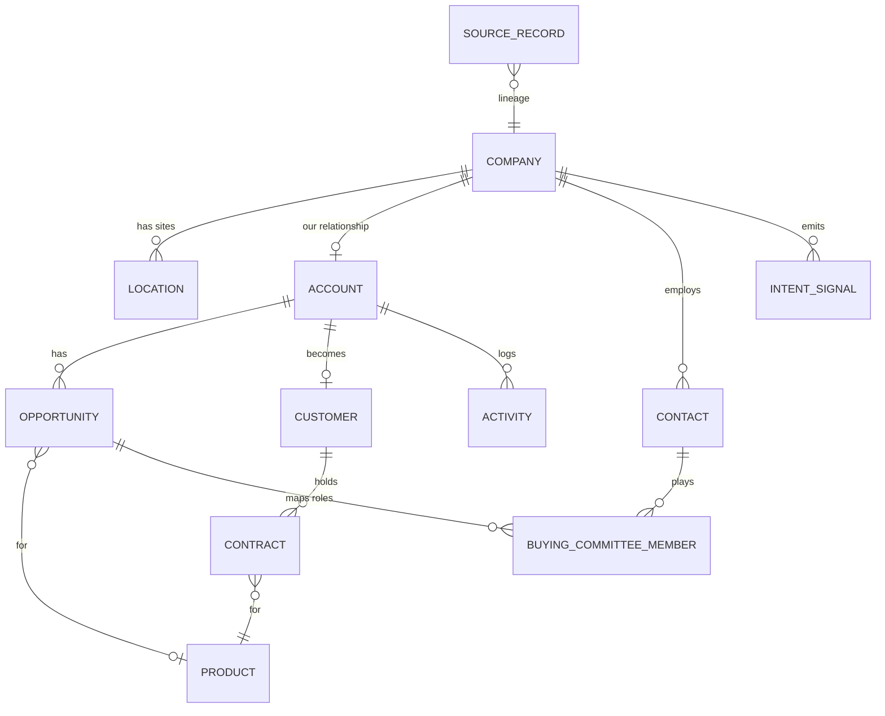

# Account data model (GTM ontology)

How a company, its branches or chapters, the people at each, and their deals and contracts connect, and how to tell when two records are the same company.

This is the structure behind my Quorum expansion work: national organizations and their state chapters, and how they bought from each other and from Quorum ([write-up](../../case-studies/revenue-impact/historical-outbound.md#quorum-expansion-whitespace-through-parent-and-child-accounts)).

Runs on sample companies and people. The patterns are the same ones used in [RouteHero](../routehero/README.md): keeping the company separate from its locations, matching records by website domain first, then phone, then name and distance, and a review queue where a person checks matches the system is unsure about.

Most GTM data problems are really "which record is which company" problems. The same customer shows up as three CRM accounts, one per branch. A data vendor attaches the headquarters address to every site. A territory report counts one holding company when the work happens at forty kitchens. AI assistants answer from whichever duplicate they happen to find. This project is a small model you can run, showing the records and links between them that prevent all of that.

## The model



How to read the diagram: each box is a type of record, and each line shows how two types connect (for example, one company has many locations).

The most important split: **company and location are facts about the world. Account, opportunity, customer and contract are facts about our relationship with it.** A buying-committee role belongs to a contact on one deal, not to the contact everywhere. Service (implementation or managed-service work) has its own table. The full database setup, with comments: [schema.sql](schema.sql).

## Identity resolution

Identity resolution means working out which records are the same company. Here, thirteen company records from three systems (CRM, a data vendor, and map listings) come together as five companies and five locations ([ontology/resolve.py](ontology/resolve.py)):

| Evidence | Decision | Example in the data |
|---|---|---|
| Same website domain, once cleaned up | merge automatically | `https://www.northgateins.com/about` and `northgateins.com` |
| Same phone number, in one standard format (E.164) | merge automatically | Summit Dental on two different domains, one phone number |
| Same domain, different address | add a new location to the same company | two Riverbend Credit Union branches |
| Similar name, under 0.25 miles apart, names less than 92% alike | a person reviews | "Summit Dental Studio" next door to "Summit Dental Group": a different business in the same strip mall |
| Similar name, no location to compare | a person reviews, never automatic | "Copper Line Mfg" versus "Copperline Manufacturing" (98% alike, still reviewed) |

Every decision is saved in `match_decision`, including matches the code chose not to make. Every original record is saved in `source_record`, along with the official record it became, so any field can be traced back to where it came from.

**Which source wins for each field** is written down, one owner per field. The CRM owns the name. The data vendor owns industry and headcount. Map listings own coordinates and category. A source can fill an empty field it owns, and it never overwrites a field another source owns.

## What it answers

From [ontology/queries.py](ontology/queries.py):

- **Account 360 (the full account view):** company, sites, contacts, open opportunities, signals, metrics and where each piece of data came from, in one request. This is what an AE, an AM or an AI assistant should read instead of raw CRM rows.
- **Territory planning:** every confirmed site within a set distance, nearest first.
- **Whitespace:** products the account has no active contract for and no open opportunity on.
- **Buying committee gaps:** required roles (economic buyer, champion, technical evaluator) with nobody assigned.
- **Renewals at risk:** contracts ending within 120 days on accounts with a churn signal. In the demo, those signals come from the conversation intelligence calls.
- **Semantic layer (one definition per metric):** `active_arr`, `open_pipeline` and `location_count` each have one definition and one SQL query. A dashboard and an AI assistant asking "what is this account's ARR" get the same answer, because they use the same calculation.
- **Graph view:** [ontology/graph.py](ontology/graph.py) turns one account into simple "thing, relationship, thing" statements and a Mermaid diagram.

## Run it

```bash
cd projects/gtm-ontology
python -m ontology                            # loads, resolves, prints every query and the graph
python -m unittest discover -s tests -t .
```

## What this is and is not

- **It is a standard table-based database, with a way to view it as a graph.** It is not a formal knowledge graph: no ontology language (OWL, RDF schema), no special graph store, no automatic reasoning. For most GTM questions, plain tables with clean IDs answer faster and are easier to manage. A graph database is worth its cost when most questions follow long chains of links ("which of our champions previously worked at this prospect's competitors").
- **Phone number cleanup works for US numbers only**, and name matching compares letters, not meaning. A real build would add address cleanup, a table of other names each business goes by, and match cutoffs tuned on reviewer decisions.
- **The cutoffs are judgment calls, not measured.** The name-similarity cutoffs of 0.92 and 0.75 (92% and 75% alike) are starting points. What should move them is how often reviewers accept matches in each range.

## How it supports AI reasoning

Say an assistant is asked "should we push expansion at Northgate?" It should not search raw notes. It should get the full account view as organized information: one official company record, active ARR from the shared metric definition, the champion on the expansion deal, the missing economic buyer, and the call signal with its source. Giving the AI records that are already matched up is what stops it from blending two Summit Dentals into one answer.

## Related

- [Data architecture: identity resolution, sync, idempotency](../../docs/03-data-architecture/README.md)
- [RouteHero](../routehero/README.md): the production version of the company and location split
- [Conversation intelligence](../conversation-intelligence/README.md): source of `intent_signal` rows
- [Revenue bowtie](../../docs/02-revenue-bowtie/README.md)
