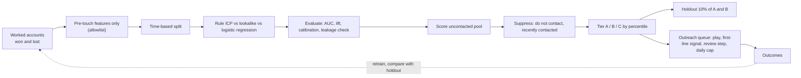

# Lookalike and propensity model: from closed-won accounts to an outreach queue

**Evidence status: Synthetic Demonstration.** 1,000 invented accounts with a hidden buying pattern. The method is real; the numbers describe this dataset only.

Most teams write their ICP once, from memory, and never test it against who actually bought. This project learns the ICP from outcomes instead. It looks at which accounts became customers and which did not, ranks every uncontacted company by how much it resembles the buyers, and hands a tiered, suppressed and explained list to outreach. It also keeps a holdout group so the meetings it produces can be credited to the model rather than assumed.



## Where it starts: the revenue target

The model exists to close part of a revenue gap. Working backward from the target (see [start from the company's revenue target](../../docs/01-gtm-foundations/README.md#start-from-the-companys-revenue-target)) gives the number of qualified opportunities needed. Raising win and reply rates by targeting better accounts is usually cheaper than sending more volume. That makes this model one of the levers, and the outcome it must move is qualified opportunities per account worked, not AUC.

## Three ways to rank accounts

| Method | How it works | When it is the right choice |
|---|---|---|
| Written ICP rule | Core industries and 50 to 1,000 employees score 1, everything else 0 | Day one, before there are outcomes to learn from |
| Lookalike (nearest neighbors) | Average similarity to the 10 most similar closed-won accounts | Few labeled losses, or a seller who wants "this looks like Customer X" as the explanation |
| Logistic regression | Weights learned from wins and losses, output is a probability | Enough wins and losses to learn from, and a need for calibrated probabilities and readable weights |

All three are scored on the same held-out accounts.

## Results (measured 2026-11-12 on the synthetic data)

Training data is accounts first touched before 2026-04-01 (392). The test set is accounts touched after (308). The pool is 300 accounts never contacted.

| Model | AUC | Win rate in top 10% | Lift, top 10% | Lift, top 20% |
|---|---|---|---|---|
| Written ICP rule | 0.583 | 0.387 | 1.75x | 1.68x |
| Lookalike (k = 10) | 0.590 | 0.290 | 1.31x | 1.68x |
| Logistic regression | **0.660** | **0.419** | **1.90x** | 1.68x |

Reading it:

- **The learned model beats the written ICP**, mainly because it found a core industry and a technology signal the written ICP left out. Its largest weights were Salesforce usage, two of the three hidden core industries, funding and a new RevOps leader.
- **The lookalike underperforms here.** Similarity to past winners without learning from losses picks up traits that winners and losers share. It is still useful for explaining a recommendation to a seller.
- **Calibration is off at the top.** In the highest-scoring fifth of the test set the model predicted a 58% win rate and 37% won. The base rate fell from 29% in the training period to 22% in the test period. A time split exposes that drift; a random split would have hidden it. Fix: recalibrate on recent outcomes before showing probabilities to reps, or show tiers instead of percentages.
- **AUC of 0.66 is modest, and that is realistic.** Firmographics explain part of who buys, not most of it. Timing signals and fit are both needed.

## The leakage trap

`meetings_held` is recorded after first touch and is strongly related to winning. Add it as a feature and test AUC jumps to **0.999**. But it is zero for every account nobody has contacted, so on the pool the leaky model's scores barely spread (0.118 from lowest to highest, against 0.789 without it). A model that scores almost perfectly on test can still be useless for the job it was built for. The defense is a feature allowlist of fields known before first touch ([lookalike/features.py](lookalike/features.py)), plus a test that fails if a post-touch field becomes a default feature.

## From scores to outreach

[lookalike/outreach.py](lookalike/outreach.py) turns pool scores into a queue a sequencer can read:

| Step | Rule | Result on this run |
|---|---|---|
| Suppress | Do-not-contact and contacted in the last 90 days are removed before tiering | 31 suppressed |
| Tier | Top 10% A, next 20% B, next 30% C, the rest no outreach | 23 A, 48 B, 81 C queued, 107 no outreach |
| Holdout | A fixed 10% of A and B (by hashed account id) gets no outreach; their outcomes are tracked | 10 held out |
| Play | A: AE-led and multithreaded, AE approves before send. B: SDR sequence with a first line from the strongest signal. C: low-touch nurture | |
| First line | The most timely trigger wins: new RevOps leader, then sales hiring, then funding | e.g. "Hiring 14 sales roles in the last 90 days" |
| Explain | Each row lists the top features that raised its score | e.g. industry, Salesforce, funding |
| Capacity | 25 accounts a day | 7 send days |

Output: [results/outreach_queue.csv](results/outreach_queue.csv) and [results/summary.json](results/summary.json). The first-line signal is the input the [GTM Learning Engine](../gtm-learning-engine/README.md) messaging step and the [proposed AI first-line experiment](../../case-studies/experimentation/proposed-ai-experiment.md) take.

## How the result would be measured in production

The test-set lift is a model property. The business result is incremental:

```
incremental meeting rate = meeting rate (tiered, contacted) - meeting rate (holdout, same tier)
```

Report qualified meetings and opportunities per 100 accounts by tier against the holdout, over enough cycles to reach the sample the comparison needs. Ten holdout accounts per run is far too few on its own, so results accumulate across runs. If Tier A does not beat its own holdout, the model is ranking accounts that would have come in anyway.

## Run it

```bash
cd projects/lookalike-model
python -m lookalike                           # train, evaluate, leakage check, build the queue
python -m unittest discover -s tests -t .
```

Python 3.10+, standard library only. Data is generated with a fixed seed, so every run gives the same numbers.

## Limits

- **Same author for the hidden pattern and the model.** Real data is noisier, and real features are messier (missing tech-stack data, stale headcount).
- **Survivorship in the training data.** Accounts that were never worked are not losses. Treating them as losses teaches the model the old targeting rules.
- **Feedback loop.** Once outreach follows the model, future training data only contains accounts the model liked. The holdout and a small random-exploration slice keep the data honest.
- **No enrichment cost in the loop.** In production, cheap public fields score the whole universe first, and paid enrichment runs only on accounts that pass, late in the funnel.

## When this is the wrong tool

With fewer than a few dozen wins, a learned model mostly memorizes noise. Use the written ICP, a lookalike list for seller intuition, and spend the effort on collecting clean outcome data.

## Related

- [Analytics and prediction: propensity, calibration, leakage, feedback loops](../../docs/06-analytics-and-prediction/README.md)
- [GTM engineering: account scoring](../../docs/04-gtm-engineering/README.md)
- [Product marketing: ICP development](../../docs/08-product-marketing-and-growth/README.md)
- [RouteHero](../routehero/README.md): explainable factor scoring for physical sites
