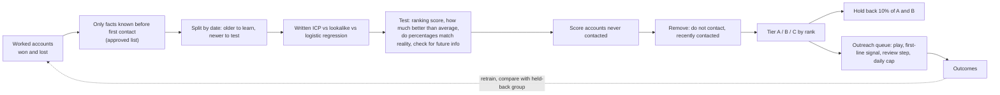

# Lookalike and propensity model: from closed-won accounts to an outreach queue

Runs on 1,000 sample accounts, so the numbers describe the sample.

Most teams write their ICP once, from memory, and never check it against who actually bought. This project learns the ICP from results instead. It looks at which accounts became customers and which did not. It ranks every company not yet contacted by how much it looks like the buyers. Then it hands outreach a list that is tiered, has do-not-contact accounts removed, and explains each ranking. It also holds back a group on purpose, as a comparison, so the meetings it produces can be credited to the model instead of assumed.



## In practice

At Quorum, companies in the same industry with the same titles cared about the same things. For example, two companies in tech or construction that each had a government affairs person, especially one focused on state and local policy, were very likely to care about data center policy. That pattern drove targeting and messaging, and the [589 contacts added through a title waterfall](../../case-studies/revenue-impact/historical-outbound.md#quorum-589-icp-contacts-added-through-a-title-waterfall) applied it at the contact level. This demo turns the same idea into a model that can be scored, tested and checked for using information you would not have yet, on invented data.

## Where it starts: the revenue target

The model exists to close part of a revenue gap. Working backward from the target (see [start from the company's revenue target](../../docs/01-gtm-foundations/README.md#start-from-the-companys-revenue-target)) gives the number of qualified opportunities needed. Raising win and reply rates by targeting better accounts is usually cheaper than sending more volume. That makes this model one of the levers. The result it must move is qualified opportunities per account worked, not a model score.

## Three ways to rank accounts

| Method | How it works | When it is the right choice |
|---|---|---|
| Written ICP rule | Core industries with 50 to 1,000 employees score 1. Everything else scores 0 | Day one, before there are results to learn from |
| Lookalike (nearest neighbors) | How similar an account is, on average, to the 10 closest closed-won accounts | Few recorded losses, or a seller who wants "this looks like Customer X" as the reason |
| Logistic regression (a standard statistics model) | Learns how much each fact matters from both wins and losses. The output is a percent chance of winning | Enough wins and losses to learn from, and a need for percentages that match reality and weights a person can read |

All three are scored on the same group of test accounts, which the models did not learn from.

## Results (measured 2026-11-12 on the sample data)

The models learned from accounts first contacted before 2026-04-01 (392 accounts). They were tested on accounts contacted after that date (308). The pool to score is 300 accounts never contacted.

How to read the columns:

- **Ranking score (AUC):** pick one buyer and one non-buyer at random. How often does the model rank the buyer higher? A coin flip scores 50%.
- **Win rate in top 10%:** of the accounts the model ranked in its top 10%, the share that won.
- **Times better than average (lift):** that win rate divided by the average win rate. 2x means twice as many wins as picking at random.

| Model | Ranking score (AUC) | Win rate in top 10% | Times better than average, top 10% | Times better than average, top 20% |
|---|---|---|---|---|
| Written ICP rule | 58.3% | 38.7% | 1.75x | 1.68x |
| Lookalike (k = 10) | 59.0% | 29.0% | 1.31x | 1.68x |
| Logistic regression | **66.0%** | **41.9%** | **1.90x** | 1.68x |

Reading it:

- **The learned model beats the written ICP.** Mainly, it found a core industry and a technology signal the written ICP left out. The facts that counted most were Salesforce usage, two of the three hidden core industries, funding and a new RevOps leader.
- **The lookalike does worse here.** It only looks at past winners and never learns from losses, so it picks up traits winners and losers both have. It is still useful for explaining a recommendation to a seller.
- **The percentages are too high at the top.** In the top-scoring fifth of the test accounts, the model predicted a 58% win rate and 37% actually won. The overall win rate fell from 29% in the learning period to 22% in the test period. Splitting by date exposes that kind of shift. A random split would have hidden it. Fix: re-tune the model on recent results before showing percentages to reps, or show tiers instead of percentages.
- **A ranking score of 66% is modest, and that is realistic.** Company facts (industry, size, tech) explain part of who buys, not most of it. Timing signals and fit are both needed.

## The leakage trap

Leakage means the model uses information you would not have yet. `meetings_held` is recorded after first contact, and it is closely tied to winning. Add it to the model and the test ranking score jumps to **99.9%**. But it is zero for every account nobody has contacted. So on the pool of new accounts, the model's scores barely differ from each other (a gap of 0.118 between lowest and highest, against 0.789 without it). A model that scores almost perfectly in testing can still be useless for the job it was built for. The defense is an approved list of facts known before first contact ([lookalike/features.py](lookalike/features.py)), plus a test that fails if a fact recorded after first contact is added by default.

## From scores to outreach

[lookalike/outreach.py](lookalike/outreach.py) turns scores for the new accounts into a queue an email sequencing tool can read:

| Step | Rule | Result on this run |
|---|---|---|
| Remove | Do-not-contact accounts, and accounts contacted in the last 90 days, are removed before tiering | 31 removed |
| Tier | Top 10% A, next 20% B, next 30% C, the rest get no outreach | 23 A, 48 B, 81 C queued, 107 no outreach |
| Hold back | A fixed 10% of A and B (picked by a scrambled account id, so the same accounts are always picked) gets no outreach. Their results are tracked for comparison | 10 held back |
| Play | A: led by an AE, with several contacts at the account, and the AE approves before anything sends. B: SDR sequence with a first line from the strongest signal. C: light-touch nurture | |
| First line | The most timely trigger wins: new RevOps leader, then sales hiring, then funding | e.g. "Hiring 14 sales roles in the last 90 days" |
| Explain | Each row lists the facts that raised its score most | e.g. industry, Salesforce, funding |
| Capacity | 25 accounts a day | 7 send days |

Output: [results/outreach_queue.csv](results/outreach_queue.csv) and [results/summary.json](results/summary.json). The first-line signal feeds the [GTM Learning Engine](../gtm-learning-engine/README.md) messaging step and the [proposed AI first-line experiment](../../case-studies/experimentation/proposed-ai-experiment.md).

## How the result would be measured in production

How much better the model did on test accounts describes the model. The business result is the extra meetings it produced, compared with the held-back group:

```
incremental meeting rate = meeting rate (tiered, contacted) - meeting rate (holdout, same tier)
```

Report qualified meetings and opportunities per 100 accounts, by tier, against the held-back group. Keep going until there are enough accounts for a fair comparison. Ten held-back accounts per run is far too few on its own, so results add up across runs. If Tier A does not beat its own held-back group, the model is ranking accounts that would have come in anyway.

## Run it

```bash
cd projects/lookalike-model
python -m lookalike                           # train, evaluate, leakage check, build the queue
python -m unittest discover -s tests -t .
```

Python 3.10+, standard library only (nothing extra to install). The sample data is generated the same way every time, so every run gives the same numbers.

## Limits

- **Same author for the hidden pattern and the model.** Real data is noisier, and real facts are messier (missing tech data, out-of-date headcount).
- **Accounts never worked are not losses.** Treating them as losses teaches the model the old targeting rules.
- **The model shapes its own future data.** Once outreach follows the model, future data only includes accounts the model liked. The held-back group, plus a small slice of randomly picked accounts, keeps the data honest.
- **Data costs are not in the loop.** In real use, cheap public facts score every company first. Paid data enrichment runs only on accounts that pass, late in the funnel.

## When this is the wrong tool

With fewer than a few dozen wins, a learned model mostly memorizes noise. Use the written ICP and a lookalike list for seller intuition, and put the effort into collecting clean win and loss data.

## Related

- [Analytics and prediction: propensity, calibration, leakage, feedback loops](../../docs/06-analytics-and-prediction/README.md)
- [GTM engineering: account scoring](../../docs/04-gtm-engineering/README.md)
- [Product marketing: ICP development](../../docs/08-product-marketing-and-growth/README.md)
- [RouteHero](../routehero/README.md): explainable factor scoring for physical sites
