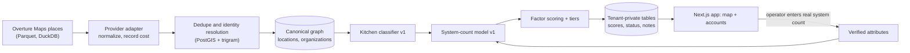

# RouteHero: territory intelligence for field-service sales

**Evidence status: Live application** (source private). Engineering measurements below are from development and are labeled as such. Commercial outcomes are **Self-reported**: 8 customers. Revenue is private and not published.

- Live application: https://routepro-mu.vercel.app/ (built under the working name RoutePro)
- Company site: https://routehero.io/

## Business problem

A commercial kitchen exhaust (hood) cleaning operator grows by winning recurring contracts within driving distance of the shop. The usual prospect list is either a scraped list of "restaurants" or a contact database. Both fail the same way: they do not answer which physical kitchens near me are worth the most to call first.

- Contact databases are built around people at companies. In a live test (2026-09-12), a contact-data provider returned restaurant groups and holding companies with one headquarters address. A 14-location group came back as one row. For a truck-based business, the 13 missing kitchens are the account.
- Scraped map data is usually not licensed for storage, so a database built on it is a liability with a deletion deadline.
- Nothing public says how many hood systems a kitchen has, and that number drives contract value.

## Hypothesis

If an operator gets every serviceable commercial kitchen inside their service radius, classified, sized and tiered by job size and distance, then the first calls of the week go to the accounts most likely to be large, recurring and close, and route density rises as contracts are won.

## What it does

- Geographic prospect discovery inside a territory, measured as a radius from the operator's shop
- Classifies whether a location has a serviceable commercial kitchen, with confidence and reasons
- Estimates hood system count as a range, never a bare number
- Scores and tiers accounts A, B, C and D with every factor visible
- Estimates annual contract value from tier, the operator's own per-tier price and visit frequency
- Interactive map (Mapbox) with an accounts table, notes and status per account
- Field sales route ordering (nearest neighbor plus 2-opt, straight-line miles)
- An MCP server so an owner can size their market from an AI assistant
- One operator per territory per service, enforced in the product

## Architecture

| Concern | Choice and reason |
|---|---|
| App | Next.js App Router, TypeScript, one deployable for UI and API |
| Database | PostgreSQL with PostGIS (Neon in production). Geospatial is core to the product, not a side feature |
| Data access | Prisma for migrations and CRUD; hand-written SQL functions for every geospatial read, because Prisma does not model `geography` columns |
| Multi-tenancy | Three independent layers: tenant context required by every repository function, Postgres row-level security with `FORCE`, and a transaction-scoped tenant setting so a pooled connection cannot carry one tenant's id into the next request |
| Data sharing rules | Public business facts are stored once and shared. Tenant data (status, notes, scores) is private. Licensed contact data is gated by an entitlement check, not copied |
| Discovery cost | Coverage tracked per H3 cell, so two operators with overlapping territories do not pay to scan the overlap twice |
| Providers | Vendor SDKs live behind interfaces in one package; swapping the discovery source is one adapter file |

## Data model highlights

- **Location is the unit, not company.** A hood cleaner services kitchens. Restaurant groups are organizations that own locations.
- **Scores are stored as factors.** Each score row keeps each factor's raw value, normalized value, weight and contribution, plus the config version that produced it. A weight change re-scores without re-deriving facts, the UI can explain any score, and a bad weight is a config rollback.
- **Estimates carry their inputs and a confidence level**, and an operator's verified system count overrides the estimate and becomes training data for the next model version.

## Scoring methodology (v1, from the code)

**Kitchen classifier.** Decides whether to believe there is a kitchen at all. Categories where cooking is the business are certain; cafes, bars and breweries are uncertain; vendor category strings, name, phone, website and size act as corroborating evidence. Each result lists its reasons in order of weight.

**System-count model** (`system_count_model_v1`). A base count by category (quick service 1, full service 2, steakhouse and barbecue 4, hospital 5, and so on), multiplied by a square-footage or seat-count band when that data exists, with confidence upgraded when the input is measured or the location is a chain. Range width depends on confidence (plus or minus 25% at high confidence, 75% at low). Floor 1, cap 12.

**Account score**, 0 to 100, from five weighted factors (hood cleaning defaults):

| Factor | Weight | Normalization |
|---|---|---|
| System count (verified count wins over the estimate) | 0.40 | count / 5, capped at 1 |
| Distance from the operator's shop | 0.25 | linear: 1 at the shop, 0 at or beyond the operator's service radius |
| Service frequency (operator's cadence, else a category default) | 0.15 | visits per year / 12 |
| Kitchen confidence | 0.15 | low 0.25, medium 0.6, high or verified 1.0 |
| Contact reachability | 0.05 | phone 0.7, website 0.3 |

Tier thresholds: A at 60, B at 45, C at 32. Estimated annual value = the operator's price for that tier x visits per year.

## Engineering decisions worth reading

Each of these is written up as a decision record:

- [ADR 0001: Overture Maps as the canonical source](../../decision-examples/adr/0001-routehero-data-source.md): Google Places and Yelp terms prohibit storing and re-serving their content; Overture's permissive license allows it.
- [ADR 0002: Tenant isolation in depth](../../decision-examples/adr/0002-routehero-tenant-isolation.md)
- [ADR 0003: Review queue for probabilistic matches](../../decision-examples/adr/0003-routehero-dedupe-review-queue.md)
- [ADR 0004: Remove contract value from the score](../../decision-examples/adr/0004-routehero-remove-circular-factor.md), and the recalibration that followed when Tier A came back empty

## Evaluation

**Measured during development** (internal engineering measurements, not customer outcomes):

| Measure | Result | Date |
|---|---|---|
| Commercial-kitchen candidates, same greater-Houston box | OpenStreetMap 9,464; Overture 24,348 | 2026-09-12 |
| Phone number coverage | OpenStreetMap about 55%; Overture 86% | 2026-09-12 |
| Score distribution, 2,785 Spring, TX accounts | p85 = 50, p95 = 56, max 74 | 2026-09 |

The phone coverage difference is the business number in that table: at 86% coverage, cold calling becomes a dialing problem instead of a research problem.

Not yet measured, and needed before any outcome claim:

- **Classifier precision:** a labeled sample of locations checked by hand (is there a serviceable kitchen?), reported as precision and recall by category.
- **System-count error:** estimate versus verified counts from completed jobs, by category. The feedback path exists; the sample does not yet.
- **Tier validity as a rate:** customers report that Tier A accounts convert better, because those kitchens care about compliance, real hood cleaning and protecting the equipment in their kitchen (self-reported). The next step is to measure it: meetings and contracts per 100 accounts called, by tier.

## Business applications

- **Operator prospecting:** a ranked, callable list for this week instead of a city-wide dump.
- **Outbound copy:** the same engine in batch mode sizes each operator's market for cold email, for example the number of commercial kitchens within 25 miles of their shop.
- **Route density:** clustering won and target accounts to cut drive time per job.

## Limitations

- Every model is a heuristic over open data and says so in the UI. System counts are shown as ranges with confidence.
- Coverage of small independents varies by metro.
- The tier thresholds were set from a measured score distribution in one metro and are expected to move as real operator results come in.
- The default per-tier prices are placeholders until an operator enters their own.

## Future improvements

- System-count model v2 trained on verified counts
- Per-metro threshold calibration
- Outcome tracking from tier to meeting to contract, which is the measurement that turns this from a ranking into evidence

## Related

- [Zero-to-one case study: RouteHero](../../case-studies/zero-to-one/routehero.md)
- [GTM ontology](../gtm-ontology/README.md): the company and location split in a runnable form
- [GTM engineering: scoring and territory intelligence](../../docs/04-gtm-engineering/README.md)
- [Governance: data licensing](../../docs/07-governance-and-operations/README.md)
