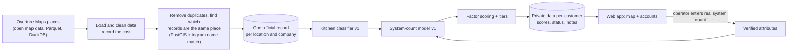

# RouteHero: territory intelligence for field-service sales

A live application with 8 customers. The source code is private. Revenue is private and not published. The engineering measurements below are from development.

- Live application: https://routepro-mu.vercel.app/ (built under the working name RoutePro)
- Company site: https://routehero.io/

## Business problem

A commercial kitchen exhaust (hood) cleaning company grows by winning recurring contracts within driving distance of its shop. The usual prospect list is either a scraped list of "restaurants" or a contact database. Both fail the same way. Neither answers the real question: which kitchens near me are worth the most, and who do I call first?

- Contact databases are built around people at companies. In a live test (2026-09-12), a contact-data provider returned restaurant groups and holding companies with one headquarters address. A 14-location group came back as one row. For a business that sends trucks to kitchens, the 13 missing kitchens are the account.
- Scraped map data usually cannot legally be stored. A database built on it is a liability with a deletion deadline.
- Nothing public says how many hood systems a kitchen has, and that number drives what the contract is worth.

## Hypothesis

Give an operator every commercial kitchen they can service inside their service area. Sort each one by type, estimated size, job size and distance, and put it in a tier. Then the first calls of the week go to the accounts most likely to be large, recurring and close. As contracts are won, jobs cluster closer together and drive time per job falls.

## What it does

- Finds prospects inside a territory, measured as a radius from the operator's shop
- Decides whether a location has a commercial kitchen worth servicing, with a confidence level and the reasons
- Estimates how many hood systems a kitchen has, always as a range, never a single number
- Scores accounts and sorts them into tiers A, B, C and D, with every factor in the score visible
- Estimates annual contract value from the tier, the operator's own price per tier and how often the kitchen is serviced
- Interactive map (Mapbox) with an accounts table, plus notes and status for each account
- Orders stops for a field sales route (nearest neighbor plus 2-opt: always go to the closest next stop, then remove any crossed paths; distances are straight-line miles)
- An MCP server (a connector that lets an AI assistant use the product), so an owner can size their market by asking an AI assistant
- One operator per territory per service, enforced in the product

## Architecture

| Concern | Choice and reason |
|---|---|
| App | Next.js App Router and TypeScript. The screens and the back end ship as one app |
| Database | PostgreSQL with PostGIS, an add-on for maps and distances (Neon hosts it in production). Location math is the core of the product, not a side feature |
| Data access | Prisma (a database toolkit) handles setup changes and everyday reads and writes. Every map or distance query is hand-written SQL, because Prisma cannot handle location columns |
| Keeping customers' data apart | Three separate safeguards. Every data function must be told which customer it is working for. The database itself blocks one customer from seeing another's data, with no exceptions allowed (Postgres row-level security with `FORCE`). And the customer setting lasts for one database transaction only, so a shared connection cannot carry one customer's id into the next request |
| Data sharing rules | Public business facts are stored once and shared. Each customer's own data (status, notes, scores) is private. Licensed contact data is shown only to customers who have paid for it, and it is not copied |
| Discovery cost | The map is divided into hexagon cells (H3) and the system remembers which cells it has already scanned. Two operators with overlapping territories do not pay to scan the overlap twice |
| Providers | Outside vendors' code sits behind a standard plug, all in one package. Switching to a different data source means changing one file |

## Data model highlights

- **The location is the unit, not the company.** A hood cleaner services kitchens. Restaurant groups are organizations that own locations.
- **Scores are stored factor by factor.** Each score keeps every factor's raw value, its 0-to-1 value, its weight and how many points it added, plus the settings version that produced it. So a weight change re-scores accounts without rebuilding the facts, the app can explain any score, and a bad weight can be undone by going back to the old settings.
- **Estimates keep their inputs and a confidence level.** When an operator enters the real system count, it replaces the estimate and becomes training data for the next model version.

## Scoring methodology (v1, from the code)

**Kitchen classifier.** Decides whether to believe there is a kitchen at all. Some categories are certain because cooking is the business. Cafes, bars and breweries are uncertain. The vendor's category label, the name, phone, website and size count as supporting evidence. Each result lists its reasons, strongest first.

**System-count model** (`system_count_model_v1`). Starts with a base count by category (quick service 1, full service 2, steakhouse and barbecue 4, hospital 5, and so on). If square footage or seat count is known, that base is multiplied by a size band. Confidence goes up when the input is measured or the location is part of a chain. The range is narrow when confidence is high and wide when it is low (plus or minus 25% at high confidence, 75% at low). The count is never below 1 or above 12.

**Account score**, 0 to 100, from five weighted factors (default settings for hood cleaning):

| Factor | Weight | How the factor is scored (0 to 1) |
|---|---|---|
| System count (a verified count beats the estimate) | 0.40 | count / 5, capped at 1 |
| Distance from the operator's shop | 0.25 | a straight line: 1 at the shop, 0 at or past the edge of the operator's service area |
| How often it is serviced (the operator's schedule, else a default for the category) | 0.15 | visits per year / 12 |
| Confidence there is a kitchen | 0.15 | low 0.25, medium 0.6, high or verified 1.0 |
| Can we reach them | 0.05 | phone 0.7, website 0.3 |

Tier cutoffs: A at 60, B at 45, C at 32. Estimated annual value = the operator's price for that tier x visits per year.

## Engineering decisions worth reading

Each of these is written up as a decision record (ADR):

- [ADR 0001: Overture Maps as the canonical source](../../decision-examples/adr/0001-routehero-data-source.md): the terms for Google Places and Yelp forbid storing and re-showing their content. Overture's open license allows it.
- [ADR 0002: Tenant isolation in depth](../../decision-examples/adr/0002-routehero-tenant-isolation.md): keeping each customer's data apart
- [ADR 0003: Review queue for probabilistic matches](../../decision-examples/adr/0003-routehero-dedupe-review-queue.md): a person checks matches the system is unsure about
- [ADR 0004: Remove contract value from the score](../../decision-examples/adr/0004-routehero-remove-circular-factor.md), and the re-tuning that followed when Tier A came back empty

## Evaluation

**Measured during development** (internal engineering measurements, not customer outcomes):

| Measure | Result | Date |
|---|---|---|
| Possible commercial kitchens found, same greater-Houston area | OpenStreetMap 9,464; Overture 24,348 | 2026-09-12 |
| Share of places with a phone number | OpenStreetMap about 55%; Overture 86% | 2026-09-12 |
| How scores spread across 2,785 Spring, TX accounts | 85% of accounts scored 50 or below, 95% scored 56 or below, highest 74 | 2026-09 |

The phone number share is the business number in that table. When 86% of places have a phone number, cold calling becomes a dialing job instead of a research job.

Not yet measured, and needed before claiming any results:

- **How often the kitchen classifier is right:** check a sample of locations by hand (is there a kitchen worth servicing?). Then report, by category, how often it was right when it said "kitchen", and how many of the real kitchens it found.
- **How far off the system count is:** compare estimates with real counts from completed jobs, by category. The way to feed real counts back in exists. The sample does not yet.
- **Whether tiers predict sales, as a rate:** customers report that Tier A accounts convert better, because those kitchens care about compliance, real hood cleaning and protecting their equipment. The next step is to measure it: meetings and contracts per 100 accounts called, by tier.

## Business applications

- **Operator prospecting:** a ranked list to call this week instead of a dump of every restaurant in the city.
- **Outbound copy:** the same engine, run in bulk, sizes each operator's market for cold email. For example: the number of commercial kitchens within 25 miles of their shop.
- **Route density:** grouping won and target accounts close together to cut drive time per job.

## Limitations

- Every model is a rule of thumb built on open data, and the app says so. System counts are shown as ranges with a confidence level.
- How well small independent restaurants are covered varies by city.
- The tier cutoffs were set from how scores spread in one metro area. They are expected to move as real operator results come in.
- The default prices per tier are placeholders until an operator enters their own.

## Future improvements

- System-count model v2, trained on real counts from operators
- Tier cutoffs tuned for each metro area
- Tracking results from tier to meeting to contract. That measurement turns this from a ranking into proof.

## Related

- [Zero-to-one case study: RouteHero](../../case-studies/zero-to-one/routehero.md)
- [GTM ontology](../gtm-ontology/README.md): the company and location split, in a form you can run
- [GTM engineering: scoring and territory intelligence](../../docs/04-gtm-engineering/README.md)
- [Governance: data licensing](../../docs/07-governance-and-operations/README.md)
